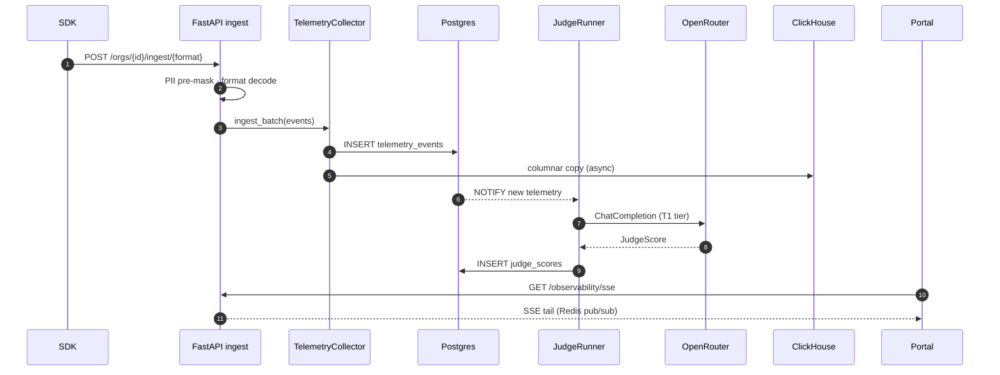
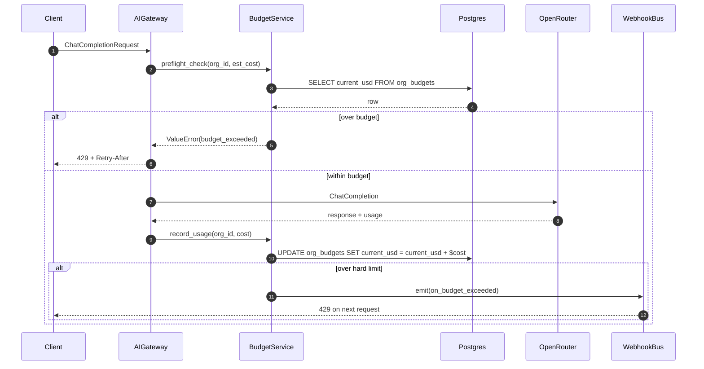

# Eden — Data Flow

End-to-end traces of the most important data paths. The sequence diagrams
below show the request/response choreography between services; the ASCII
trees below them give the per-component internals.

## 1. Trace ingest → judge → dashboard



```
SDK (browser / server)
  │
  │  POST /orgs/{org_id}/ingest/otlp | langchain | openai | ...
  ▼
FastAPI ingest route
  │  PII pre-mask
  │  format decoder
  ▼
TelemetryCollector.ingest_batch
  │  validate → enrich → dedup → route
  ▼
Postgres: telemetry_events
  │
  │  triggers judge_runner on insert
  ▼
JudgeRunner.run_for_event
  │  asyncio.gather over JudgeRegistry.for_event(event)
  │  each Judge → OpenRouter LLM call (T1)
  ▼
Postgres: judge_scores
  │
  │  triggers judge_detector (every 1m)
  ▼
InsightService → KB
  │
  │  user views /portal/observability
  ▼
Portal SSE → live tail (Redis pub/sub)
```

## 2. Webhook → delivery → DLQ

```
Customer configures webhook
  │
  │  POST /orgs/{org_id}/webhooks
  ▼
Postgres: webhooks
  │
  │  event fires (e.g. on_judge_regression)
  ▼
WebhookDeliveryService.deliver_event
  │  CAS: UPDATE webhook_deliveries SET status='in_flight'
  │  SSRF guard: re-resolve hostname → reject if private
  │  HMAC sign: Stripe-style X-Eden-Signature
  ▼
Customer endpoint
  │  2xx → UPDATE webhook_deliveries SET status='succeeded'
  │  non-2xx / timeout → schedule retry via loop.call_later
  ▼
After 7 attempts
  │
  ▼
webhook_dlq (manual replay via portal)
  │  replay cap: 3 attempts, 60s gap
```

## 3. Budget gate → record_usage → hard-limit block



```
LLM call
  │
  │  AIGateway._execute_provider
  │  → BudgetService.preflight_check(org_id, estimated_cost)
  │      ├→ ok → call LLM
  │      └→ over cap → ValueError → 429
  │
  │  on response: BudgetService.record_usage(org_id, cost)
  │      ├→ UPDATE org_budgets SET current_usd = current_usd + $cost
  │      └→ if > hard_limit: hook.emit(on_budget_exceeded)
  ▼
Customer gets 429 (Budget exceeded) + Retry-After header
```

## 4. Memory ingest → retrieval → injection

```
Agent call → memory.add (SDK)
  │
  │  POST /orgs/{org_id}/kb/memories
  ▼
FastAPI kb route
  │  PII mask
  │  generate embedding (OpenRouter embed-3-small)
  ▼
Qdrant: upsert vector (collection = kb)
Postgres: insert memory row (durable copy)
  │
  │  Agent call later
  ▼
memory.retrieve(query)
  │  generate query embedding
  │  Qdrant.search (top-K, threshold=0.7)
  ▼
Top-K memories → injected into system prompt
```

## 5. Auth flow (Clerk → portal → backend)

```
User → /sign-in (Clerk)
  │
  │  Clerk issues session JWT in __session cookie
  ▼
Portal catch-all proxy /api/proxy/*
  │
  │  clerkMiddleware attaches Authorization: Bearer <jwt>
  ▼
FastAPI clerk_auth.verify_clerk_token
  │  decode + verify against Clerk JWKS (auto-refresh on kid miss)
  │  look up / provision Eden user
  ▼
FastAPI request scoped to current_user
  │
  │  route handler runs
```

## 6. Closed-loop drift → promotion

```
InsightService.surface_insights (every 5m)
  │
  │  reads judge_scores, drift_alerts
  ▼
PromotionHook.on_drift_alert(drift_type, severity)
  │
  │  high severity: fire to PromotionLoop
  ▼
PromotionLoop.propose_action
  │
  │  reads guardrail_policies + org settings
  │  decides: record | alert | promote | block
  ▼
Postgres: guardrail_policies (audit trail)
  │
  │  user views /portal/promotions
  ▼
Approve / Reject via portal
```
