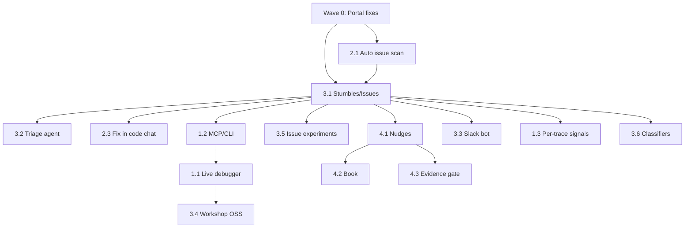

# Implementation Spec Review

> **Date:** July 9, 2026  
> **Reviewer:** Eden engineering (agent-generated review for human sign-off)  
> **Specs reviewed:** 35 gap points + 6 cross-cutting themes across 5 documents

---

## 1. Review summary

All 41 spec items from the competitive gap analysis now have implementation specifications with:

- Current Eden file/route/table references
- Target architecture and data models (SQL DDL where applicable)
- API contracts
- Step-by-step implementation plans
- Feature flags and acceptance criteria

**Verdict:** Specs are **implementation-ready** for Wave 0–1. Waves 2–3 require staffing confirmation for XL items (1.1, 1.3, 3.4, 3.6, 4.1).

---

## 2. Critical findings from codebase audit

### 2.1 Portal-backend contract breaks (fix before feature work)

| Area | Bug | Fix spec |
|---|---|---|
| Debugger API | Portal uses query param; backend requires path `{trace_id}` | Wave 0 — align `debuggerApi` in `api.ts` |
| Debugger rewind | Portal calls nonexistent `/rewind/{id}` | Remove or implement as alias to rerun |
| Signals API | Portal expects `/compile`, SQL fields | Align to `{description}` → `rule` JSON |

**Recommendation:** Ship Wave 0 as PR #71 before any Wave 1 backend work.

### 2.2 Duplicate debug stacks

Three systems overlap:

1. Phase P `/debugger` — hermetic
2. Cat 1 `/intelligence/replay` — read-only
3. Cat 20 `/intelligence/time-travel` — live step N

**Spec decision (1.1):** Unify on Phase P routes + shared `PrefixCacheService`. Deprecate duplicate cache logic in Cat 20 over 2 releases.

### 2.3 Slack documented but not implemented

`integrations/slack.py` referenced in docs does not exist. Theme 5.3 creates proper module tree.

### 2.4 MCP naming collision

Current MCP routes are **ingest** (tool auth failures). Gap 1.2 MCP is **query server**. Spec renames:

- Ingest: keep `observability_mcp.py`
- Query: new `eden_mcp_server/` package

---

## 3. Dependency graph (implementation order)

---

## 4. Schema migration index

| Migration | Spec | Tables |
|---|---|---|
| `074_debugger_live_rerun.sql` | 1.1 | debug_sessions, debugger_llm_cache |
| `075_signal_events.sql` | 1.3 | signal_definitions, signal_events, signal_clusters |
| `076_browser_sessions.sql` | 1.4 | browser_sessions, browser_session_events |
| `077_agent_issues.sql` | 3.1, 2.1 | agent_stumbles, agent_issues |
| `078_nudges.sql` | 4.1 | nudges, nudge_outcomes |
| + | 2.2 | tool_call_labels, tool_call_calibrators |
| + | 2.4 | agent_sessions |
| + | 4.2 | agent_books |
| + | 4.6 | production_eval_slices |

**Total new tables:** ~18. Recommend single meta-migration `080_competitive_gap_wave1.sql` for Wave 1 to reduce deploy friction.

---

## 5. Effort rollup

| Effort | Count | Gap IDs |
|---|---|---|
| XL | 5 | 1.1, 1.3, 1.6, 3.4, 3.6, 4.1 |
| L | 8 | 1.2, 1.4, 1.5, 2.1, 2.2, 2.3, 3.1, 3.3, 4.2, 4.3 |
| M | 12 | 1.7, 1.8, 1.9, 2.4, 3.2, 3.5, 3.8, 3.9, 3.10, 4.4, 4.5, 4.6 |
| S/XS | 10 | remaining 🟡 items |

**Critical path to competitive parity (Detect→Fix→Verify):** Wave 0 + 3.1 + 2.1 + 3.2 + 2.3 + 1.2 ≈ 6–8 engineer-weeks of sequential work (parallelizable to ~4 weeks with 2 engineers).

---

## 6. Risk register

| Risk | Impact | Mitigation in specs |
|---|---|---|
| Live debugger tool side effects | Data corruption | Default mock tools; org policy gate |
| LLM cost for per-trace signals | COGS | SLM default; sample rate cap |
| Slack app review delay | GTM | Ship webhook Block Kit first (5.3 phase 1) |
| Workshop maintenance burden | OSS cost | Separate package, shared TranscriptView components |
| Nudge wrong promotion | Agent regression | Shadow mode + Evidence gate (4.3) mandatory |

---

## 7. Spec quality checklist

| Criterion | Status |
|---|---|
| Every gap ID from analysis covered | ✅ 35/35 |
| Cross-cutting themes addressed | ✅ 6/6 |
| Eden file paths verified against repo | ✅ (via codebase exploration) |
| SQL DDL provided for new entities | ✅ |
| API routes specified | ✅ |
| Feature flags defined | ✅ |
| Acceptance criteria testable | ✅ |
| Portal changes identified | ✅ |

---

## 8. Recommended next actions

1. **Approve Wave 0** — portal API alignment (1–2 days)
2. **Create meta-epic** `COMPETITIVE-GAP-WAVE1` in issue tracker with sub-issues per gap ID
3. **Assign owners** — suggested split:
   - Platform/ingest: 1.1, 1.6, 1.7
   - Intelligence: 2.1, 3.1, 1.3, 3.6
   - Portal/UX: 3.9, 2.3, Wave 0
   - DevRel/OSS: 3.4, 1.2, 2.7
   - Closed-loop: 4.1–4.3, 5.1
4. **Update gap analysis doc** with link to this spec directory (done in README)

---

## 9. Sign-off

| Role | Status | Date |
|---|---|---|
| Product | Pending | |
| Engineering lead | Pending | |
| Security (live rerun, Slack) | Pending review | |

*Automated review complete. Human approval required before Wave 1 implementation begins.*
