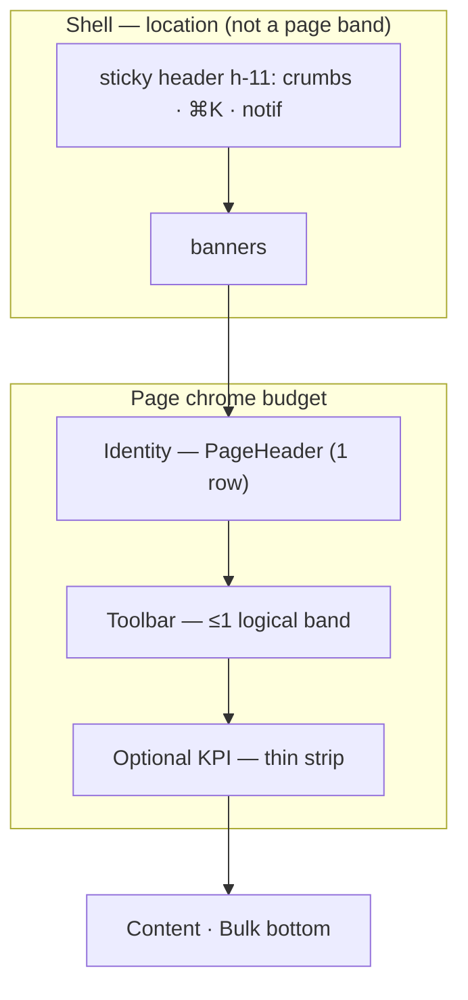

# Wave 3/4 — Visual Hierarchy Contract

**Agent:** `w4-hierarchy-spec` (refresh of `w3-hierarchy-spec`)  
**Date:** 2026-07-20  
**Status:** Wave 4 refresh — **binding** with [`w4-anti-clutter-contract.md`](./w4-anti-clutter-contract.md)  
**Audience:** Wave 5–10 implementers  
**Inputs:** [`w2-laminar-contracts.md`](./w2-laminar-contracts.md) §A · [`w2-linear-stripe-chrome.md`](./w2-linear-stripe-chrome.md) · [`w1-hub-surfaces.md`](./w1-hub-surfaces.md) · [`w1-chrome-mapper.md`](./w1-chrome-mapper.md) · [`w1-consolidated-inventory.md`](./w1-consolidated-inventory.md) · Pattern Library **P0-1** · anti-clutter contract

**Scope:** Page identity, chrome bands, CTA/KPI caps, overflow placement. Not tokens, not table OS internals, not skins.

---

## 0. One-liner (band budget)

**Max page chrome = Identity (`PageHeader`) + 1 Toolbar; optional thin KPI strip; never a third stacked band.**

Shell sticky header is **location**, not a page band. Do not count it toward the page budget.

---

## 1. Three tiers: shell sticky vs page identity vs toolbar

```
┌─ AppShell ─────────────────────────────────────────────────────────┐
│ sidebar (org · nav)                                                │
│ ┌─ main#main-content ────────────────────────────────────────────┐ │
│ │ [SHELL] sticky h-11  breadcrumbs | ⌘K | notifications          │ │  ← location only
│ │ banners (offline / org-sync / auth / onboarding)               │ │
│ │                                                                │ │
│ │ [IDENTITY] PageHeader  eyebrow · H1 · primary actions          │ │  ← band 1 (required*)
│ │ [TOOLBAR]  Tabs · filters · views · display · live             │ │  ← band 2 (≤1)
│ │ [KPI?]     severity/status chips only when resource needs them │ │  ← optional thin strip
│ │ [CONTENT]  table / grid / detail split                         │ │
│ │ [BULK]     BulkActionBar (selection > 0) — sticky bottom       │ │  ← not a top band
│ └────────────────────────────────────────────────────────────────┘ │
│ aiRail (sibling)                                                   │
└────────────────────────────────────────────────────────────────────┘
* Overview Home may be Identity-only (0 Toolbar). Settings uses rail + one PageHeader (see §6).
```



| Tier | Owner | Job | Sticky? |
|---|---|---|---|
| **Shell header** | `portal-chrome` / `AppShell` | Where you are (breadcrumbs) + global find (⌘K) + notifications | Yes (`top-0 z-30`, `h-11`) |
| **Identity** | `PageHeader` via `ResourcePageShell.header` / `CoreResourcePage` | What this page is (eyebrow + H1) + primary CTAs | No (scrolls with page) |
| **Toolbar** | `ResourcePageShell.toolbar` | How you slice the resource (tabs, filters, views, live) | Prefer non-sticky; if sticky, **one** band only — never restack shell |
| **KPI strip** | Page-owned, under toolbar | Status/severity counts when the list needs them | Thin; never a second filter row |
| **Bulk** | `BulkActionBar` | Selection actions | Sticky **bottom** |

**Must:** Shell breadcrumbs ≠ page H1 restatement as a second sticky. Location lives in shell; identity lives in `PageHeader` (`w2-linear-stripe-chrome` P-03).

**Must not:** Duplicate sticky headers inside the page that restate crumbs (`w2-laminar-contracts` §A.1).

---

## 2. Chrome band budget

| Band | Allowed | Max | Counts toward budget? |
|---|---|---|---|
| Shell sticky | crumbs · ⌘K · notif | `h-11` | **No** |
| **Identity** | One `PageHeader` (eyebrow + title + actions) | ~1 row | **Yes — required on hubs** |
| **Toolbar** | Hub `Tabs` + filters + views + display + live/refresh | **1** logical row (wrap on narrow = still one band) | **Yes — max 1** |
| **Optional KPI** | Severity/status chips only | 1 thin strip | Yes, but **not** a third nav/filter band |
| Content | Table / panels | flex fill | No |
| Bulk | Selection bar | bottom sticky | No |

### Hard caps

| Rule | Contract |
|---|---|
| Max stacked page bands | **Identity + Toolbar** (+ optional KPI) — **≤2 purpose bands** |
| Triple bands | **Banned** — Wave 1 Traces ≈3 is the anti-pattern (P0-1) |
| Toolbar primary actions | **≤5** visible; rest → overflow ([`w4-anti-clutter-contract`](./w4-anti-clutter-contract.md) §3) |
| PageHeader actions | **≤3** primary |
| KPI desktop / mobile | **5–7** / **3–4** primary glance metrics |
| Facets / secondary filters | Inside Toolbar (`QueryFilterBar` chips / `?facet=`) — **not** a sibling band |
| CrossLinkBar at hub | Prefer **overflow** / Advanced / detail — do **not** make CrossLinkBar a permanent third band between Identity and Tabs |
| Legacy product tools | Overflow `DropdownMenu` or detail `CrossLinkBar` — **never** tab-row siblings |
| Dual title / dual org | **Banned** (Settings dual_title must stay N) |
| Card-nest in chrome | **Banned** — see anti-clutter §5 |
| Settings | Rail (search + category tabs) + **one** identity title — see §6 |

Height cue from Laminar contracts: Identity ~1 row; Toolbar 1 logical band; KPI thin strip (`w2-laminar-contracts` §A.2).

---

## 3. PageHeader rules

### 3.1 Single identity

- Exactly **one** visible page H1 per view.
- `EmbeddedSurface` / `embedded` continues to suppress nested `PageHeader`s in hub children.
- **Settings:** rail label **or** `PageHeader title="Settings"` — never both (`w2-linear-stripe-chrome` P-02 / P0-8). Prefer: keep `PageHeader` as sole H1; rail = search + tabs only (non-heading label OK).

### 3.2 No double titles

| Smell | Fix |
|---|---|
| Rail `<h2>Settings</h2>` + `PageHeader title="Settings"` | Drop one |
| Breadcrumb leaf identical to H1 | Allowed (Home); do not add a third label in toolbar |
| Child route PageHeader inside hub embed | Must hide via `EmbeddedSurface` |
| Subtitle that repeats the H1 string | Ban; subtitle = job sentence only |

### 3.3 Eyebrow language

| Hub | Eyebrow | Title |
|---|---|---|
| Traces | `Observe` | `Traces` |
| Agents | (product group or omit) | `Agents` |
| Evals | (product group or omit) | `Evals` |
| Alerts | (product group or omit) | `Alerts` |
| Issues | (product group or omit) | `Agent Issues` (or shorten to `Issues` if nav already says Agent Issues) |
| Improve | (product group or omit) | `Improve` |
| Settings | omit or `Workspace` | `Settings` **once** |
| Home | omit | `Home` |

**Eyebrow rules:**

- Eyebrow = **category / job family**, not a second title.
- Do not invent marketing eyebrows (“Intelligence”, “Platform”).
- Prefer matching sidebar group labels when they exist (e.g. Observe).
- Empty eyebrow is better than a redundant one that duplicates the H1.

### 3.4 Actions slot

**Primary actions only** in `PageHeader.actions` (1–3): e.g. Live, Refresh, Connect, Edit layout, Share.

Everything else → §4 overflow.

---

## 4. Secondary actions → overflow

| Kind | Destination | Examples |
|---|---|---|
| **Primary** | `PageHeader.actions` or first toolbar controls | Live · Refresh · New · Connect |
| **Hub navigation siblings** | `Tabs` in Toolbar (`ui/tabs`) | traces \| spans \| sessions; agents \| fleet |
| **Deep / related surfaces** | `CrossLinkBar` **inside detail** or under Advanced — **or** header `DropdownMenu` labeled More / Tools | Inspector, Replay, Debugger, Time-Travel, Query; Scorecard; Ledger |
| **Power / rare** | `DropdownMenu` “Advanced” / “More” | Export formats, SQL escape hatch, open-in-leaf |
| **Settings categories** | Settings rail tabs + `SettingsSearch` | Not CrossLinkBar |

### Placement priority (overflow)

```
1. Does it change the primary table lens?     → Tabs (Toolbar)
2. Does it filter/sort the current lens?      → QueryFilterBar / ViewsMenu (Toolbar)
3. Is it a related product surface?           → Detail CrossLinkBar OR header DropdownMenu
4. Is it legacy / Advanced nav?               → DropdownMenu · Advanced sidebar · ⌘K
5. Never                                     → Extra horizontal band · tab-row sibling links
```

**CrossLinkBar at hub level:** Wave 1 Agents/Improve use hub CrossLinkBar as a full band → **non-compliant** with ≤2-band budget. Target: fold links into Tabs when they are true lenses, else `DropdownMenu` / detail CrossLinkBar / Advanced.

---

## 5. Ban list

| Ban | Why | Wave 1 evidence |
|---|---|---|
| **Triple (or more) chrome bands** | Content drowned before first row | Traces ~3; Alerts ~4–5; Issues 4 |
| **Duplicate sticky headers** | Shell already sticky; page sticky restating crumbs | Laminar §A.1 must-not |
| **Legacy tools on tab row** | Competes with lens Tabs; reads as peer navigation | Traces Inspector/Replay/Debugger/Time-Travel/Query |
| **Facet chips as own band** | Third filter metaphor | Traces mcp/decisions/memory/retrieval strip |
| **Hub CrossLinkBar as permanent band 2.5** | Pushes Tabs/filters into band 3 | Agents, Improve |
| **Double Settings title** | Two H1-class labels | Rail h2 + PageHeader |
| **Dual org switcher** | Shell owns workspace | Sidebar Clerk + Settings Select |
| **Hand-rolled hub tablists** when `ui/tabs` exists | Grammar drift (P0-6) | 0/8 hubs use shared Tabs |
| **`fallback={null}` on Settings/hub Suspense** | Blank flash | Settings |
| **Promoting Advanced leaves onto hub tabs** | U12 core freeze | Laminar §B.1 |

---

## 6. Hub-by-hub target composition

Band counts = **page** bands only (shell excluded).

### 6.1 Traces (`/traces`) — P0-1 reference fix

| | Wave 1 | Target |
|---|---|---|
| Bands | **3 critical** | **Identity + Toolbar** (KPI optional: none by default) |
| Identity | Eyebrow Observe · Traces · Live/Refresh/overflow | Keep |
| Toolbar | Tabs + legacy + facets + filters (stacked) | **One band:** `Tabs` (traces\|spans\|sessions) + `QueryFilterBar` (+ facet chips **inside**) + `ViewsMenu` + Display + Live |
| Overflow | — | Legacy tools → header `DropdownMenu` or detail `CrossLinkBar` |
| Detail | Panel | Unchanged master–detail; modes inside panel, not hub bands |

```
[PageHeader Observe / Traces | Live · Refresh · More▾]
[Tabs: Traces|Spans|Sessions | QueryFilterBar+facets | Views | Display]
[InfiniteDataTable ± DetailPanelShell]
```

### 6.2 Agents (`/agents`)

| | Wave 1 | Target |
|---|---|---|
| Bands | **3** (Header + CrossLinkBar + tabs) | **Identity + Toolbar** |
| Identity | Agents + primary CTAs | Keep; move dense subtitle/description down or shorten |
| Toolbar | CrossLinkBar then tabs | **Tabs** agents\|fleet only; Fleet/Improve/Ledger/Audit → `More▾` or Advanced / detail |
| Body filters | Search + framework in body | OK (body, not chrome band) |

### 6.3 Evals (`/evals`)

| | Wave 1 | Target |
|---|---|---|
| Bands | **2** | **Identity + Toolbar** (already compliant count) |
| Identity | One hub header | Keep |
| Toolbar | 7 hand-rolled tabs | Same lenses via `ui/tabs`; no new bands; optional path CrossLinks in overflow only (do not add CrossLinkBar band) |

### 6.4 Alerts (`/alerts`)

| | Wave 1 | Target |
|---|---|---|
| Bands | Feed **~4–5** | **Identity + Toolbar** (+ optional **thin KPI**) |
| Identity | Alerts · Signals link / primary | Keep; Signals/Rules as Tabs or header mode, not extra bands |
| Toolbar | Merge ResourceOsToolbar + ack/rules into **one** toolbar band | Filters + views + mode controls co-located |
| KPI | Severity buttons as own band | **Optional thin strip** under toolbar **or** chips inside toolbar — not a fourth band |
| Bulk | BulkActionBar | Bottom sticky — OK |

### 6.5 Issues (`/issues`)

| | Wave 1 | Target |
|---|---|---|
| Bands | Issues tab **4** | **Identity + Toolbar** (+ optional KPI if status counts need it) |
| Identity | Agent Issues | Keep |
| Toolbar | Section tabs + ResourceOsToolbar + status tabs stacked | **One band:** section Tabs (Issues\|Incidents) + ResourceOsToolbar; status filters as chips/select **inside** toolbar (not a second tablist band) |
| Detail | CrossLinkBar in panel | Keep in detail only |

### 6.6 Improve (`/improve`)

| | Wave 1 | Target |
|---|---|---|
| Bands | **3** (Header + CrossLinkBar + tabs) | **Identity + Toolbar** |
| Identity | Improve · Refresh when queue | Keep |
| Toolbar | Tabs queue\|plans\|history | Tabs only in toolbar |
| CrossLinkBar | Issues, Artifacts, Promotions, Scorecard | → `More▾` / Advanced / detail — not a hub band |

### 6.7 Settings (`/settings`)

| | Wave 1 | Target |
|---|---|---|
| Layout | Custom split rail + main | Keep split; **not** CoreResourcePage |
| Identity | **Double “Settings”** | **One** title only |
| Rail | h2 + SettingsSearch + ~21 tabs | Search + category tabs; no duplicate H1 |
| Org | In-page Select | **Remove** — shell Clerk switcher only (collapse-safe) |
| Suspense | `fallback={null}` | Skeleton / `PageLoadingSkeleton` |
| Page bands | Rail + header (+ org panel) | Rail + single PageHeader; org panel gone |

```
┌ Settings rail (search + tabs) ┬ PageHeader (title once) + tab body ┐
│  no duplicate h2 if header    │  no org Select                     │
└───────────────────────────────┴────────────────────────────────────┘
```

### 6.8 Home / Dashboard (reference — already good)

| | Wave 1 | Target |
|---|---|---|
| Bands | **1** | **Identity only** (no Toolbar) |
| Keep | PageHeader Home + CTAs; no filter chrome | Do not add bands to “match” explorers |

---

## 7. Acceptance checks

### Shell vs page

- [ ] One sticky shell header (`h-11`); no page-level sticky that restates breadcrumbs.
- [ ] Banner `top-*` offset matches shell header height.
- [ ] Shell org switcher is the only workspace control; collapsed rail still exposes it.

### Band budget

- [ ] Every hub ≤ **Identity + 1 Toolbar** (+ optional thin KPI).
- [ ] **Zero** hubs with triple+ top chrome bands (Traces, Alerts, Issues, Agents, Improve fixed).
- [ ] Facets / status / severity do not create a third horizontal band.
- [ ] Legacy Observe tools absent from Traces tab row.
- [ ] Hub CrossLinkBar is not a permanent band between Identity and Tabs.

### PageHeader

- [ ] One visible H1 per view; Settings not double-titled.
- [ ] Eyebrows are category labels (Observe, …), not duplicate titles.
- [ ] Embedded children hide nested PageHeaders.

### Primitives

- [ ] Hub lenses use `@/components/ui/tabs` (or SettingsRailTabs wrapper), not ad-hoc `role="tablist"` for new work.
- [ ] Secondary/deep links use `DropdownMenu` / detail `CrossLinkBar` / Advanced / ⌘K.
- [ ] `ResourcePageShell` / `CoreResourcePage` slot order: `header` → `toolbar` → content → bulk.

### Hub spot-checks

- [ ] **Traces:** Identity + single toolbar; P0-1 satisfied.
- [ ] **Agents / Improve:** CrossLinkBar demoted; Tabs in toolbar.
- [ ] **Alerts / Issues:** severity/status collapsed into toolbar or one KPI strip.
- [ ] **Evals:** still ≤2 bands; no new CrossLinkBar band.
- [ ] **Settings:** one title; no dual org; Suspense skeleton.
- [ ] **Home:** remains 1-band overview.

### Tests / selectors (Wave 4)

- [ ] Update hub chrome selectors in vitest / golden observe probes when bands collapse (see Laminar §B.5).
- [ ] Do not assert on legacy tab-row tool links as primary chrome.

---

## 8. Refs

| Doc | Use |
|---|---|
| [`w2-laminar-contracts.md`](./w2-laminar-contracts.md) §A.2 | Resource chrome budget table |
| [`w2-competitor-pattern-library.md`](./w2-competitor-pattern-library.md) P0-1 | Single Observe toolbar |
| [`w2-linear-stripe-chrome.md`](./w2-linear-stripe-chrome.md) P-02/P-03 | Single title; two-tier chrome |
| [`w1-hub-surfaces.md`](./w1-hub-surfaces.md) | Wave 1 band counts |
| [`w1-chrome-mapper.md`](./w1-chrome-mapper.md) | Shell sticky anatomy |

---

## Deliverable

**Written:** [`docs/specs/ui/overhaul-2026/w3-hierarchy-spec.md`](./w3-hierarchy-spec.md)
