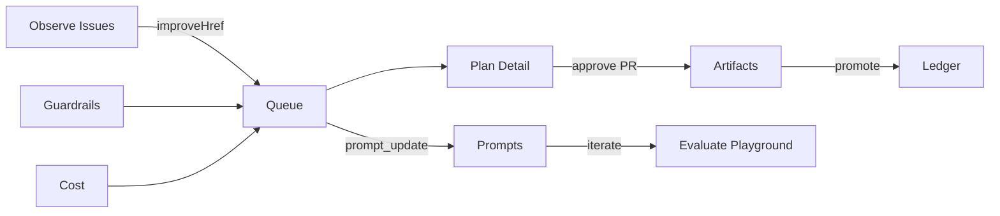

# IMPROVE_V3_PLAN.md

**Improve V3 interaction + IA contract** — locked decisions for Waves 1–11.  
**Research:** [`IMPROVE_V3_OBSERVATIONS.md`](./IMPROVE_V3_OBSERVATIONS.md) · Wave 0 inventory/closed-loop/audit (below)  
**Fleet plan:** `.cursor/plans/improve_v3_fleet_cdd87ca0.plan.md` (source; do not edit)  
**Frozen kit:** [`DESIGN.md`](./DESIGN.md) — dark-only · PageHeader · kit Button/Dialog/Badge · ≤2 chrome bands · no new accents/glow/pill clusters  
**Product thesis:** Improve = **act** (queue → ship → remember); Evaluate = **compare** (datasets / playgrounds / experiments) — stays separate

**Signed:** Wave 0 exit 2026-07-21 · Prompts→core **YES** · Evaluate merge **NO**

---

## 1. Locked IA (no optionality in impl)

```
Improve
  Core
    Queue      /improve                 → master–detail action board
    Plans      /improve?tab=plans       → list; detail /improve/plans/[id]
    Artifacts  /artifacts               → evidence-gated promote (hard boundary)
    Ledger     /ledger                  → institutional memory; promotions = mode
    Prompts    /prompts                 → PROMOTED to core (Helicone-adapted)
  Advanced
    Scorecard           /improve/scorecard
    Online scoring      /improve/online-scoring
    Change impact       /improve/change-impact
    Guardrails          /guardrails
    Cost                /optimization
```

| Decision | Locked choice | Rationale |
|----------|---------------|-----------|
| Prompts location | **Core Improve** | Helicone groups Prompts under Improve; Eden plan kinds include `prompt_update`; Datasets/Playgrounds stay Evaluate |
| Evaluate hub | **Out of scope** | `/evals` datasets/playgrounds/experiments stay Evaluate; do not merge into Improve |
| Guardrails / Cost | **Advanced** | Peer-quality satellites; do not pollute core act path |
| Queue interaction | **Master–detail** | Replace kanban-only walls; columns → Views (Needs you / In progress / Verify) |
| Plan detail | Diff + Summary | Braintrust Diff/Summary grammar on Eden `DiffViewer`; toast honesty preserved |
| Artifacts promote | Hard evidence boundary | Visible gates before CTA |
| Ledger | Modes incl. promotions | One institutional-memory mental model |
| Advanced discovery | Sidebar Advanced + ⌘K | Off related strip / primary chrome |

### Sidebar order (Wave 1 target)

| Order | id | href | category |
|------:|----|------|----------|
| 1 | `improve` | `/improve` | core |
| 2 | `artifacts` | `/artifacts` | core |
| 3 | `ledger` | `/ledger` | core |
| 4 | `prompts` | `/prompts` | **core** (today: advanced — Wave 1 promotes) |
| 5 | `scorecard` | `/improve/scorecard` | advanced |
| 6 | `online-scoring` | `/improve/online-scoring` | advanced |
| 7 | `change-impact` | `/improve/change-impact` | advanced |
| 8 | `guardrails` | `/guardrails` | advanced |
| 9 | `optimization` | `/optimization` | advanced |

**As-is (pre-W1):** Prompts is last Advanced item — see `sidebar-config.ts` L144–216.

---

## 2. Interaction contracts

### 2.1 Queue hub (`/improve`)

1. **Master–detail stays after rebuild.** List never unmounts on select. Split ≥1280 / drawer &lt;1280.
2. **ViewsMenu** for Needs you / In progress / Verify — not three permanent card walls.
3. **One primary CTA** per selected item (Approve / Open plan / Promote).
4. **Related strip:** Issues · Artifacts · Ledger · Prompts (add Prompts in W1/W2; keep Advanced off strip).
5. **Embedded tabs:** Plans / History via `EmbeddedSurface` **without** double PageHeader (strip nested chrome).
6. **Preserve:** `?issue=` filter + `queueItemMatchesIssue` + auto-open single N23 plan; soft redirects `/improve/plans`→`?tab=plans`, `/improve/runs`→`?tab=history`.
7. **Shell LOC ≤400** (today hub `page.tsx` = **713**).

### 2.2 Plan detail (`/improve/plans/[id]`)

1. Diff toggle (unified | split) + **Summary** panel: what changes / evidence / risk.
2. Kit Dialog only for approve / reject / snooze; **no false success toasts**.
3. `PlanKindBadge` deep-links: `prompt_update`→`/prompts`, `guardrail_tune`→`/guardrails`.

### 2.3 Artifacts + Ledger

1. Artifacts modes without card walls; promote = hard boundary UI with evidence panel.
2. Ledger modes; promotions nested as Ledger mode (`/ledger?tab=promotions`).
3. Issue → Artifact → Promote ≤5 clicks (as-is met at 4–5 — preserve).

### 2.4 Prompts (core)

1. List | editor master–detail (already present — extend lifecycle).
2. Draft → playground iterate (`/evals?tab=playgrounds` deep-link) → publish → env pin / rollback.
3. Do **not** merge with Studio.

### 2.5 Guardrails (Advanced)

1. Policies primary; Red-team as report mode (Promptfoo drill: summary → category → case → I/O).
2. Failed guardrail → Improve queue scent (Wave 6).

### 2.6 Cost (`/optimization`, Advanced)

1. Primary tabs ≤4: `cost | budget | outcomes | advisor`.
2. KPI strip; Model Advisor side-by-side compare; kill Outcomes StatCard soup.
3. Soft-redirect orphans: `/optimization/budget`→`?tab=budget`, `/optimization/outcomes`→`?tab=outcomes`.

---

## 3. Closed-loop map (Wave 0.3 — as-is)



### Helpers (preserve)

| Name | Path | Contract |
|------|------|----------|
| `improveHref` | `src/lib/portal-cross-links.ts` | `(issueId?) => /improve?issue=` or `/improve` |
| `queueItemMatchesIssue` | `src/lib/improve-queue-issue.ts` | Match `issue:` ref / payload ids |
| `artifactHref` | `portal-cross-links.ts` | `/artifacts` ± `artifactId` |
| `promotionsHref` | `portal-cross-links.ts` | `/ledger?tab=promotions` |

### Click budgets

| Journey | Target | As-is (best → typical) | Wave gate |
|---------|--------|------------------------|-----------|
| Issue → cause → act | ≤3 | **2–3** (peek+Approve) → **4** (plan+confirm) | W2 tighten plan path |
| Issue → Artifact → Promote | ≤5 | **4–5** | Preserve (W4/W8) |
| Trace → Improve | — | ≥4 (via Issues) | Optional W9 deep link |
| Alert → Improve | — | **None** | Optional W9 |

### Gaps (safe to add later; do not break contracts)

1. Traces / Alerts → `improveHref` missing  
2. `?agent=` from Fleet ignored  
3. `prompt_update` / `guardrail_tune` badge-only (no CTA)  
4. Promote does not auto-route to Ledger  
5. Guardrails / Cost → Queue bridges missing  
6. Plan detail has no Artifacts / Ledger / Prompts forward scent  

### Redirects to preserve (`next.config.ts`)

| Source | Dest |
|--------|------|
| `/pr-suggestions`, `/agents/eden/inbox` | `/improve?tab=plans` |
| `/closed-loop`, `/autonomous` | `/improve` |
| `/improve/plans` | `/improve?tab=plans` (soft) |
| `/improve/runs` | `/improve?tab=history` (soft) |
| `/promotions` | `/ledger?tab=promotions` |
| `/redteam` | `/guardrails?tab=redteam` |
| `/llmops` | `/optimization` |
| `/optimization/model-advisor` | `/optimization?tab=advisor` |

---

## 4. Inventory delta (Wave 0.1)

| Route | LOC (page) | Fetch | Double-header | StatCard / KPI | Notes |
|-------|----------:|-------|---------------|----------------|-------|
| `/improve` | **713** | RQ ✓ | OK | none | Peel to ≤400 |
| `/improve/plans` | 362 | **manual** | embed soft-hide | inline KPI OK | Migrate RQ |
| `/improve/plans/[id]` | 571 | **manual** | standalone OK | none | Diff+Summary W3 |
| `/improve/runs` | 267 | **manual** | embed soft-hide | none | Migrate RQ |
| `/artifacts` | 490 (+251 panel) | RQ ✓ | OK | none | Promote boundary W4 |
| `/ledger` | 220 (+465 promo) | **manual** | promo embed | none | Modes W4 |
| `/prompts` | 395 (+329 editor) | mixed | OK | none | Lifecycle W5 |
| `/guardrails` | 252 (+~1.3k) | **manual** | redteam embed | calm KPI | Report IA W6 |
| `/optimization` | 269 | shell | OK | FinOps KpiCell | Flat tabs W7 |
| budget | 455 | RQ ✓ | nested header code | custom | Strip chrome |
| outcomes | 460 | RQ ✓ | nested header code | **3 StatCard** | KPI strip |
| advisor | 321 | **manual** | nested | **4 StatCard** | Compare polish |
| scorecard | 212 | **manual** | OK | none | W8 |
| online-scoring | 345 | mixed | OK | Card list | W8 |
| change-impact | 316 | on-demand | OK | none | W8 |

**P0 dual-fetch:** plans, plans/[id], runs (keys exist unused in `query-keys.ts`).  
**P1 StatCard soup:** outcomes, advisor project-view, predict-panels.  
**P1 nested headers:** plans/runs/budget/outcomes/advisor/promotions/redteam under `EmbeddedSurface`.

---

## 5. Prompts / Guardrails / Cost audit (Wave 0.4)

| Cluster | Closest to V3? | Biggest gaps |
|---------|----------------|--------------|
| **Prompts** | list\|editor **done** | No playground / publish / rollback loop; no Improve/Eval links |
| **Guardrails** | Test declutter **done** | Not summary→category→case→I/O; red-team still full tool; dead enable toggle |
| **Cost** | 4 primary tabs **done**; Advisor compare **done** | FinOps dual KPI bands; Outcomes StatCards; no Queue links |
| **Advanced leaves** | Correctly shelved | Online-scoring alone has Eval playground tip |

---

## 6. Wave deliverables

| Wave | Ship | Exit |
|------|------|------|
| **0 Research** | IA freeze + observations + critic | This doc + `.wave0-improve-critic.md` |
| **1 Nav** | Prompts→core; Advanced satellites; ⌘K; IA vitest | `.wave1-improve-critic.md` |
| **2 Queue** | Master–detail; peel ≤400; RQ unify; `?issue=` | `.wave2-improve-critic.md` |
| **3 Plans** | Diff/Summary; toast honesty; kind badges | `.wave3-improve-critic.md` |
| **4 Artifacts+Ledger** | Promote boundary; ledger modes; ≤5 click | `.wave4-improve-critic.md` |
| **5 Prompts** | Lifecycle + playground bridge | `.wave5-improve-critic.md` |
| **6 Guardrails** | Promptfoo report IA | `.wave6-improve-critic.md` |
| **7 Cost** | KPI strip + Advisor; flatten headers | `.wave7-improve-critic.md` |
| **8 Advanced** | Scorecard / online-scoring / change-impact | `.wave8-improve-critic.md` |
| **9 Cross-loop** | Deep links, empties, walkthrough | `.wave9-improve-critic.md` |
| **10 Verify** | Axe, LOC, E2E | `.wave10-improve-verifier.md` |
| **11 Freeze** | Route matrix, changelog, freeze tests | Final SHIP critic |

W5/W6/W7 may run in parallel after W1; W2 is critical path.

---

## 7. Success metrics (locked)

| Metric | Target |
|--------|--------|
| Improve hub shell LOC | ≤400 |
| Issue → cause → act | ≤3 clicks |
| Issue → Artifact → Promote | ≤5 clicks |
| Core Improve nav | Queue, Plans (tab), Artifacts, Ledger, **Prompts** |
| Dual headers on embedded tabs | 0 |
| Axe serious on Improve-group core | 0 |
| Hand-rolled accent CTAs growth | 0 (ratchet) |

---

## 8. Hard gates (every wave)

- DESIGN.md density (≤2 chrome bands; one primary accent CTA)
- `lint:portal-clutter` + `lint:portal-classes`
- Hub vitest + `data-waveN-improve-*` markers
- Preserve `improveHref`, `?issue=`, legacy redirects, Advanced off primary strip
- Prefer existing APIs (`improveApi` / `improvePlansApi` / etc.) — API gaps → honest empty/disabled, not fake success
- Shells touched → peel toward ≤400 LOC

---

## 9. Non-goals

- Moving `/evals` under Improve  
- Reopening dual Observe IA, settings double-sidebar, new brand accents  
- Blocking on kanban j/k (optional nicety in W2 if cheap)  
- Backend/API redesign  

---

## 10. IA critic verdict (Wave 0.5)

| Claim | Verdict | Evidence |
|-------|---------|----------|
| Prompts → core | **PASS** | Helicone Improve grouping; Eden `prompt_update` plan kind; Datasets/Playgrounds remain Evaluate so Braintrust path not duplicated |
| Advanced = scorecard / online-scoring / change-impact / guardrails / cost | **PASS** | Matches fleet plan; as-is sidebar already Advanced except Prompts placement |
| Evaluate stays separate | **PASS** | DESIGN.md L185; fleet non-goals; Prompts iterate bridges to `/evals?tab=playgrounds` without nav merge |
| Queue master–detail | **PASS** | No peer ships kanban-default; R4/R6 + LangSmith queues |
| Risk: Prompts core dilutes “act” | **Mitigated** | Lifecycle + queue scent (`prompt_update`); list|editor already present; Studio stays Evaluate |

**IA confirmation: Prompts core = YES.**
