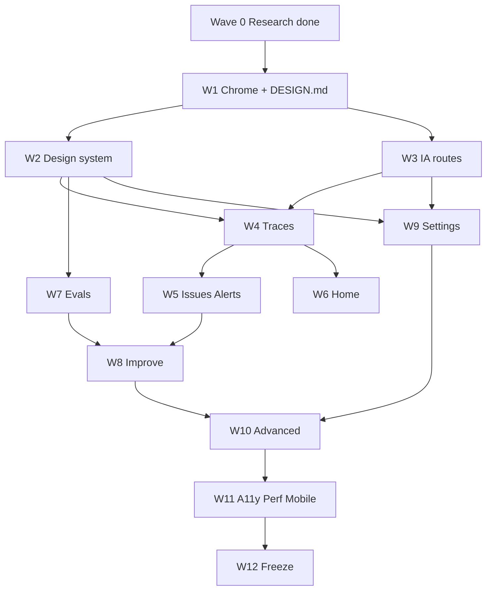

# Eden Portal — Full UI/UX Overhaul Plan

**Scope:** `clients/portal` authenticated product only. Docs site and marketing pages are out of scope.  
**Status:** Research Wave 0 complete → ready for Wave 1 execution.  
**Model for all waves:** Grok 4.5 (`cursor-grok-4.5-high`) · ≥10 subagents per wave · ≥10 waves.

---

## 0. Verdict

Eden’s portal is overcrowded because **chrome, hubs, and legacy leaves all compete at once**. Prior IA freezes (U12/U18/U20) reduced sidebar count but left:

1. A **1,615-line chrome monolith** (`portal-chrome.tsx`) with 8–12 always-on attention sinks  
2. **Hub-of-hubs** (Traces / Evals / Settings / Cost / Improve embed full pages)  
3. **~75 page routes** with dual entry points (`/observability` vs `/traces`, etc.)  
4. A **fragmented design system** (duplicate badges, buttons, command palettes, hand-rolled dialogs)  
5. **Traces toolbar** presenting ~18–22 competing controls on first paint  

Peers that feel usable (Laminar, Langfuse, Phoenix, Helicone/Braintrust) win with: flat ~10-item nav, transcript-first reading, master–detail everywhere, saved views, progressive disclosure, and one primary CTA per screen — not with more widgets.

---

## 1. Research Wave 0 (completed) — 11 Grok 4.5 agents

| # | Agent | Focus | Key deliverable |
|---|-------|-------|-----------------|
| R1 | [Map Eden portal](c5e33973-772f-4b57-abf0-a3a919147be3) | Full route/component inventory | 75 pages, ~180 modules, stack, IA tree |
| R2 | [Laminar UX](2c5805f1-88f6-4131-abe0-689651d905b6) | Peer product + OSS frontend | Transcript-first, DESIGN.md density, ~10 flat nav |
| R3 | [Langfuse UX](586b473c-3589-490f-97bd-4a5a9530790b) | Peer IA + patterns | Observation table + hierarchical drill, saved views |
| R4 | [Phoenix / Arize](f0646bfe-5e29-4ac3-8656-051e46ef007f) | Dense data UI without clutter | Local-debug clarity, RAG-focused progressive disclosure |
| R5 | [Helicone + Braintrust](609a044d-9545-412c-940f-bcc7c4a7cd68) | Logs / experiments UX | Request-log clarity, experiment compare patterns |
| R6 | [UX articles checklist](4d614a68-31eb-41e7-964c-33a461562a0c) | Industry best practices | MUST/SHOULD/NICE with citations |
| R7 | [Visual screenshots](5e575519-a9a9-41e3-ae9f-5c3dd0c26b4d) | 78 PNGs + notes | `.cursor/visual-research/ai-portals/` (OBSERVATIONS.md); Langfuse public trace = only live unauth product UI |
| R8 | [Eden clutter audit](c40bf745-6f5c-43a2-a5cd-bf77853709ad) | Ruthless pain ranking | Top 15 offenders with paths |
| R9 | [Linear / Vercel / Stripe](3746cbec-ae2b-4963-ac9e-fa8c06d65dcb) | Gold-standard B2B portals | Density-without-clutter principles |
| R10 | [Design system inventory](d6b96fb8-608f-4f27-95f7-5b83f2ff364b) | Primitives + inconsistencies | ~44 ui/ files, duplicate Badge/Button debt |
| R11 | [OpenLIT / Promptfoo / Weave](aabb5b32-18b7-487b-b11e-c992efcfa404) | Additional OSS portals | Comparative IA notes |

**Raw synthesis dump:** `clients/portal/.research-wave0.md`  
**Parent visual pass:** Laminar transcript embed + Langfuse product grammar captured via browser screenshots (2026-07-21).

### Largest surface area (LOC) — prioritize rewrite/split

| File | LOC |
|------|-----|
| `portal-chrome.tsx` | 1615 |
| `dashboard/page.tsx` | 1188 |
| `guardrails/page.tsx` | 1179 |
| `alerts/page.tsx` | 1154 |
| `traces/page.tsx` | 1042 |
| `optimization/model-advisor/page.tsx` | 1013 |
| `studio/page.tsx` | 934 |
| `TranscriptView.tsx` | 897 |
| `issues/[id]/page.tsx` | 840 |
| `TraceDetailPanel.tsx` | 588 |

---

## 2. Design principles Eden must adopt

Derived from Laminar DESIGN.md (PR #1810), Langfuse/Phoenix IA, Linear/Stripe density essays, and NN/g progressive disclosure.

### P0 — Non-negotiable

| ID | Principle | Eden application |
|----|-----------|------------------|
| D1 | **One page = one decision** | Home = health; Traces = triage; Evals = compare; Improve = act |
| D2 | **≤2 chrome bands** above content | Identity + toolbar only; KPI strips are optional thin |
| D3 | **≤5 primary toolbar actions** | Everything else → Overflow / More / ⌘K |
| D4 | **Master–detail everywhere** | List preserved; detail = split ≥1280 / drawer below |
| D5 | **Transcript-first for agents** | Tree/Timeline are power modes, not defaults |
| D6 | **Collapse by default** | Subagents, AI rail, metadata, timeline = opt-in |
| D7 | **One primary CTA** (accent once) | Secondary actions use quiet ghost/secondary |
| D8 | **Named saved views** | Filters + columns + sort persist per hub |
| D9 | **Empty states teach next step** | First-run ≠ filtered-empty ≠ error |
| D10 | **Flat nav ≤12 core items** | Keep U12; kill orphan hubs and dual entry points |

### P1 — Visual system

| ID | Rule |
|----|------|
| V1 | Dark-only; hierarchy via **tonal steps**, not new accents |
| V2 | Control height **28–32px**; body **14px**; kill 9–10px micro-labels in chrome |
| V3 | Semantic span colors only (tool / LLM / subagent / error) |
| V4 | Cards only for interaction units — not decoration |
| V5 | Inputs use secondary fill so fields ≠ cards |
| V6 | Motion ≤200ms, confirms action only |
| V7 | Density toggle: Comfortable (default) / Compact (tables) |

### P2 — Anti-patterns to eradicate

- Dual side rails open by default (nav 240 + AI 360)  
- Sticky sandwich (header + filters + table head + bulk + FAB + mobile nav)  
- Hub-of-hubs embedding full pages with second headers  
- Settings double-sidebar with 19+ tabs  
- Parallel Observe IA (`/observability` + `/traces`)  
- Hand-rolled buttons / raw Radix Dialogs bypassing kit  
- Duplicate `CommandPalette` / Badge / StatusBadge families  

---

## 3. Target information architecture

```
Home          /dashboard          → health strip + next action + recent failures
Observe
  Traces      /traces             → list | detail (transcript default)
  Issues      /issues             → clusters + incident tab
  Alerts      /alerts             → feed; Signals advanced overflow
Evaluate      /evals              → datasets | playgrounds | experiments
Improve
  Queue       /improve            → action board (simplified columns)
  Artifacts   /artifacts
  Ledger      /ledger             → promotions merged as mode/filter
Workspace
  Settings    /settings           → 6 categories, ≤8 visible tabs default
  Audit       /audit-trail
```

**Advanced (collapsed):** Agents, Analytics, Cost, Guardrails, Prompts, Debugger sessions, Signals.  
**Deleted as top-level destinations:** `/observability` hub cards, orphan `/users`/`/insights`/`/tools` (live only under Analytics tabs), nested Cost→Predict tab-in-tab (flatten).

**Trace detail modes (toolbar, not routes):** Transcript (default) · Tree · Timeline · Meta · Scores.  
**Legacy tools (Inspector/Replay/Debugger/Query/Time-Travel):** overflow menu only; deep links preserved.

---

## 4. Success metrics (definition of done)

| Metric | Baseline (today) | Target |
|--------|------------------|--------|
| Always-on chrome sinks | 8–12 | ≤5 (sidebar, header, ⌘K, optional banner, toast) |
| Traces first-paint primary controls | ~18–22 | ≤8 |
| Settings visible tabs | ~19 | ≤8 default (+ Advanced) |
| `portal-chrome.tsx` LOC | 1615 | ≤400 (split modules) |
| Dual entry points for same surface | many | 0 |
| Design-system hand-rolled buttons on core hubs | many | 0 |
| Axe critical on U20 routes | gated | still 0; serious → 0 on traces/improve |
| User can: find failing agent run → cause → act | multi-hub maze | ≤3 clicks from Home |

---

## 5. Execution waves (10+) × (≥10 Grok 4.5 subagents)

Each wave: parallel Grok 4.5 agents → merge PR → visual QA gate → next wave.  
Agents are **surgical** (1–2 files or one page domain). Critic/verifier agents run every wave.

---

### Wave 1 — Foundation: DESIGN.md + chrome surgery + kit freeze

**Goal:** Stop the bleeding. Establish canonical visual rules and split chrome so every later wave has a stable shell.

| # | Subagent | Deliverable |
|---|----------|-------------|
| 1.1 | Write `clients/portal/DESIGN.md` | Laminar-style: palette, density 28–32px, one primary, do/don’t |
| 1.2 | Extract `SidebarNav.tsx` from chrome | Nav groups, advanced toggle, collapse |
| 1.3 | Extract `PortalHeader.tsx` | Breadcrumbs (single location system), search, notifications |
| 1.4 | Extract `ChromeBanners.tsx` | Auth/offline/org/onboarding — max one visible |
| 1.5 | Extract `AiRailHost.tsx` | AI collapsed by default; no FAB vs mobile collision |
| 1.6 | Fix bottom-layer z-index contract | BulkBar / MobileNav / AI — mutually exclusive zones |
| 1.7 | Kill duplicate CommandPalette | Keep `portal-os/CommandPalette`; delete/alias `ui/command-palette` |
| 1.8 | Unify location grammar | Remove PageHelpHint + eyebrow triple; one breadcrumb + page title |
| 1.9 | Token cleanup pass | Deprecate `--font-size-3xs` in chrome; alias map in DESIGN.md |
| 1.10 | Critic + visual QA | Screenshot Home/Traces/Settings before/after chrome |

**Exit:** `portal-chrome.tsx` ≤500 LOC; DESIGN.md merged; bottom collisions fixed.

---

### Wave 2 — Design system consolidation

**Goal:** One grammar for buttons, badges, surfaces, empty/error states.

| # | Subagent | Deliverable |
|---|----------|-------------|
| 2.1 | Button variant freeze | Collapse `default`/`secondary`, `destructive`/`danger`; document |
| 2.2 | Badge unification | Single Badge API; StatusBadge wraps Badge; kill Tag overlap |
| 2.3 | Surface freeze | Card vs Panel vs Section rules; ban decorative Card |
| 2.4 | Replace hand-rolled buttons | Settings dialogs, not-found, users, ScoresTab |
| 2.5 | Ban raw Radix Dialog imports | Migrate delete-org / transfer-ownership / security-tab |
| 2.6 | Empty/Error/QueryState audit | All hubs use QueryState + U20 copy |
| 2.7 | Tabs grammar | Only `ui/tabs` underline for hubs; kill hand-rolled settings tablist gradually |
| 2.8 | Form controls polish | Input/Select 28–32px, secondary fill |
| 2.9 | Barrel completeness | Export filter-bar, wizard, error-boundary; prune next.config Radix ghosts |
| 2.10 | Story/fixture or visual checklist | Snapshot Button/Badge/Panel/Empty matrix |

**Exit:** No raw accent buttons on core hubs; DESIGN.md kit section complete.

---

### Wave 3 — IA cleanup & route truth

**Goal:** One path per job. Kill orphan hubs and dual Observe.

| # | Subagent | Deliverable |
|---|----------|-------------|
| 3.1 | Retire `/observability` landing | Redirect → `/traces`; preserve facet deep links |
| 3.2 | Analytics-only homes for users/insights/tools | Soft-delete as top-level; keep embeds |
| 3.3 | Promotions → Ledger mode | Or Artifacts filter — pick one, update nav |
| 3.4 | Signals only via Alerts overflow | Sidebar advanced already; ensure no second home |
| 3.5 | Cost hub flatten | Remove Predict nested 5-tab; promote to Cost modes |
| 3.6 | Sidebar config rename hygiene | Align group ids with labels (build≠Home debt) |
| 3.7 | `portal-routes.ts` + redirects audit | Dead links → 0; tests green |
| 3.8 | Command palette IA sync | Only canonical destinations |
| 3.9 | MobileBottomNav sync | Same core five as desktop |
| 3.10 | Docs-in-app link audit | Quickstart only; no marketing bleed |

**Exit:** Zero dual entry points; nav map matches §3.

---

### Wave 4 — Traces hub overhaul (highest ROI)

**Goal:** Laminar-class triage. ≤8 first-paint controls. Transcript default.

| # | Subagent | Deliverable |
|---|----------|-------------|
| 4.1 | Traces toolbar redesign | Tabs + search + 3 filters + Views + Overflow |
| 4.2 | QueryFilterBar progressive disclosure | Basic default; Advanced drawer |
| 4.3 | Detail modes toolbar | Transcript default; Tree/Timeline/Meta/Scores secondary |
| 4.4 | `TraceDetailPanel` slim | Header metrics ≤4; actions in overflow |
| 4.5 | `TranscriptView` polish | Collapsed subagents, inline previews, semantic colors |
| 4.6 | Live mode as opt-in rail | Not default chrome |
| 4.7 | Saved views first-class | Unsaved amber; shareable names |
| 4.8 | Sessions view | Laminar session list pattern (expand-in-place) |
| 4.9 | Spans view declutter | Columns hideable; density compact |
| 4.10 | Visual QA vs Laminar shared trace | Side-by-side screenshot critique |

**Exit:** Traces usable for “find failure → cause” in ≤2 clicks from list.

---

### Wave 5 — Issues + Alerts

| # | Subagent | Deliverable |
|---|----------|-------------|
| 5.1 | Issues list master–detail | Match ResourcePageShell contract |
| 5.2 | Issue detail (`[id]`) slim | Evidence first; actions secondary |
| 5.3 | Incidents as Issues tab only | No parallel IA |
| 5.4 | Alerts feed declutter | Severity chips + clear filters |
| 5.5 | Alerts detail panel | Ack/resolve primary; config secondary |
| 5.6 | Split Rules/Channels | Config → Settings or sheet, not same viewport |
| 5.7 | BulkActionBar collision fix | Desktop only when selection; hide on mobile if FAB |
| 5.8 | Signals advanced surface | Quiet entry from Alerts More |
| 5.9 | Empty/filter-empty copy | U20 + first-run doctor |
| 5.10 | Critic pass | Severity-ranked remaining clutter |

---

### Wave 6 — Home / Dashboard

| # | Subagent | Deliverable |
|---|----------|-------------|
| 6.1 | Home job rewrite | Status → Diagnosis → one Action |
| 6.2 | KPI strip ≤4 | Throughput, errors, cost, open issues |
| 6.3 | Diagnosis strip | Single narrative + deep link |
| 6.4 | Recent failures list | Not full traces OS |
| 6.5 | Remove widget soup | Agentic/quick-links behind Edit only |
| 6.6 | First-run waiting UX | FIRST_EVENT_WAIT polish |
| 6.7 | Time range control | Quiet, sticky context |
| 6.8 | Split page.tsx | Extract widgets to `_components` (<400 LOC page) |
| 6.9 | Mobile home | 3 cards max above fold |
| 6.10 | Visual QA | Stripe-like hierarchy check |

---

### Wave 7 — Evaluate hub

| # | Subagent | Deliverable |
|---|----------|-------------|
| 7.1 | Evals hub shell | 3 primary tabs only |
| 7.2 | Datasets list/detail | Master–detail; no nested Card walls |
| 7.3 | Playgrounds declutter | One primary Run CTA |
| 7.4 | Experiments compare | Side-by-side scores; Langfuse/Braintrust pattern |
| 7.5 | Advanced embeds | Labeling / Studio / Synthetic behind Advanced |
| 7.6 | Studio page split | Dialogs/grids out of 934 LOC monolith |
| 7.7 | Labeling queue UX | Empty state with 3 sources (Laminar pattern) |
| 7.8 | Eval ↔ Trace deep links | Preserve filters/time |
| 7.9 | Remove “Go to” overflow dupes | |
| 7.10 | Critic + axe | |

---

### Wave 8 — Improve loop (queue, artifacts, ledger)

| # | Subagent | Deliverable |
|---|----------|-------------|
| 8.1 | Improve queue redesign | 3 columns max (Needs you / In progress / Verify) |
| 8.2 | Kill path overflow soup | Cross-links in ⌘K / related strip only |
| 8.3 | Plans list + detail | Calm hierarchy |
| 8.4 | History / runs | Table density |
| 8.5 | Artifacts hub | Modes without card walls |
| 8.6 | Ledger + promotions merge UX | One institutional memory surface |
| 8.7 | Scorecard / online-scoring | Advanced Improve only |
| 8.8 | Diff viewer polish | |
| 8.9 | Toast mutations audit | U20_TOAST_MUTATIONS complete |
| 8.10 | End-to-end loop QA | Issue → Artifact → Promote ≤5 clicks |

---

### Wave 9 — Settings + Workspace

| # | Subagent | Deliverable |
|---|----------|-------------|
| 9.1 | Settings IA | 6 categories; ≤8 default tabs |
| 9.2 | Kill double sidebar | Top category pills + content (or single rail ≤180px) |
| 9.3 | Members / API keys polish | Primary jobs first |
| 9.4 | Billing / plan limits | Stripe-like calm |
| 9.5 | Gateway / retention / PII / exports | Advanced group |
| 9.6 | Soft-hide ghosts | roles/sso: remove deep links or ship UI |
| 9.7 | Profile not embedded page | Inline account panel |
| 9.8 | Audit trail declutter | |
| 9.9 | Permission gates microcopy | |
| 9.10 | Settings search quality | |

---

### Wave 10 — Advanced surfaces + remaining pages

| # | Subagent | Deliverable |
|---|----------|-------------|
| 10.1 | Agents + fleet | Card density → table/list default |
| 10.2 | Agent detail | Tabs declutter |
| 10.3 | Analytics hub | One overview + progressive tabs |
| 10.4 | Cost / budget / outcomes / advisor | Flat modes; Model Advisor split |
| 10.5 | Guardrails | Kill 3-card Test wall; KPIs non-redundant |
| 10.6 | Prompts | Version list + editor split |
| 10.7 | Debugger sessions | Laminar debugger pattern |
| 10.8 | Auth pages polish | Sign-in/up/invite consistency |
| 10.9 | Onboarding tour slim | Fewer steps; no overlapping chrome |
| 10.10 | Full portal inventory sweep | Every remaining `page.tsx` signed off |

---

### Wave 11 — Motion, a11y, performance, mobile

| # | Subagent | Deliverable |
|---|----------|-------------|
| 11.1 | Motion tokens | panel-enter / row-select only |
| 11.2 | Axe serious → 0 on traces/improve | |
| 11.3 | Keyboard: list nav + ⌘K completeness | |
| 11.4 | Focus rings consistent | |
| 11.5 | Virtualization audit | Large traces/tables |
| 11.6 | Bundle / island audit | Lazy chrome islands |
| 11.7 | Mobile: cards not shrunk tables | |
| 11.8 | Density toggle e2e | |
| 11.9 | Perf budgets | TTI on Home/Traces |
| 11.10 | Verifier | Metrics §4 all green |

---

### Wave 12 — Hardening & freeze

| # | Subagent | Deliverable |
|---|----------|-------------|
| 12.1 | DESIGN.md ↔ code drift check | |
| 12.2 | Anti-clutter lint rules | Fail PRs with >5 toolbar actions / nested hubs |
| 12.3 | Visual regression baselines | Core hubs |
| 12.4 | E2E happy paths | Observe → Eval → Improve |
| 12.5 | Kill dead CSS / unused primitives | |
| 12.6 | i18n string pass | |
| 12.7 | Changelog / release notes for portal UX | |
| 12.8 | Team walkthrough script | |
| 12.9 | Open questions backlog | Only intentional debt |
| 12.10 | Final critic | Ship / no-ship recommendation |

---

## 6. Wave dependency graph



---

## 7. Implementation rules for every subagent

1. **Portal only** — never touch `docs/` or `(marketing)/`.  
2. **Follow DESIGN.md** once Wave 1 lands.  
3. **No new accents / glow / pill clusters.**  
4. **Prefer ResourcePageShell + DetailPanelShell** over custom layouts.  
5. **Split files >600 LOC** as you touch them.  
6. **Preserve deep links** via redirects when retiring routes.  
7. **Tests:** update hub tests (`w3-*`, `w6-*`, `u18-*`, `u20-*`) in same PR.  
8. **Evidence:** before/after screenshot paths in PR body.  
9. **Model:** Grok 4.5 for all planning/implementation subagents unless user overrides.

---

## 8. Reference URLs (research)

| Source | URL |
|--------|-----|
| Laminar product | https://laminar.sh/ |
| Laminar viewing traces | https://laminar.sh/docs/platform/viewing-traces |
| Laminar transcript rationale | https://laminar.sh/blog/transcript-view-agent-traces |
| Laminar table views | https://laminar.sh/docs/platform/table-views |
| Laminar DESIGN.md PR | https://github.com/lmnr-ai/lmnr/pull/1810 |
| Laminar vs Langfuse | https://laminar.sh/blog/2026-02-13-laminar-vs-langfuse-why-we-prefer-laminar |
| Langfuse | https://langfuse.com/ |
| Phoenix | https://github.com/Arize-ai/phoenix |
| NN/g Progressive Disclosure | https://www.nngroup.com/articles/progressive-disclosure/ |
| NN/g Empty States | https://www.nngroup.com/articles/empty-state-interface-design/ |
| UI Density (Ström) | https://mattstromawn.com/writing/ui-density/ |
| Stripe/Linear/Vercel craft | https://mantlr.com/blog/stripe-linear-vercel-premium-ui |
| Honeycomb Design as Infrastructure | https://www.honeycomb.io/blog/design-as-infrastructure |

---

## 9. What to look at next

1. Approve this plan (or adjust Wave order / IA merges).  
2. Say **execute Wave 1** to spawn 10 Grok 4.5 agents on chrome + DESIGN.md.  
3. Track progress against §4 metrics after each wave.

---

## 10. Accomplished in planning (evidence)

| Item | Evidence |
|------|----------|
| Research Wave 0 | 11 Grok 4.5 agents; dump at `.research-wave0.md` |
| Portal inventory | 75 pages, ~180 components, stack confirmed Next 16 / React 19 / TW4 |
| Clutter ranking | Top 15 offenders with file paths (chrome, settings, traces…) |
| Peer research | Laminar, Langfuse, Phoenix, Helicone/Braintrust, OpenLIT/Promptfoo |
| Visual research | Laminar transcript UI + Langfuse product grammar screenshots |
| Industry checklist | MUST/SHOULD/NICE with citations |
| Design system debt | Duplicate Badge/Button/Dialog mapped |
| Execution plan | Waves 1–12 × 10 agents = **120 implementation agent slots** + Wave 0 research |
| Plan file | This document |
