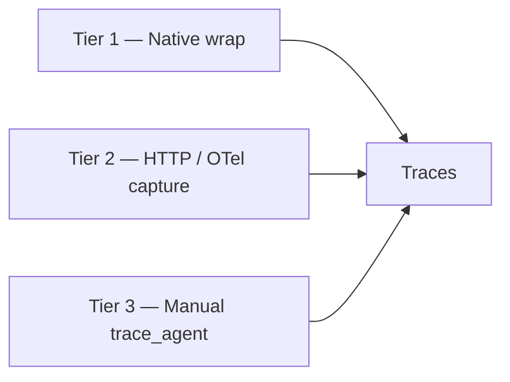

# How-to — Connect any agent

Every customer gets a clear path to first trace, regardless of framework.
Eden uses a **three-tier** model:



| Tier | When | What you ship |
|------|------|---------------|
| **1 — Native** | Framework in the [support matrix](/reference/auto-instrumentation) | `eden.instrument()` / `wrap*` — full model, tools, tokens, cost |
| **2 — Universal** | Custom agent, niche framework, raw HTTP to OpenAI/Ollama/Anthropic | HTTP capture + OTel bridge + logging forwarder |
| **3 — Manual** | Maximum control | `@trace_agent` / `traceAgent` + `ToolSpan` helpers |

## Step 0 — Run the doctor

Before picking a tier, validate connectivity:

```bash
# Python
pip install eden-sdk
export EDEN_ORG_ID="org_..." EDEN_API_KEY="sk_eden_..."
python -m eden_sdk.doctor   # or: eden-doctor

# TypeScript
npm install @eden-ai/sdk
export EDEN_ORG_ID="org_..." EDEN_ORG_API_KEY="sk_eden_..."
npx eden-doctor
```

:::tip
Fastest path for first credentials: **[Fill in](/quickstart)** on the
docs quickstart.
:::

Doctor checks API key, org id, and connectivity (defaults to
`https://api.edenobservability.com`). Fix any red items before continuing.

## Tier 1 — Native instrumentation

### Python

```python
import os
import eden

eden.configure(
    api_key=os.environ["EDEN_API_KEY"],
    org_id=os.environ["EDEN_ORG_ID"],
)
eden.instrument()  # patches every installed framework
```

Supported frameworks include OpenAI, Anthropic, LangChain, LlamaIndex,
CrewAI, AutoGen, and **Pydantic AI** (SDK 0.3+).

### TypeScript

`instrument()` (default `autoPatch: true`) patches OpenAI and Anthropic
prototypes — instances built afterward are traced without a `wrap*` call.
Other frameworks still need explicit wrappers:

```ts
import {
  configure,
  detectInstalledFrameworks,
  instrument,
  wrapOpenAI,
  traceAgent,
} from "@eden-ai/sdk";

configure({
  apiKey: process.env.EDEN_API_KEY!,
  orgId: process.env.EDEN_ORG_ID!,
});

const { wrapLangChain, patched } = instrument();
const installed = detectInstalledFrameworks();
let client: ReturnType<typeof wrapOpenAI> | undefined;
if (installed.openai) {
  const { default: OpenAI } = await import("openai");
  client = patched.openai ? new OpenAI() : wrapOpenAI(new OpenAI());
}
if (installed.langchain) {
  const { ChatOpenAI } = await import("@langchain/openai");
  wrapLangChain(new ChatOpenAI({ modelName: "gpt-4o-mini" }));
}
```

Native TypeScript frameworks: OpenAI, Anthropic (prototype patch via
`instrument()`), plus Vercel AI, LangChain, and **Mastra** (`wrapMastra`,
SDK 0.3+) and the other `wrap*` helpers.

## Tier 2 — Universal HTTP / OTel capture

Use Tier 2 when your framework is not in the matrix — custom FastAPI
agents, niche runtimes, or direct `httpx` / `fetch` calls to LLM APIs.

### HTTP capture (Python)

```python
import eden
from eden_sdk.http_capture import install_http_capture

eden.configure(api_key=..., org_id=...)
install_http_capture()  # patches httpx for known LLM URL patterns
```

### HTTP capture (TypeScript)

```ts
import { configure } from "@eden-ai/sdk";
import { installHttpCapture } from "@eden-ai/sdk/http-capture";

configure({ apiKey: ..., orgId: ... });
installHttpCapture();  // patches fetch / undici for OpenAI-compatible URLs
```

### OTel bridge

If your agent already exports OpenTelemetry spans:

```python
import eden
eden.configure_otel_exporter(
    api_key=os.environ["EDEN_API_KEY"],
    org_id=os.environ["EDEN_ORG_ID"],
)
# or: from eden_sdk.otel import configure_exporter
```

Spans forward to Eden ingest with framework attribution from OTel
resource attributes.

### Logging forwarder

Mirror server-side logging shim UX from the SDK:

```python
from eden_sdk.logging_forwarder import install_logging

install_logging()  # forwards log events as event_type: log
```

## Tier 3 — Manual `@trace_agent`

When you need full control over span boundaries:

```python
@eden.trace_agent(name="checkout-agent", tags=["prod"])
def run_checkout(cart_id: str) -> str:
    ...
```

```ts
class Checkout {
  @traceAgent({ name: "checkout-agent", tags: ["prod"] })
  async run(cartId: string) { ... }
}
```

Use `eden.tool_span("search", fn)` (Python) or `toolSpan("search", fn)`
(TypeScript) for nested tool calls.

## Portal first-trace polling

After pasting a snippet:

1. Open **Traces** in the portal.
2. Run your agent once.
3. The trace should appear within ~5 seconds.

If nothing shows after **120 seconds**, check:

| Check | Fix |
|-------|-----|
| Wrong `org_id` | Match the key's org in Settings → API Keys |
| Wrong API URL | Leave `base_url` unset — SDKs use `https://api.edenobservability.com` |
| Firewall | Allow HTTPS egress to Eden ingest |
| Doctor red | Re-run `python -m eden_sdk.doctor` / `npx eden-doctor` |

## Pick your path (decision tree)

1. Is your framework in the [auto-instrumentation matrix](/reference/auto-instrumentation)?
   → **Tier 1**
2. Do you call OpenAI-compatible HTTP directly?
   → **Tier 2 HTTP capture**
3. Do you already emit OTel spans?
   → **Tier 2 OTel bridge**
4. Otherwise
   → **Tier 3** manual decorators

## What's next

- [Quickstart](/quickstart) — five-minute first trace
- [MCP in Cursor](/how-to/mcp-cursor) — debug from your IDE
- [Instrument an existing repo](/how-to/auto-instrument)
