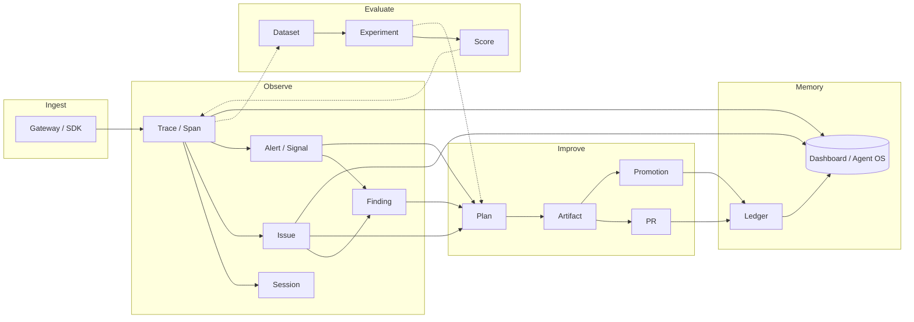
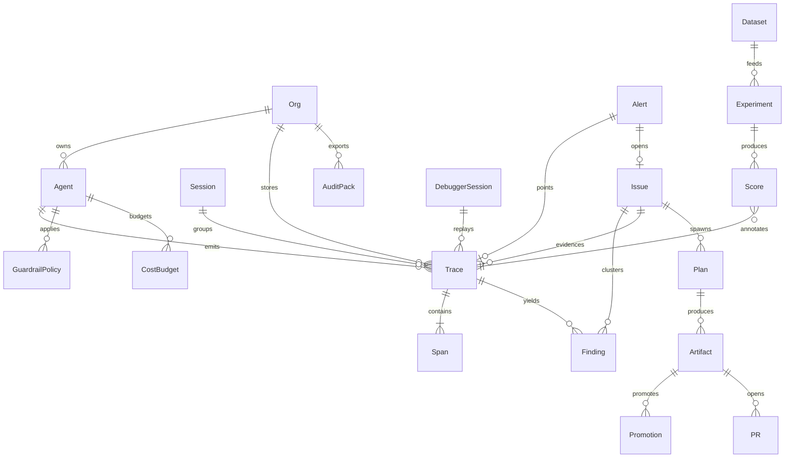
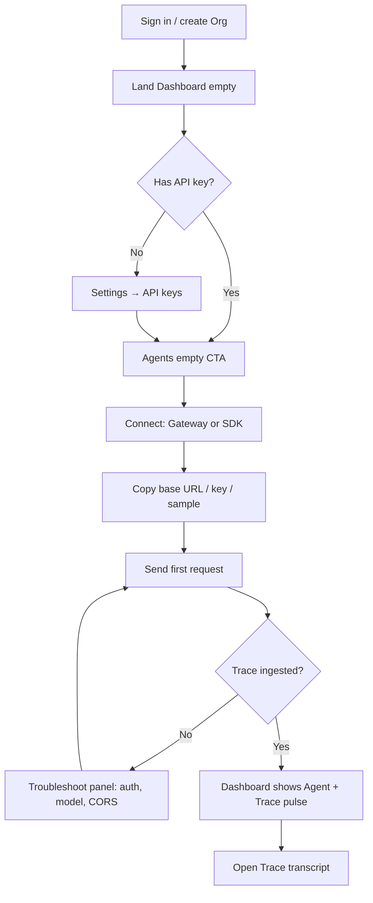

# 01 — Product Bible

> **Status:** Authoritative  
> **Decision date:** 2026-07-21  
> **Companions:** [00-vision.md](./00-vision.md) · [02-information-architecture.md](./02-information-architecture.md)

This document defines **who** the product is for, **what jobs** it owns, the **canonical object model**, and the **closed-loop grammar** engineers implement against. Surface layouts live under `surfaces/`; routes live in `02-information-architecture.md`.

---

## 1. Personas

### 1.1 Primary — Solo AI engineer (tonight)

**Name (working):** Mira  
**Role:** AI / ML engineer, often sole owner of an agent or small agent fleet  
**Context:** Lives in terminal + IDE. Ships OpenAI / Anthropic / Bedrock (or gateway-proxied equivalents). Probably on call or self-on-call for their own agent. Opens Eden because something failed, drifted, got expensive, or a user complained.

**Sophistication:** High. Reads diffs, eval scores, span attributes, HTTP status. Expects honest units (`ms`, `$`, token counts) and trustworthy timestamps (UTC + local display rules).

**Triggers (tonight):**

| Trigger | Immediate need |
|---------|----------------|
| User-facing wrong answer | Find the bad turn in transcript; attribute tool vs model vs prompt |
| Spike in errors / latency | Session/trace filter → issue cluster → evidence |
| Cost surprise | Cost surface scoped to agent; link back to heavy traces |
| Eval regression | Experiment compare → promote or roll back |
| “Did our last fix help?” | Ledger / promotion history for that agent |

**Jobs (owned by primary):**

1. Connect an agent and see live traces the same night.  
2. Read a failing transcript without fighting the UI.  
3. Turn a failure into an Issue (or land on an auto-clustered one).  
4. Start an Improve Plan and leave with an Artifact / PR path.  
5. Replay / time-travel a DebuggerSession when the live path is insufficient.  
6. Ask the Eden AI Agent (`/agent` or bubble) with citations to real traces/issues.

**Pain (product must remove):**

- Clutter and visual wrongness (Round 1 hate list).  
- Dual routes and hub-of-hubs.  
- Agent demoted under Advanced.  
- Observe disconnected from Improve.  
- Mobile unusable for triage.

**Success sentence:**  
*“I found the bad turn, filed/joined the issue, and kicked off a fix PR before I went to sleep.”*

---

### 1.2 Secondary — EM / platform lead (brief)

**Name (working):** Jordan  
**Role:** Engineering manager or platform owner  
**Lens:** Same surfaces; different default questions — cost burn, eval regression rate, org coverage, audit readiness, alert noise.

**Needs:**

- Numbers trustworthy enough for a board or leadership update without re-running math.  
- Org-scoped AuditPack export.  
- Ability to see fleet health without learning a second product.

**Non-needs in v1:**

- Separate manager dashboard product.  
- Analytics hub (users/tools/topics) — **later**.  
- Red-team theater for compliance theater — **killed**.

**Success sentence:**  
*“I can answer cost, failure rate, and whether fixes shipped — from the same Eden the eng uses.”*

---

## 2. Jobs-to-be-done (ranked)

Rank = product priority for v1 must-ship. Higher jobs get chrome, empty states, and closed-loop exits first.

| Rank | Job | Primary surface(s) | Done when |
|------|-----|--------------------|-----------|
| **J1** | Connect agent tonight and see first Trace | Settings (keys/gateway) → Agents connect → Traces | First trace visible; agent appears on Dashboard |
| **J2** | Debug a failing turn in transcript | Traces (mode=transcript) | Root cause span/message identified; shareable URL |
| **J3** | Understand multi-turn Session context | Traces `view=sessions` / Sessions | Session timeline + jump to child traces |
| **J4** | Triage clustered failures | Issues | Issue opened with evidence; status updated |
| **J5** | Act on Alerts / Signals | Alerts | Alert acknowledged or routed to Issue/Trace |
| **J6** | Start Improve from failure | Improve ← Issue/Alert/Trace | Plan created, linked to evidence |
| **J7** | Produce Artifact and open PR | Improve (artifact / PR) | Artifact versioned; PR created or suggestion ready |
| **J8** | Promote / record outcome | Improve → Promotion → Ledger | Promotion recorded; ledger entry for agent |
| **J9** | Run / inspect Evals | Evals | Dataset → experiment → scores on traces/agents |
| **J10** | Control spend | Cost | Budget visible; drill to agent/trace |
| **J11** | Enforce GuardrailPolicy | Guardrails | Policy attached to agent/gateway path; violations observable |
| **J12** | Replay / time-travel | Debugger | DebuggerSession created; compare runs |
| **J13** | Ask Eden AI with citations | `/agent` + bubble | Answer cites Trace/Issue/Artifact IDs |
| **J14** | Export AuditPack | Audit | Pack generated for time range / agent |
| **J15** | Administer workspace | Settings | Members, keys, billing, retention, PII |

**Later (explicitly not ranked into v1 nav):** Prompts registry; Analytics (users/tools/insights).

---

## 3. Core loop

### 3.1 Narrative

Gateway (or SDK) ingests LLM/agent traffic into Eden under an **Agent** identity. The engineer **Observes** via Trace/Session (transcript-first). Diagnosis produces or attaches an **Issue** / **Alert** (**Signal** / **Finding**). Optionally they **Evaluate** with Dataset / Experiment / Score. **Improve** creates a **Plan**, materializes an **Artifact**, then **Promotion** and/or **PR**. Outcomes land in the **Ledger** (institutional memory) and feed Dashboard / Agent health.

### 3.2 Diagram

### 3.3 Loop invariants

1. **Evidence identity travels.** Cross-links preserve `traceId`, `spanId`, `sessionId`, `agentId`, and filter grammar (`pastHours`, `q`, …) per IA deep-link rules.  
2. **Agent is the spine.** Traces, issues, artifacts, promotions, costs, and ledger entries resolve to an Agent whenever identity is known.  
3. **Improve never invents evidence.** Plans cite Issue/Alert/Finding/Experiment.  
4. **PR is a first-class exit.** Not every Plan becomes a PR, but the product grammar always *allows* PR as an outcome.  
5. **Ledger is append-only memory.** Promotions and shipped PRs do not vanish when the queue clears.

---

## 4. Canonical object model

Conventions:

- **Identity:** stable ID shown in UI (copyable); external keys noted.  
- **UI home:** primary page where the object is listed or owned. Detail may be master–detail or `/…/[id]`.  
- **Project?:** optional scoping object — see Org row. If Project is not first-class in v1 backend, treat as future; UI must not invent orphan Project hubs.

| Object | Definition | Identity | Relationships | UI home |
|--------|------------|----------|---------------|---------|
| **Org** | Multi-tenant workspace boundary (Clerk org ↔ Eden org). Billing, members, keys, retention live here. | `orgId` | Has many Agents, Traces, Issues, …; owns Settings & Audit | Settings (org tabs); implicit on all pages |
| **Project?** | Optional sub-org partition for large tenants (env, product line). **v1:** may be absent or soft-attribute only — do not ship a Project hub. | `projectId?` | Child of Org; Agents may tag project | Deferred — filter facet later, not nav |
| **Agent** | First-class product object: a deployed AI agent / app identity that emits traffic and owns improve history. | `agentId` (slug or UUID; display name required) | Emits Traces/Sessions; owns Issues, Artifacts, Promotions, CostBudget attachment, GuardrailPolicy attachment, Ledger | `/agents`, `/agents/[id]`; Dashboard agent OS |
| **Trace** | One end-to-end execution graph (root + spans) for a request/run. | `traceId` | Belongs to Org (+ Agent when known); contains Spans; may belong to Session; scored by Scores; evidence for Issues/Findings | `/traces` (detail via `?traceId=`) |
| **Span** | Node in a Trace (LLM call, tool, retrieval, agent step, …). | `spanId` (+ `traceId`) | Child of Trace; parent/child span tree | Trace reader modes (`tree`, `timeline`, `meta`) |
| **Session** | Multi-trace conversation or multi-turn agent thread. | `sessionId` | Contains Traces; scoped to Agent/Org | `/traces?view=sessions` (canonical); `/sessions` redirects |
| **Issue** | Clustered or manually filed failure / incident unit with status workflow. | `issueId` | Evidence → Traces/Spans/Sessions; may spawn Plan; may group Findings | `/issues`, `/issues/[id]` |
| **Alert / Signal** | Alert = fired notification from a rule/detector. Signal = diagnostic detector output (Laminar-style), may feed Alerts or Issues. | `alertId` / `signalId` | Rule in Settings or Alerts; points at Trace/Issue/Agent | `/alerts` (`tab=rules\|signals\|inbox`) |
| **Finding** | Atomic diagnostic assertion (e.g. “tool X failed”, “hallucination heuristic”). | `findingId` | Attached to Trace/Span/Issue; may roll into Issue | Embedded in Issue/Trace diagnosis panels — not a top-level nav |
| **Dataset** | Versioned set of examples for eval / labeling. | `datasetId` | Feeds Experiments; may be built from Traces | `/evals?tab=datasets` (+ `/evals/datasets/[id]` if needed) |
| **Experiment** | Eval run over a Dataset (and optional playground config). | `experimentId` | Produces Scores; may inform Plan | `/evals?tab=experiments` |
| **Plan** | Improve work unit: proposed fix path tied to evidence. | `planId` | From Issue/Alert/Finding/Experiment; produces Artifacts | `/improve?tab=plans` / `/improve/plans/[id]` |
| **Artifact** | Versioned runtime fix (prompt patch, config, code suggestion payload, …) with evidence gate. | `artifactId` (+ version) | From Plan; promotes via Promotion; may open PR | `/improve?tab=artifacts` (list); detail under Improve |
| **Promotion** | Recorded decision to promote an Artifact (or related change) toward production. | `promotionId` | Artifact → Agent; lands in Ledger | `/improve?tab=promotions` (and Ledger mode) |
| **PR** | Pull request (or PR suggestion) as Improve outcome — GitHub/Git provider linked. | `prId` / provider URL | Linked to Artifact/Plan/Agent | Improve plan/artifact detail; external provider |
| **Score** | Eval or online score attached to Trace/Span/Experiment item. | `scoreId` | Experiment or online scorer → Trace/Span | Trace `mode=scores`; Evals |
| **GuardrailPolicy** | Declarative safety/policy rules applied at gateway/agent. **Not** a red-team campaign. | `policyId` | Attached to Agent/Org/gateway route; violations → Finding/Alert | `/guardrails` |
| **CostBudget** | Spend limit / budget policy and observed cost rollups. | `budgetId` | Org and/or Agent scoped | `/cost` |
| **DebuggerSession** | Multi-run debug / replay / time-travel workspace. | `debuggerSessionId` | References Traces/Runs; compare timeline | `/debugger`, `/debugger/[id]` |
| **AuditPack** | Exportable compliance / chain-verified audit bundle. | `auditPackId` | Org (+ optional Agent, time range) | `/audit` |
| **Ledger** *(view/collection)* | Institutional memory of promotions, shipped PRs, and agent change history — not a separate domain object type in all backends, but a **product noun**. | entries keyed by agent + time | Reads Promotion/PR/Artifact history | `/improve?tab=ledger` (canonical); agent ledger tab |

### 4.1 Identity rules

- Prefer **camelCase query keys** in URLs (`traceId`, `agentId`) with read-time aliases for snake_case legacy (`trace_id`).  
- Display IDs in mono; always offer copy.  
- Never show raw internal DB integers as the only identity.

### 4.2 Relationship diagram (compact)

---

## 5. Gateway’s role in the product story

The gateway is not a settings footnote. It is **how truth enters Eden**.

| Story beat | Product meaning |
|------------|-----------------|
| **Day 0** | Empty Dashboard / Agents first-run: “Point your OpenAI base URL at Eden” (or SDK drop-in). |
| **Identity** | Gateway keys + agent headers/metadata bind traffic to **Agent**. |
| **Observe** | Every proxied call becomes Span/Trace material — transcript-first. |
| **Guardrails** | Policies can enforce at the edge (Gateway) without a red-team UI. |
| **Cost** | Token/cost attribution follows gateway-normalized usage. |
| **Improve** | Fixes that change prompts/models/tools are validated against gateway-captured traffic (replay / change-impact as Improve capabilities, not separate products). |

**Settings home for gateway:** `/settings?tab=gateway` (+ API keys tab).  
**Connect UX home:** `/agents/connect` (or Agents empty state CTA) — not a marketing tour.

SDK path is equal-class: first-run must offer **Gateway or SDK**, then “send a first trace,” matching docs quickstart (external docs site).

---

## 6. Closed-loop grammar (max-click contracts)

Contracts are **upper bounds** for the happy path for a logged-in member with an existing Agent and evidence. Violations are IA bugs.

| # | Flow | Max clicks / actions | Required URL preservation |
|---|------|----------------------|---------------------------|
| **C1** | Dashboard diagnosis chip → Trace or Issue | **1** | Land with `traceId` or `issueId` set |
| **C2** | Trace → create/link Issue | **2** | `traceId`, `spanId?`, `agentId?` on Issue create context |
| **C3** | Issue → open primary evidence Trace | **1** | Preserve `pastHours`, `q`, `agentId` when present |
| **C4** | Issue → Create Improve Plan | **2** | Plan form prefilled with `issueId` + evidence IDs |
| **C5** | Alert → Trace or Issue | **2** | `alertId` retained in back-nav / related strip |
| **C6** | Plan → generate Artifact | **2** | Stay in Improve; `planId` in URL |
| **C7** | Artifact → open PR flow | **3** | Artifact identity + provider deep link |
| **C8** | Artifact → Promote | **2** | Creates Promotion; visible in Ledger |
| **C9** | Trace → open DebuggerSession (replay/time-travel) | **2** | Seed session with `traceId` |
| **C10** | Any page → AI bubble open with page context | **1** | Context payload includes current object IDs |
| **C11** | AI citation → navigate to Trace/Issue | **1** | Opens canonical URL with IDs |
| **C12** | Agents list → Agent detail | **1** | `/agents/[id]` |

**Non-negotiable:** Back navigation and breadcrumbs must return to the **list with selection state** where master–detail applies (do not unmount list on select at ≥1280).

**Explicit dead-ends allowed:** “Not enough evidence to plan” — must say so; do not fake a Plan.

---

## 7. Empty / first-run journey (connect agent tonight)

**Goal:** Solo eng, new org, zero traces → first Trace visible and Agent on Dashboard **the same night**.

### 7.1 Stages

### 7.2 Empty-state copy rules

- One primary CTA per empty surface.  
- No feature tourism (“Explore Analytics”).  
- Point to **external docs quickstart** as secondary link.  
- German + English keys required.

### 7.3 First-run checklist (product)

| Step | Surface | Acceptance |
|------|---------|------------|
| 1 | Auth | Org exists |
| 2 | API keys | At least one key creatable/copyable |
| 3 | Gateway tab | Base URL + auth instructions visible |
| 4 | Agents | Connect flow completable without Advanced nav |
| 5 | Traces | Empty state explains waiting vs error |
| 6 | Dashboard | Switches from empty → agent OS when first trace arrives (live or refresh) |
| 7 | AI bubble | Available but does not block first-run; may prompt “connect agent first” |

### 7.4 Anti-patterns

- Forced multi-step “product tour” modals before keys.  
- Requiring Eval setup before Observe.  
- Requiring GitHub before seeing traces.  
- Red-team or synthetic attack as onboarding.

---

## 8. Permissions sketch

Three portal roles (map to Clerk org roles in implementation). Exact capability matrix may refine in engineering docs; this is the product sketch.

| Capability | Viewer | Member | Admin |
|------------|--------|--------|-------|
| View Dashboard, Agents list, Traces, Sessions, Issues, Alerts, Evals, Cost readouts, Audit read | ✓ | ✓ | ✓ |
| Use AI Agent / bubble (org data) | ✓ | ✓ | ✓ |
| Create/update Issue status, acknowledge Alerts | read-only comments? **Viewer: read**; **Member: write** | ✓ write | ✓ |
| Create Plans, Artifacts, Promotions | | ✓ | ✓ |
| Open PR / connect git | | ✓ | ✓ |
| Run Experiments, edit Datasets | | ✓ | ✓ |
| Edit GuardrailPolicy | | ✓ (propose?) / **Admin: mutate** — default: **Member edit policies**, Admin delete org-wide | ✓ |
| CostBudget create/edit | | | ✓ |
| Settings: members, billing, keys, gateway, retention, PII, SCIM | | limited (own account) | ✓ |
| API keys create/revoke | | ✓ if granted | ✓ |
| AuditPack export | ✓ if policy allows | ✓ | ✓ |
| Delete Agent / dangerous ops | | | ✓ |
| DebuggerSession create | | ✓ | ✓ |

**Viewer** = read + AI ask; no mutate improve/eval write.  
**Member** = day-to-day eng (Mira).  
**Admin** = Jordan + billing/security.

UI must hide primary mutate CTAs for Viewer (not merely fail on API).

---

## 9. Glossary

| Term | Meaning in Eden |
|------|-----------------|
| **Agent** | First-class monitored AI system identity — not the Eden AI assistant. |
| **Eden AI / Agent page** | Product assistant at `/agent` + floating bubble; cites org data. |
| **Gateway** | OpenAI-compatible HTTP proxy that captures traffic into Eden. |
| **Transcript** | Default Trace canvas: message/tool stream, Laminar-style. |
| **Signal** | Detector output / diagnostic; lives under Alerts hub (`tab=signals`). |
| **Finding** | Atomic diagnostic fact attached to evidence. |
| **Issue** | Workflow object for clustered or filed failures. |
| **Alert** | Fired notification instance from a rule. |
| **Plan** | Improve work unit linking evidence → fix path. |
| **Artifact** | Versioned fix payload with evidence gating. |
| **Promotion** | Decision record moving an Artifact toward production. |
| **PR** | Pull request / suggestion as Improve outcome. |
| **Ledger** | Historical memory of promotions/PRs/changes per agent. |
| **Score** | Eval or online metric on a Trace/Span/item. |
| **GuardrailPolicy** | Policy object — **not** red-team. |
| **DebuggerSession** | Replay / compare / time-travel workspace. |
| **AuditPack** | Compliance export bundle. |
| **Master–detail** | List + detail without unmounting list; URL holds selection. |
| **Chrome budget** | ≤2 bands; ≤5 primary toolbar actions. |
| **Core leaf** | Sidebar item counting toward ≤12 cap (not Advanced/later). |
| **Mode** | Trace reader presentation: `transcript \| tree \| timeline \| meta \| scores`. |
| **View (hub)** | Traces hub lens: `traces \| spans \| sessions` — not saved-view id. |
| **viewId** | Saved table view id — never overload `view`. |
| **Closed loop** | failure → artifact → PR (Wedge A). |
| **Dual wedge** | Closed loop **and** gateway+observe+improve unity. |
| **Teardown A** | Delete old UI → stub + docs until rebuild. |
| **Later** | Prompts registry; Analytics — not v1 nav. |
| **Kill** | Red-team UI, clutter, hub-of-hubs, dual routes, decorative cards, purple glow. |

---

## 10. Cross-links

- Vision & success: [00-vision.md](./00-vision.md)  
- Routes, nav, redirects: [02-information-architecture.md](./02-information-architecture.md)  
- Frozen interview answers: [04-interview-log.md](./04-interview-log.md)

---

*End of 01-product-bible.md*
