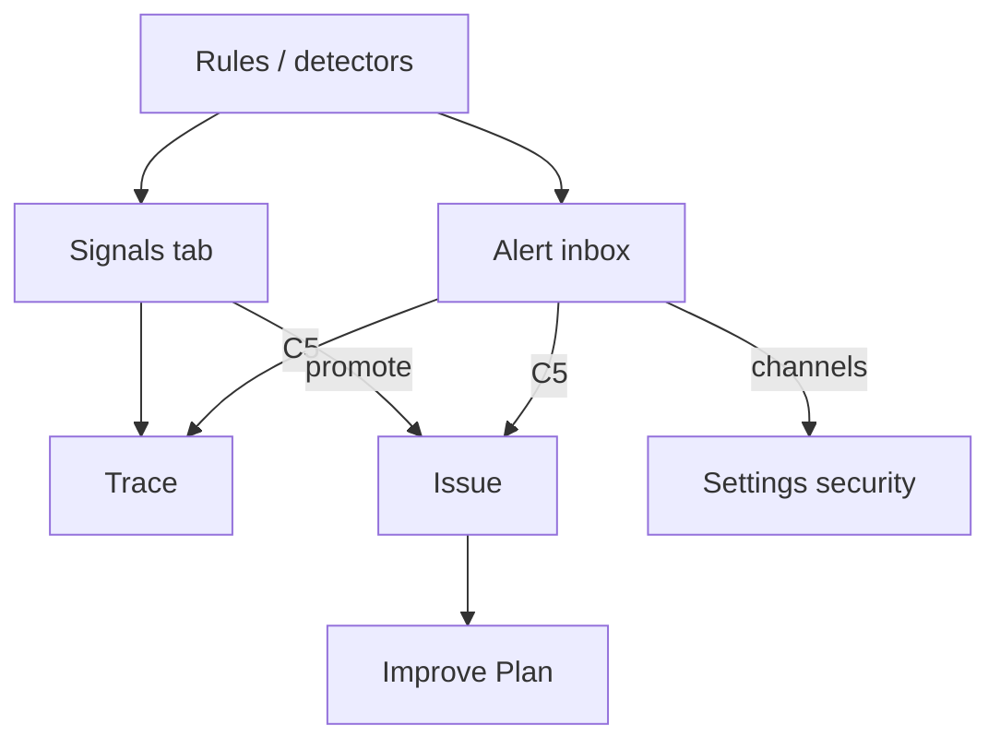

# Surface: Alerts

> **Route:** `/alerts`  
> **IA leaf:** Observe → Alerts (core #5)  
> **Primary objects:** Alert · Signal · (rules)  
> **Decision date:** 2026-07-21  
> **North star:** Laminar Signals callout + detector fire inbox; TraceRoot detectors — **policies/rules, not red-team**  
> **Companions:** bible Alert/Signal · IA `tab=inbox|rules|signals` · competitive §1.4 · §2.2

Alerts hub = **inbox of fired notifications**, **detector/signal stream**, and **rules**. Laminar Signals brand box is remapped to Eden tonal diagnosis — not orange/blue marketing panels.

`/signals` redirects to `/alerts?tab=signals`.

---

## 1. Purpose

**One decision this page owns:**  
*What fired, is it noise or real, and do I open a Trace/Issue or change the rule?*

Alerts own delivery/detection workflow. Issues own multi-occurrence clustering workflow. Traces own reading. Overlap is intentional via cross-links; do not merge into one leaf.

---

## 2. Primary user + JTBD

| | |
|--|--|
| **Primary** | Mira (J5 act on Alerts/Signals) |
| **Secondary** | Jordan (noise rate, channels) |
| **Contracts** | C5 Alert→Trace/Issue ≤2; C1 from Dashboard chips |
| **Done when** | Alert acknowledged or routed; Signal triaged into Issue/Trace; rule editable without red-team UI |

---

## 3. URL + query grammar

### 3.1 Hub tabs

| `tab` | Purpose |
|-------|---------|
| `inbox` | Fired Alert instances (default) |
| `rules` | Alert / detector rules CRUD |
| `signals` | Diagnostic detector outputs (Laminar Signals analogue) — may feed Alerts or Issues |

### 3.2 Selection & filters

| Param | Meaning |
|-------|---------|
| `alertId` | Select alert in inbox master–detail |
| `signalId` | Select signal in signals tab |
| `ruleId` | Select/edit rule |
| `q` | Search |
| `filter` | status, severity, agent |
| `agentId` | Scope |
| `pastHours` / `from`/`to` | Window |
| `issueId` | Cross-link highlight |

### 3.3 Redirects

| Old | New |
|-----|-----|
| `/signals` | `/alerts?tab=signals` |

Channels configuration may live in Settings `tab=security` — Alerts rules link out; do not rebuild Settings inside Alerts.

### 3.4 Examples

```
/alerts
/alerts?tab=inbox&alertId=al_1
/alerts?tab=signals
/alerts?tab=rules&ruleId=rule_err_rate
/alerts?agentId=agent_support&pastHours=24
```

### 3.5 Cmd+K

Alerts · Alert rules · Signals destinations per IA §6.

Breadcrumb: `Observe / Alerts`.

---

## 4. Layout

### 4.1 Desktop ≥1280 — Inbox

```
┌─ Observe / Alerts ─────────────────────────────────────────────────┐
│ [Inbox | Rules | Signals] · Search · Status · Agent · Time · ⋯     │
├──────────────────────────┬─────────────────────────────────────────┤
│ MASTER alerts            │ DETAIL                                  │
│ firedAt · severity ·     │ Title · StatusBadge · rule name         │
│ title · agent · state    │ Diagnosis strip (why it fired)          │
│                          │ Pointers: Trace / Issue / Agent         │
│                          │ CTA: Open trace | Open issue | Ack      │
│                          │ Secondary: Create Issue · Silence · ⋯   │
└──────────────────────────┴─────────────────────────────────────────┘
```

### 4.2 Signals tab

Laminar-style diagnostic stream:

```
MASTER signals                 DETAIL
kind · message · agent · time  Finding body · confidence · evidence
                               [Open trace] [Create / attach Issue]
                               [Create eval from cluster] when clustered
```

Signals may be noisier than Issues; UX prioritizes **evidence jump** and **promote to Issue**.

### 4.3 Rules tab

```
MASTER rules                   DETAIL / editor
name · enabled · type ·        Form: condition, threshold, window,
channel summary                severity, agent scope, channels
                               CTA: Save (accent) · Test (secondary)
```

**No red-team tab. No attack library. No adversarial campaign wizard.**

Guardrail **policies** remain on `/guardrails` — Alerts rules are detectors/notifications, not policy CRUD duplication. Cross-link if a rule references a policy.

### 4.4 Tablet / mobile

List → Sheet detail. Alerts reachable from More sheet (not bottom-five). Rules editor: single column; Advanced thresholds in Sheet. Touch ≥44px.

### 4.5 Wireframes

**ASCII — inbox**

```
Observe / Alerts          [Inbox|Rules|Signals]
INBOX                            DETAIL
14:02 ● High  Error rate spike   Error rate spike · support-bot
      support-bot · fired        Rule: error_rate_5m > 3%
14:00 ○ Med   Cost burn          Fired 14:02 · Status: Open
13:55 ○ Low   Latency p95        Diagnosis: 12 errors in 5m
                                 Evidence: tr_ab12 · iss_12 (cluster)
                                 [Open trace] [Ack] [Create Issue]
```

**ASCII — signals**

```
SIGNALS                          SIGNAL
tool_timeout  search failed ×   tool_timeout
schema_drift  refund fields     Evidence spans…
halluc_heur   citation miss     [Attach to Issue iss_12] [Open trace]
```

**Mermaid**



---

## 5. Chrome budget

| Band | Contents |
|------|----------|
| 1 | Breadcrumb Alerts · Ask AI · Notifications (may deep-link here) |
| 2 | Tabs Inbox/Rules/Signals · Search · ≤2 filters · Overflow |

≤5 primary actions. Inbox detail: one solid CTA — **Open trace** or **Ack** depending on state (prefer Open trace when unacked with evidence; Ack when already viewed). Rules: Save is accent.

LIVE opt-in under Display/Overflow for inbox append — not first-paint primary.

---

## 6. States

### 6.1 Empty / first-run

| Tab | Empty treatment |
|-----|-----------------|
| Inbox | No fired alerts. CTA: **Configure rules** → `tab=rules` or Open Traces. If zero agents: Connect. |
| Signals | No signals yet. Explain detectors run on ingest. CTA: Traces / Rules. |
| Rules | No rules. CTA: **Create rule** (Member+). Template list ≤3 (error rate, latency, cost) — not a marketplace. |

### 6.2 Loading

Tab-appropriate skeletons.

### 6.3 Error

Retry. Rule save error: inline field errors, no false success toast. Channel misconfig: link Settings.

### 6.4 Filtered-empty

Data exists; filters/tab hide it. CTA Clear filters / View all statuses. Distinct from first-run.

### 6.5 Populated

Inbox/signals lists with severity + state. Evidence MetricInline when pointing at traces (latency·tokens·$ on evidence row).

### 6.6 Live

`live=1` or Display live: new alerts/signals append. Aria-live polite. Phosphor/`--terminal` indicator only.

### 6.7 Ack / silenced

Detail shows state. Silenced rule: Badge + Resume action. Do not delete history on silence.

---

## 7. Components (kit only)

ResourcePageShell · DetailPanelShell · Tabs underline · DataTable · QueryState · StatusBadge · Panel · Button · Input · Select · Dialog · Sheet · Tag · CodeChip · MetricInline · Wizard (optional create-rule).

Ban: red-team UI; parallel `/signals` app; Helicone card spam; decorative Signal “insight gallery” without evidence links; purple glow.

---

## 8. Keyboard map

| Key | Action |
|-----|--------|
| `⌘K` | Palette (Alerts, Rules, Signals) |
| `/` | Search |
| `j`/`k` | Move list |
| `Enter` | Open detail |
| `Esc` | Clear `alertId`/`signalId`/`ruleId` |
| `t` | Open Trace evidence |
| `i` | Open / create Issue |
| `a` | Acknowledge alert |
| `1`/`2`/`3` | Tabs inbox/rules/signals |

---

## 9. Closed-loop exits

| From | To | Cap | Notes |
|------|----|-----|-------|
| Alert → Trace | `/traces?traceId=&alertId=` | **≤2** C5 | preserve filters |
| Alert → Issue | `/issues/[id]` or create | **≤2** C5 | |
| Signal → Trace | `/traces?…` | 1 | |
| Signal → Issue | create/attach | 2 | cluster promote |
| Signal/Issue cluster → Evals | `/evals?tab=datasets` | 2 | Laminar steal |
| Alert → Plan | via Issue preferred | 2–3 | don’t skip evidence |
| Rules → Settings channels | `/settings?tab=security` | 1 | |
| Agent chip | `/agents/[id]` | 1 | |
| Ask AI | context alert/signal | 1 | |

---

## 10. Anti-patterns (banned)

- Red-team / adversarial test center / attack libraries  
- Top-level `/signals` without redirect to Alerts  
- Always-on LIVE primary control  
- Merging Alerts into Issues as one undifferentiated dump without tabs  
- Fake “self-healing” success toasts on Ack  
- Building full TraceRoot alert product chrome clone  
- Guardrails redteam tab links  
- Card collage; 9–10px chrome; Laminar orange brand box  

---

## 11. Acceptance checklist

- [ ] `/alerts` core leaf; tabs `inbox|rules|signals`  
- [ ] `/signals` → `/alerts?tab=signals`  
- [ ] Master–detail inbox/signals; rules editor usable  
- [ ] C5 Alert→Trace/Issue ≤2 clicks with ids  
- [ ] No red-team surfaces or tabs  
- [ ] States per tab: empty, loading, error, filtered-empty, populated, live, ack/silenced  
- [ ] Chrome ≤2 bands; ≤5 toolbar actions; one accent CTA  
- [ ] Channels deep-link Settings; not duplicated sprawl  
- [ ] Cluster/signal → dataset exit available  
- [ ] Mobile via More; Sheet detail; ≥44px  
- [ ] i18n en/de; AA contrast; reduced motion  
- [ ] Dark-terminal tokens only  

---

## 12. Field contracts

**Alert:** `alertId`, `ruleId`, `title`, `severity`, `status` (`open|acked|silenced|resolved`), `firedAt`, `agentId?`, `traceId?`, `issueId?`, `message`, `payload` (diag summary).

**Signal:** `signalId`, `kind`, `message`, `severity`, `createdAt`, `agentId?`, `traceId?`, `spanId?`, `clusterIssueId?`, `confidence?`.

**Rule:** `ruleId`, `name`, `enabled`, `type` (`threshold|detector|composite`), `condition`, `window`, `severity`, `agentScope`, `channelRefs[]`.

---

*End of surfaces/alerts.md*
