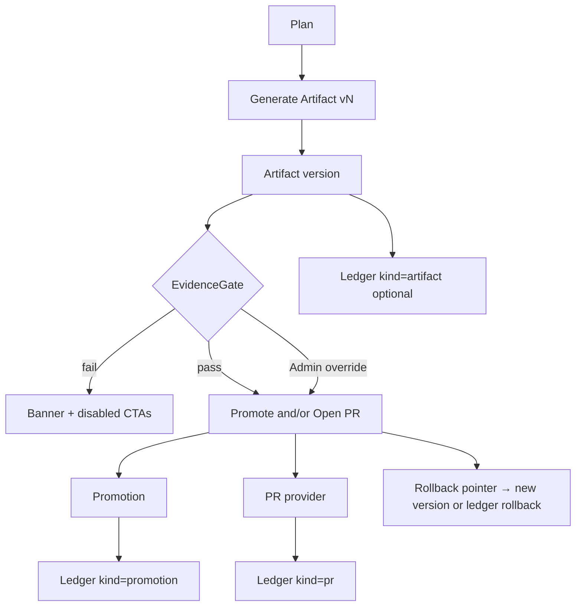

# Surface: Artifacts

> **Status:** Authoritative surface contract  
> **Decision date:** 2026-07-21  
> **Phase:** P5 Improve (artifacts tab + agent peek + plan panel)  
> **Companions:** [improve.md](./improve.md) · [ledger.md](./ledger.md) · [../01-product-bible.md](../01-product-bible.md) · [../02-information-architecture.md](../02-information-architecture.md) · [../design/DESIGN-SYSTEM-V2.md](../design/DESIGN-SYSTEM-V2.md) · [../03-competitive-synthesis.md](../03-competitive-synthesis.md)  
> **Critical:** Artifacts are **not** a core sidebar leaf. Canonical host: `/improve?tab=artifacts`. Versioned evidence-gated runtime fixes. Outcomes: **Promote → Ledger** and/or **Open PR**.

---

## 1. Purpose

**One decision this page owns:** Which versioned fix payload (Artifact) do we ship next — and is EvidenceGate satisfied for Promote and/or PR?

An **Artifact** is a versioned runtime fix: prompt patch, config delta, code suggestion, tool policy, model/routing change, or other Improve payload. It is produced by a **Plan**, gated by evidence, and exits via **Promotion → Ledger** and/or **PR**.

Artifacts are **not** Observe, **not** Evals datasets, **not** Prompt registry (Later), and **not** Cost advisor (link out only). Improve hosts the tab; do not duplicate hub chrome.

---

## 2. Primary user + JTBD

| | |
|--|--|
| **Primary** | Mira — “I have a Plan; I need a versioned fix I can promote or PR before sleep.” |
| **Secondary** | Jordan — “Which artifact versions shipped? What’s blocked on evidence?” |
| **JTBD** | J7 Artifact + PR · J8 Promote → Ledger |
| **Success sentence** | Artifact version selected → EvidenceGate pass → Promote and/or Open PR → Ledger entry visible |
| **Done when** | Version table + detail show diff, linked Plan/evidence, gate status; Promote (C8 ≤2) and Open PR (C7 ≤3) work without false success toasts |

**Loop position (Eden nouns)**

```
Plan
  → Artifact vN (versioned fix payload)
    → Show Code / Diff / Git
      → Promote  AND/OR  Open PR
        → Ledger entry (kind=promotion | pr | artifact)
```

---

## 3. URL + query grammar

### 3.1 Canonical entry points

| Route | Role |
|-------|------|
| `/improve?tab=artifacts` | **Canonical** org/agent-filterable artifact list + detail |
| `/improve/plans/[id]?panel=artifacts` | Plan-scoped artifact versions (same domain components) |
| `/agents/[id]` artifacts peek | Thin strip/links → canonical tab with `agentId` locked in query |
| `/artifacts` | **Redirect** → `/improve?tab=artifacts` |
| `/artifacts/:path*` | **Redirect** → `/improve?tab=artifacts` (map id → `artifactId` when recognizable) |
| `/agents/:id/artifacts` | **Redirect** → `/improve?tab=artifacts&agentId=:id` |

### 3.2 Query params

| Param | Values | Notes |
|-------|--------|-------|
| `tab=artifacts` | required on Improve hub | |
| `artifactId` | id | Master–detail selection (lineage root or concrete version — see §12) |
| `version` | semver-ish / integer / opaque | Pin specific version when `artifactId` is lineage |
| `planId` | id | Filter / focus artifacts from plan |
| `agentId` | id | Scope; locked when arriving from agent redirect |
| `status` | `draft` \| `ready` \| `gated` \| `promoted` \| `pr_open` \| `pr_merged` \| `rolled_back` \| `failed` | |
| `kind` | `prompt` \| `config` \| `code` \| `tool_policy` \| `model` \| `other` | Payload type filter |
| `gate` | `pass` \| `fail` \| `override` \| `unknown` | EvidenceGate lens |
| `issueId` / `experimentId` / `alertId` | id | Evidence filters |
| `q` / `filter` / `viewId` | | Search / structured / saved view |
| `pastHours` / `from` / `to` | | Time window |
| `compare` | `versionA,versionB` | Optional diff pair in detail |

### 3.3 Example URLs

```
/improve?tab=artifacts
/improve?tab=artifacts&agentId=agent_support
/improve?tab=artifacts&artifactId=art_3
/improve?tab=artifacts&artifactId=art_3&version=2
/improve?tab=artifacts&planId=pl_91&status=ready
/improve?tab=artifacts&gate=fail
/improve?tab=artifacts&artifactId=art_3&compare=1,2
/improve/plans/pl_91?panel=artifacts
/artifacts  →  /improve?tab=artifacts
/agents/agent_support/artifacts  →  /improve?tab=artifacts&agentId=agent_support
```

### 3.4 Breadcrumb

| Entry | Crumb |
|-------|-------|
| Improve tab | `Improve` (header title region may say Artifacts) |
| Plan panel | `Improve / Plans / {title\|id}` (+ Artifacts panel active) |
| From agent redirect | Same Improve crumb; `agentId` in URL only |

Do not invent `Improve / Artifacts / {id}` as a fake third core leaf; detail is master–detail under the tab.

---

## 4. Layout diagrams

### 4.1 Desktop ≥1280 — Improve `tab=artifacts`

```
┌─ Improve · tab=artifacts ───────────────────────────────────────────────┐
│ PageHeader inherits Improve; tab=Artifacts active                       │
│ Toolbar: Views · Search · Kind · Gate · Status · Display · ⋯            │
│ (≤5 primary: Views, Search, Filter, Display, Generate/New — rest Overflow)│
├──────────────────────────────┬──────────────────────────────────────────┤
│ Version / lineage list (~50%)│ Artifact detail (~50%)                   │
│ row: kind · title · vN       │ Header: title · StatusBadge · version    │
│ agent · plan · gate · age    │ EvidenceGateBanner (pass/fail + reason)  │
│                              │ Diff vs previous (Formatted / Unified)   │
│                              │ Payload summary · files / paths          │
│                              │ Links: Plan · Issue · Experiment · Traces│
│                              │ Outcomes: Promote | Open PR | → /cost    │
│                              │ ONE solid CTA = next required step       │
│                              │ Related: Promotions · Ledger · Queue     │
└──────────────────────────────┴──────────────────────────────────────────┘
```

### 4.2 Row anatomy (ASCII)

```
│ art_3  v2  prompt   Support Bot   “Refund tool schema fix”              │
│        gate:pass    plan pl_91    ready · 2h ago · mira                 │
│ art_3  v1  prompt   Support Bot   “Refund tool schema fix”              │
│        gate:fail    plan pl_91    draft · yesterday                     │
```

Hairline separators; **no card-per-row** spam. Kind + gate via StatusBadge / Tag — not color alone. Group by lineage (`artifactId`) with version expand, or flat version rows — pick one table mode under Display; default = latest version per lineage + expand for history.

### 4.3 Plan detail `panel=artifacts`

```
┌─ /improve/plans/[id]?panel=artifacts ───────────────────────────────────┐
│ Same ArtifactVersionTable + detail inspector as hub tab                 │
│ Scoped to planId; Generate artifact CTA when Member+                    │
│ Promote / Open PR still EvidenceGate-bound                              │
└─────────────────────────────────────────────────────────────────────────┘
```

### 4.4 Agent peek (not a second product)

```
Agent home: “Artifacts” strip — last N versions, status chips
CTA: View all → /improve?tab=artifacts&agentId=
Never embed full Improve hub inside Agent detail
```

### 4.5 Mobile

```
Tabs horizontal scroll (Improve)
Artifacts full-width list → Sheet detail
EvidenceGateBanner sticky under Sheet header
Primary CTA sticky in Sheet footer (one only)
≥44px rows; Kind/Gate/Status in Overflow filters
FAB Ask AI clears bottom nav when open
```

### 4.6 Tablet (768–1279)

```
Collapsible split or list→push detail
URL still holds artifactId; Esc returns to list without wiping filters
Toolbar collapses to Search + Filter + Overflow
```

### 4.7 Mermaid — write / exit path



### 4.8 ASCII — outcome triad on detail (equal weight UI)

```
┌─────────────────────────────────────────────────────────┐
│  Outcomes (first-class — not buried menus)              │
│  ┌─────────────┐  ┌──────────────┐  ┌────────────────┐  │
│  │ Promote     │  │ Optimization │  │ Pull request   │  │
│  │ → Ledger    │  │ → /cost?…    │  │ Create / view  │  │
│  │ (gated)     │  │ (link out)   │  │ (gated + git)  │  │
│  └─────────────┘  └──────────────┘  └────────────────┘  │
│  One solid CTA = next required step for THIS version    │
└─────────────────────────────────────────────────────────┘
```

---

## 5. Chrome budget

| Context | Budget |
|---------|--------|
| As Improve tab | Shares Improve ≤2 bands; pane toolbar ≤5 primary actions |
| As Plan `panel=artifacts` | Plan page chrome; no second Improve hub tabs inside panel |
| As Agent peek | Links + chips only — **no** nested Artifacts router |
| Primary CTA | One solid: `Generate artifact` **or** `Promote` **or** `Open PR` **or** `Fix evidence` — never all solid |
| Related strip | Plan · Issue · Promotions · Ledger · Traces · Cost — **links only** |

Toolbar primary set (hub): Views · Search · Filter · Display · context CTA. Kind / Gate / Status chips count as Filter/Display, not a third band.

---

## 6. States

| State | Copy / behavior |
|-------|-----------------|
| **Empty / first-run** | “No artifacts yet.” CTA: `Open Improve queue` or `Create plan from issue` — not feature tourism; explain artifacts come from Plans |
| **Loading** | Skeleton list + detail |
| **Error** | Retry; preserve `artifactId` / filters in URL |
| **Filtered-empty** | Clear filters / widen time / clear gate lens |
| **Populated** | Master–detail ≥1280 |
| **Live** | Optional status updates when PR checks change — Display opt-in; polite live region |
| **EvidenceGate fail** | Banner with reason; Promote/PR disabled; optional Admin override path |
| **EvidenceGate pass** | Enable Promote / Open PR per permissions + git connection |
| **Generating** | Version row `in_progress`; detail shows progress; do not fake completed version |
| **Blocked / no plan** | Cannot invent artifact without Plan (or audited manual create with warning) |
| **Git disconnected** | Open PR disabled with “Connect git” → Settings/Improve connect flow |
| **Viewer** | Read-only; mutate CTAs hidden |

**Invariant:** Deleting/clearing Improve queue must **not** delete Artifact versions or Ledger history (append-only / versioned product rule). Rollback = new pointer or new version + ledger entry — not silent rewrite.

---

## 7. Components used (kit only)

| Kit | Use |
|-----|-----|
| `PageHeader`, `Tabs` underline | Hosted under Improve |
| `ResourcePageShell`, `DetailPanelShell` | List + inspector |
| `DataTable`, `QueryState`, `QueryFilterBar`, `ViewsMenu` | Required |
| `Badge` / `StatusBadge` / `Tag` | kind, status, gate |
| `Button` | One `default` CTA |
| `Dialog` | Promote gate confirm, discard draft, Admin override reason |
| `Sheet` | Mobile detail |
| `Panel` | Detail grouping |
| `MetricInline` | Impact / score deltas when present |
| `CodeChip` | artifactId, version, commit SHAs, planId |
| `CommandPalette` | Artifacts, Promote, Open PR, Generate |

**Domain (`components/improve/` shared):** `ArtifactVersionTable`, `ArtifactDetail`, `ArtifactDiffPane`, `EvidenceGateBanner`, `OutcomeTriad`, `ShowCodePanel` (read/write as allowed), `RelatedStrip`, `PromoteConfirmDialog`, `PrOutcomeCard`.

**One implementation** imported by Improve tab, Plan `panel=artifacts`, and Agent peek (peek = summary only).

---

## 8. Keyboard map

| Key | Action |
|-----|--------|
| `⌘K` | Palette → Artifacts / Promote / Open PR |
| `⌘J` | Ask AI with artifact/plan context |
| `/` | Focus search |
| `↑` `↓` / `Enter` | Select / open detail |
| `Esc` | Clear `artifactId` / close Sheet; keep filters |
| `g` then `a` | (optional chord) Jump Improve artifacts tab — or rely on palette |
| `v` | Focus version list / expand lineage |
| `d` | Toggle Diff Formatted ↔ Unified |
| `p` | Open PR flow when enabled |
| `Shift+P` | Promote when EvidenceGate passes |
| `o` | Open linked Plan |
| `e` | Focus evidence links / gate banner |
| `c` | Focus Code / Diff pane |
| `n` | Generate artifact (Member+, when Plan context exists) |

Improve hub tab keys `1`–`6` still switch queue…history when focus is on hub chrome; within Artifacts pane, list navigation takes precedence.

---

## 9. Closed-loop exits

| Flow | Max | Contract |
|------|-----|----------|
| Plan → Generate Artifact | **≤2** (C6) | Stay in Improve; `planId` + new `artifactId`/`version` in URL |
| Artifact → Promote | **≤2** (C8) | Creates Promotion; Ledger `kind=promotion` visible without dead-end refresh |
| Artifact → Open PR | **≤3** (C7) | Provider deep link; no false success toast |
| Artifact → Cost optimization | **1** link | `/cost?tab=advisor&agentId=` — do not embed Cost |
| Artifact → Experiment gate | **1** | `/evals?tab=experiments&…` when scores required |
| Artifact → Trace / Issue evidence | **1** | Canonical ids |
| Artifact → Plan | **1** | `/improve/plans/[id]` or hub `planId` |
| Artifact → Ledger | **1** | `/improve?tab=ledger&artifactId=` |
| Artifact → Promotions | **1** | `/improve?tab=promotions&artifactId=` |
| Rollback | **≤2** | New version or rollback entry; audited |
| AI citation → Artifact | **1** (C11) | Canonical `/improve?tab=artifacts&artifactId=` |

**PR is always allowed in grammar** even when not every Artifact opens one.

---

## 10. Anti-patterns banned on this surface

- Top-level `/artifacts` as a core sidebar leaf (redirect only)
- Duplicate divergent Artifacts UIs for Agents vs Improve vs Plan panel
- Promote/PR without EvidenceGate (or audited Admin override)
- False success toasts on Promote/PR
- Silent auto-merge / silent auto-promote
- Editable history that rewrites past versions in place (versions are immutable; corrections = new version)
- Absorbing FinOps into Artifact detail (Cost stays `/cost`)
- Prompt registry product (Later) disguised as Artifacts
- Red-team / attack payloads as Artifacts
- Hub-of-hubs: embedding full Traces/Evals/Improve Queue pages inside detail
- Multiple solid accent CTAs on one selection
- Unmount list on select ≥1280
- Sticky sandwich chrome
- Decorative Card soup; Card only for interactive outcome units
- TraceRoot “self-healing” marketing copy
- Inventing Artifacts with no Plan/evidence without explicit audited manual path

---

## 11. Acceptance checklist

- [ ] Canonical `/improve?tab=artifacts`; `/artifacts` and `/artifacts/:path*` redirect
- [ ] `/agents/:id/artifacts` redirects with `agentId` preserved
- [ ] Master–detail ≥1280; Sheet &lt;1280; Esc clears `artifactId` only
- [ ] Version table: kind, version, agent, plan, gate, status, age
- [ ] Detail: diff vs previous, EvidenceGateBanner, Outcome triad, related links
- [ ] Generate from Plan ≤2 actions (C6); URL updated
- [ ] EvidenceGate blocks Promote/PR with explicit reason
- [ ] Promote ≤2 (C8) → Promotion + Ledger entry
- [ ] Open PR ≤3 (C7); provider URL; no false success toast
- [ ] Rollback creates auditable new state (version or ledger), not silent rewrite
- [ ] Plan `panel=artifacts` reuses same components
- [ ] Agent peek links out; does not nest full hub
- [ ] Chrome ≤2 bands; ≤5 toolbar actions; one solid CTA
- [ ] QueryState states complete; Viewer hides mutate CTAs
- [ ] Filters: kind, status, gate, agent, plan, time, search; saved `viewId`
- [ ] Cmd+K reaches Artifacts (IA §6)
- [ ] en+de i18n; kit only; a11y focus + Esc
- [ ] Queue clear does not delete artifact versions

---

## 12. Artifact model (UI)

### 12.1 Identity

| Field | Notes |
|-------|-------|
| `artifactId` | Stable lineage id (copyable mono) |
| `version` | Monotonic integer or opaque version string; immutable once sealed |
| `kind` | prompt \| config \| code \| tool_policy \| model \| other |
| `title` | Human summary |
| `status` | draft \| ready \| gated \| promoted \| pr_open \| pr_merged \| rolled_back \| failed |
| `agentId` | Required when known |
| `planId` | Required for normal generate path |
| `gate` | pass \| fail \| override \| unknown |
| `gateReasons[]` | Human-readable EvidenceGate failures |
| `refs` | issueId, alertId, experimentId, traceIds[], findingIds[] |
| `payload` | Diff hunks / file paths / structured patch summary |
| `prIds[]` / `prUrl` | When opened |
| `promotionIds[]` | When promoted |
| `createdBy` / `createdAt` | Actor + UTC store; local display |
| `parentVersion` | Previous version for diff default |

### 12.2 Version rules

1. Sealed versions are **immutable**.  
2. Edits create `version+1` (or discard draft).  
3. “Current” pointer per agent/lineage is explicit; rollback moves pointer or creates rollback version + Ledger `kind=rollback`.  
4. Diff default = selected vs `parentVersion` (or `compare` query).

### 12.3 Payload kinds (display)

| kind | Detail emphasis |
|------|-----------------|
| `prompt` | Prompt diff / message templates |
| `config` | JSON/YAML structured diff |
| `code` | File path + Show Code / Diff / Git |
| `tool_policy` | Tool allow/deny / schema patch |
| `model` | Model/routing change summary |
| `other` | Generic payload + raw |

---

## 13. EvidenceGate (product rules)

Promote / Open PR requires (same Improve grammar — [improve.md](./improve.md) §13):

1. Linked evidence (Issue or Experiment or Trace set) **or** explicit override reason (audited)  
2. Artifact version selected (sealed, not mid-generate)  
3. Org git connection for PR path  
4. No unresolved blocking EvidenceGate policy from Settings  

Failures surface in `EvidenceGateBanner` — never fake green toast. Admin override: Dialog with reason → Ledger/audit note; gate shows `override`.

---

## 14. Permissions

| Action | Viewer | Member | Admin |
|--------|--------|--------|-------|
| View artifacts / diffs | ✓ | ✓ | ✓ |
| Generate / update drafts | | ✓ | ✓ |
| Seal version | | ✓ | ✓ |
| Promote | | ✓ | ✓ |
| Open PR / connect git | | ✓ | ✓ |
| Rollback pointer | | ✓ (policy) | ✓ |
| Force override EvidenceGate | | | ✓ (audited) |
| Hard-delete version | | | ✓ (prefer tombstone; audited) |

---

## 15. Relationship to sibling surfaces

| Sibling | Contract |
|---------|----------|
| [improve.md](./improve.md) | Owns hub tabs, queue, plans, EvidenceGate umbrella, Outcome triad |
| [ledger.md](./ledger.md) | Destination of Promote/PR; Artifacts link into ledger by `artifactId` |
| Plan detail | `panel=artifacts` reuses this surface’s domain components |
| `/cost` | Optimization outcome = link only |
| `/evals` | Experiment scores may feed EvidenceGate — link, do not embed |

This file is the **authoritative** Artifacts tab/detail contract. Improve §12.3 remains a summary pointer; on conflict, prefer this file for Artifacts-specific UI.

---

## 16. Wireframes (reference density)

### 16.1 Hub — gate fail

```
┌─ Artifacts ─────────────────────────────────────────────────────────────┐
│ [art_3 v2 selected]                                                     │
│ ┌ EvidenceGate ───────────────────────────────────────────────────────┐ │
│ │ FAIL — Missing experiment score threshold; Issue iss_12 open        │ │
│ │ [Open issue] [Open experiment]              Promote · Open PR muted │ │
│ └─────────────────────────────────────────────────────────────────────┘ │
│ Diff v1→v2 …                                                            │
│ Outcomes: [Fix evidence] solid   Promote ghost   Open PR ghost          │
└─────────────────────────────────────────────────────────────────────────┘
```

### 16.2 Hub — gate pass

```
┌─ Artifacts ─────────────────────────────────────────────────────────────┐
│ EvidenceGate PASS · git connected                                       │
│ Outcomes: [Promote] solid   Open PR secondary   → Cost advisor link     │
│ Related: Plan pl_91 · Ledger · Promotions                               │
└─────────────────────────────────────────────────────────────────────────┘
```

---

*End of surfaces/artifacts.md*
