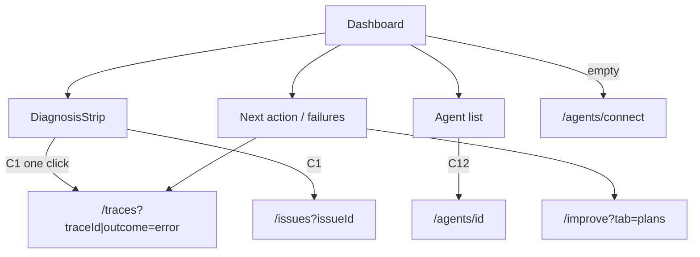

# Surface: Dashboard

> **Route:** `/dashboard`  
> **IA leaf:** Home → Dashboard (core #1)  
> **Primary objects:** Org · Agent  
> **Decision date:** 2026-07-21  
> **Companions:** [01-product-bible.md](../01-product-bible.md) · [02-information-architecture.md](../02-information-architecture.md) · [DESIGN-SYSTEM-V2.md](../design/DESIGN-SYSTEM-V2.md) · [03-competitive-synthesis.md](../03-competitive-synthesis.md) §1 Laminar

Landing after login (D4). Agent-centric OS home — Laminar “agent first page” energy. **Not** Helicone KPI-card spam. Grammar: **Status → diagnosis → next action**.

---

## 1. Purpose

**One decision this page owns:**  
*What needs attention across my agents right now, and what is the single next action?*

Dashboard answers: agent health pulse, recent failures worth opening, and a clear path into Traces / Issues / Connect. It does not own deep triage (Traces), clustering workflow (Issues), or spend math (Cost).

---

## 2. Primary user + JTBD

| | |
|--|--|
| **Primary** | Mira — solo AI eng (tonight) |
| **Secondary** | Jordan — EM / platform (brief fleet glance) |
| **JTBD** | J1 (connect → see first traffic), J4/J5 (triage via diagnosis strip), C1 (diagnosis → Trace/Issue in **1** click) |
| **Done when** | User can name the worst agent, open its failing evidence, or complete Connect — without leaving for a second “overview” hub |

---

## 3. URL + query grammar

| Piece | Spec |
|-------|------|
| Canonical | `/dashboard` |
| Aliases | `/` (authenticated) → `/dashboard`; `/analytics` → `/dashboard` (Later soft-land) |
| Query | Minimal. Optional: `agentId` (highlight agent row), `pastHours` (default `24`), `ai=1` / `ai_prompt` / `ai_session` (global AI) |
| Forbidden | Fake hub tabs that only link elsewhere; `view=` overload; KPI drill URLs that invent `/dashboard/metrics` |

**Write rules:** Omit empty params. Prefer camelCase. Org switch clears foreign `agentId`.

---

## 4. Layout

### 4.1 Desktop ≥1280

```
┌─ AppShell: sidebar 240 · header 40–56 ─────────────────────────────┐
│ Breadcrumb: Home · utilities (Search · Ask AI · Notifications)     │
├────────────────────────────────────────────────────────────────────┤
│ [optional single Banner: ingest error / billing — max one]         │
├────────────────────────────────────────────────────────────────────┤
│ PageHeader: title "Dashboard" · optional subtitle one-liner        │
│                                                                    │
│ ┌─ DiagnosisStrip (Signals-style) ───────────────────────────────┐ │
│ │  N open issues · M error traces · worst agent · [Open] CTA     │ │
│ └────────────────────────────────────────────────────────────────┘ │
│                                                                    │
│ ┌─ Agent OS list (primary) ──────────────┬─ Next action / peek ──┐ │
│ │ Agent · status · error rate · $ · last │  Suggested action     │ │
│ │ … dense rows, click → /agents/[id]     │  Recent failures (≤5) │ │
│ │                                        │  Ledger peek (≤3)     │ │
│ └────────────────────────────────────────┴───────────────────────┘ │
│                                                                    │
│ Recent failures table (optional below fold if many agents)         │
└────────────────────────────────────────────────────────────────────┘
```

**First viewport composition (one job):** diagnosis strip + agent list + one next-action panel. No decorative card collage above the fold.

### 4.2 Tablet 768–1279

```
Sidebar collapsed or overlay. Single column:
  DiagnosisStrip (full width)
  NextAction panel (collapsed accordion allowed)
  Agent list (full width)
Detail peeks open in Sheet when needed.
```

### 4.3 Mobile `<768`

```
Bottom nav: Home active.
DiagnosisStrip (compact, one CTA)
Agent list as priority rows (name · status · error · time)
Recent failures: tap → /traces?traceId=
Connect CTA sticky only in empty/first-run.
AI FAB + bottom nav mutual exclusion per design system.
```

### 4.4 Wireframes

**ASCII — populated**

```
Home / Dashboard                                    [Ask AI] [bell]
───────────────────────────────────────────────────────────────────
Diagnosis  ·  3 open issues  ·  12 errors / 24h  ·  support-bot worst
[ Review support-bot failures → ]                         ← one accent CTA

Agents (4)                              Next
─────────────────────────────────       ────────────────────────────
● support-bot   err 4.2%  $12.1  2m     Create Issue from cluster
○ research-rag  err 0.1%  $3.4   8m     Recent failures
○ writer-v2     err 0.0%  $1.1  14m       tr_ab12  tool:search  2.1s
○ nightly-eval  idle      —    3h         tr_cd34  LLM timeout   8.0s
                                        Ledger peek
                                          promo_9  prompt v3 ↑
```

**Mermaid — information flow**



---

## 5. Chrome budget

| Band | Contents | Cap |
|------|----------|-----|
| 1 Identity | Breadcrumb `Home` · Search · Ask AI · Notifications | Header ≤56px |
| 2 Toolbar | Time window (`pastHours`) · optional Agent filter · Overflow (Export snapshot, Copy link) | ≤5 primary actions |
| Banner | At most one (ingest outage, plan limit) | Mutually exclusive |

**First-paint controls ≤8 total** including diagnosis CTA and time select. No second filter strip. No sticky sandwich with bulk bar.

**Primary CTA (one solid `--accent`):** context-dependent —

| Context | CTA |
|---------|-----|
| Empty / first-run | Connect agent |
| Populated + failures | Review failures / Open worst issue |
| Healthy | View traces (ghost) — do not invent a fake solid CTA |

---

## 6. States

Use `QueryState`: `loading → error → empty | filter-empty → children`. Live optional.

### 6.1 Empty / first-run

**When:** Org has zero Agents **or** zero Traces ever.

| Element | Spec |
|---------|------|
| Title | `Connect an agent` |
| Body | One sentence: Gateway or SDK → first Trace tonight. |
| Primary CTA | `Connect agent` → `/agents/connect` |
| Secondary | External docs Quickstart (link) |
| Forbidden | Feature tourism, Analytics, red-team, eval setup gates |

### 6.2 Loading

Skeleton: diagnosis strip shimmer (respect `prefers-reduced-motion` → static blocks) · 4 agent rows · right peek blocks. No fake KPI numbers.

### 6.3 Error

Title + `Retry` + support/docs path. Do not show stale KPI as success. Partial: if agents load but diagnosis fails, show agents + inline error on strip.

### 6.4 Filtered-empty

**When:** `agentId` / time window yields no matching agents or failures but org has data.

| Copy | `No agents match this window` |
| CTA | `Clear filters` (resets `agentId` / `pastHours` to default) |
| Distinct from | First-run empty |

### 6.5 Populated

DiagnosisStrip + Agent OS list + Next action / Recent failures. Optional ≤3 StatCards **only** if each is a click-through (Issues count → `/issues`, Error rate → `/traces?outcome=error`, Spend → `/cost`) — never decorative Helicone collage.

### 6.6 Live

| Spec | Value |
|------|-------|
| Default | Off |
| Opt-in | Display / Overflow → Live pulse (poll or SSE for agent last-seen + diagnosis counts) |
| Indicator | `--terminal` / `--status-running` dot on strip — not a second CTA |
| Announce | Polite live region on count change |

### 6.7 Healthy / quiet

DiagnosisStrip shows calm summary (`0 open issues · traffic normal`). Primary action demotes to ghost `View traces`. Do not invent alarming chrome.

---

## 7. Components (kit only)

| Region | Kit |
|--------|-----|
| Shell | AppShell · PageHeader · Breadcrumb |
| States | QueryState · ErrorBoundary |
| Diagnosis | Panel (tonal) · StatusBadge · Button (one `default`) · MetricInline |
| Agents | DataTable or dense list rows · StatusBadge · MetricInline |
| Failures | DataTable · CodeChip (ids) · Tag |
| KPI (optional) | StatCard **click-through only** |
| Filters | Select (time) · Overflow menu |
| Mobile | Sheet · MobileBottomNav |
| AI | Bubble / FAB (global) |

**Ban on this surface:** Card-per-KPI soup; nested Card→Card; decorative charts without click-through; Helicone-style collage as primary grammar.

---

## 8. Keyboard map

| Key | Action |
|-----|--------|
| `⌘K` / `Ctrl+K` | Command palette |
| `⌘J` / Ask | Open AI with Dashboard context |
| `/` | Focus search (palette or header) |
| `j` / `k` | Move agent row focus |
| `Enter` | Open focused agent `/agents/[id]` |
| `g` then `t` | Go Traces |
| `g` then `i` | Go Issues |
| `Esc` | Clear agent highlight / close sheet |

All primary flows operable without pointer. Focus ring = `--terminal`.

---

## 9. Closed-loop exits

| From | To | Max actions | Preserve |
|------|----|-------------|---------|
| Diagnosis chip / CTA | `/traces?…` or `/issues?issueId=` | **1** (C1) | `pastHours`, `agentId` |
| Agent row | `/agents/[id]` | **1** (C12) | — |
| Recent failure row | `/traces?traceId=&mode=transcript` | **1** | `pastHours` |
| Next action “Create plan” | `/improve?tab=plans` (+ issue context) | **2** | evidence ids |
| Empty CTA | `/agents/connect` | **1** | — |
| Spend StatCard | `/cost?tab=overview&agentId=` | **1** | `agentId` |
| Ask AI citation | Trace/Issue canonical URL | **1** (C11) | ids |

Related strip (optional, links only): Issues · Traces · Improve — never nested routers.

---

## 10. Anti-patterns (banned)

- Helicone KPI card spam / decorative card collage as first viewport  
- Hub-of-hubs “Overview” that only links elsewhere  
- Second Observe entry / dual Dashboard brands  
- Purple glow, Laminar orange brand, Phosphor green as CTA  
- More than one solid accent button  
- Always-on LIVE as primary toolbar control  
- Red-team / adversarial onboarding  
- 9–10px chrome micro-labels  
- Unmounting content into marketing empty tours  
- Showing Analytics/Prompts as must-do  
- Manager-only second dashboard product  

---

## 11. Acceptance checklist

- [x] Login lands on `/dashboard`  
- [x] First viewport = diagnosis + agents + next action (not KPI soup)  
- [x] Empty state: single Connect CTA → `/agents/connect`  
- [x] Diagnosis → Trace or Issue in ≤1 click with ids in URL  
- [x] Agent row → `/agents/[id]`  
- [x] Chrome ≤2 bands; ≤5 toolbar actions; ≤8 first-paint controls  
- [x] States: empty, loading, error, filtered-empty, populated, live, healthy  
- [x] QueryState used; filter-empty ≠ first-run  
- [x] Dark-terminal tokens only; one `--accent` CTA  
- [x] Mobile: bottom Home; detail in Sheet; ≥44px targets *(Sheet for agent peeks deferred with Observe; rows use ≥44px targets)*  
- [x] i18n en/de for all chrome strings  
- [x] No red-team, no Analytics hub, no Helicone Traces grammar  

---

## 12. Data contracts (implementation hints)

| Block | Minimum fields |
|-------|----------------|
| DiagnosisStrip | `openIssueCount`, `errorTraceCount`, `worstAgentId?`, `worstAgentName?`, `windowHours`, `primaryHref` |
| Agent row | `agentId`, `displayName`, `status` (`healthy\|degraded\|failing\|idle\|unknown`), `errorRate`, `costUsd`, `lastSeenAt`, `openIssueCount` |
| Failure row | `traceId`, `agentId`, `summary`, `outcome`, `latencyMs`, `totalTokens`, `costUsd`, `startedAt` |
| Next action | `kind` (`connect\|review_failures\|open_issue\|create_plan\|healthy`), `href`, `labelKey` |

Refresh: soft poll 30–60s when Live off; faster when Live on. Prefer incremental diagnosis counts over full page reload.

---

*End of surfaces/dashboard.md*
