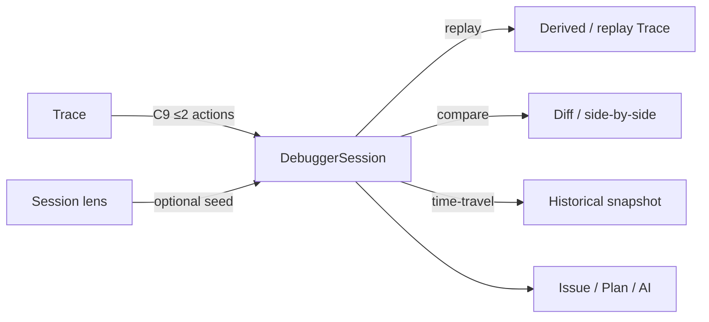

# Surface: Debugger

> **Status:** Spec — must-ship  
> **Phase:** P6  
> **Decision date:** 2026-07-21  
> **Companions:** [../02-information-architecture.md](../02-information-architecture.md) §1.2 / §2.1 · [../01-product-bible.md](../01-product-bible.md) J12/C9 · [../03-competitive-synthesis.md](../03-competitive-synthesis.md) §1.5 · [../design/DESIGN-SYSTEM-V2.md](../design/DESIGN-SYSTEM-V2.md)  
> **Energy:** Laminar debugger-session — multi-run investigation object, not a second Traces hub.

---

## 1. Purpose

**One decision this surface owns:** Create and drive a **DebuggerSession** — replay, compare, and time-travel across runs — when live Trace reading is insufficient.

Not owned here: default transcript triage (`/traces`), Session conversation lens (`/traces?view=sessions`), or Improve Plan creation (exits *to* Improve).

---

## 2. Primary user + JTBD

| Field | Value |
|-------|-------|
| **Primary** | Mira — needs multi-run compare / replay after spotting a bad turn |
| **JTBD** | J12 — Replay / time-travel |
| **Done when** | DebuggerSession exists; seeded Trace(s) attached; compare or time-travel mode yields a shareable URL; optional exit to Issue / Improve / AI |

---

## 3. Relationship to Traces & Sessions

| Concept | Home | Role |
|---------|------|------|
| **Trace** | `/traces` | Single execution graph; transcript-first reader |
| **Session** (product) | `/traces?view=sessions` | Multi-turn conversation grouping Traces |
| **DebuggerSession** | `/debugger`, `/debugger/[id]` | **Investigation workspace** spanning one or more Traces/runs — notes, pins, compare, replay, time-travel |

Rules:

1. Debugger is **not** a core sidebar leaf (chrome budget). Reach via Traces actions, Agent detail, Cmd+K, AI citation, legacy redirects.  
2. Breadcrumb group: `Observe / Debugger` (IA §9) even though not a core leaf.  
3. Mobile More sheet includes Debugger.  
4. Do **not** resurrect dual entry points (`/replay` + `/debugger-sessions` as peers). Redirects only.  
5. Traces legacy `view=replay|debug|time-travel` → seed `/debugger` (IA §3.4) — never fake Observe hubs.



---

## 4. URL + query grammar

### 4.1 Routes

| Route | Purpose |
|-------|---------|
| `/debugger` | DebuggerSession list + create |
| `/debugger/[id]` | Session workspace |

### 4.2 List / mode params

| Param | Values | Meaning |
|-------|--------|---------|
| `tab` | `sessions` \| `replay` \| `compare` \| `time-travel` | Hub lens / default mode for new session |
| `traceId` | id | Seed from Observe |
| `spanId` | id | Focus span inside seeded trace |
| `agentId` | id | Scope filter |
| `sessionId` | id | Optional product Session seed (conversation) — **not** DebuggerSession id |
| `q` | string | Search sessions |
| `pastHours` / `from` / `to` | time | List filter |

Detail page may use `mode=` mirroring tab values when deep-linking into a workspace pane:

`/debugger/[id]?mode=compare&traceId=a&traceIdB=b` (implementation may use `leftTraceId` / `rightTraceId` — pick one canonical pair and document in code; prefer `leftTraceId` / `rightTraceId`).

### 4.3 Canonical compare params (normative)

| Param | Meaning |
|-------|---------|
| `leftTraceId` | Baseline run |
| `rightTraceId` | Candidate run |
| `mode` | `replay` \| `compare` \| `time-travel` \| `notes` |

### 4.4 Redirects

| Old | New |
|-----|-----|
| `/debugger-sessions` | `/debugger` |
| `/debugger-sessions/:id` | `/debugger/:id` |
| `/replay` | `/debugger?tab=replay` |
| `/observability/time-travel` | `/debugger?tab=time-travel` |
| Traces `view=replay\|debug\|time-travel` | `/debugger` seeded |

### 4.5 Examples

```
/debugger
/debugger?tab=sessions
/debugger?traceId=tr_abc&tab=replay
/debugger/dbg_01?mode=compare&leftTraceId=tr_a&rightTraceId=tr_b
/debugger/dbg_01?mode=time-travel&traceId=tr_abc&spanId=sp_9
```

---

## 5. Layout diagrams

### 5.1 List — desktop ≥1280

```
Band 1: Observe / Debugger
Band 2: New session · Search · Agent filter · Time · Overflow
────────────────────────────────────────────────────────────
DataTable: updated · title · agent · seeded traces · mode · status
Row click → /debugger/[id] (full page OK — investigation depth)
```

Master–detail optional on list if density requires; default **navigate to detail** (unlike Traces row open) because compare canvas needs width.

### 5.2 Detail — desktop ≥1280

```
Band 1: Observe / Debugger / {title|idShort}
Band 2: Mode tabs (Replay | Compare | Time-travel | Notes) · ≤3 actions · Overflow
────────────────────────────────────────────────────────────
┌──────────────┬────────────────────────────────────────────┐
│ Run / pin    │ Canvas                                     │
│ list         │  Replay: transcript or timeline synced     │
│ (~280)       │  Compare: split or Diff (Braintrust energy)│
│ Notes peek   │  Time-travel: scrubber + snapshot reader   │
└──────────────┴────────────────────────────────────────────┘
Related strip: Traces · Issues · Improve · Ask AI
```

### 5.3 Tablet / mobile

- List full width; detail full page or Sheet for notes only.  
- Compare: stacked panes with toggle Left/Right (not squeezed dual columns).  
- Mode as underline Tabs; ≥44px touch.

---

## 6. Chrome budget

| Band | Contents |
|------|----------|
| **1** | Breadcrumb + title |
| **2** | Mode (counts as tab control, not 5 actions) + ≤5: **New/Add run** · **Compare** · **Ask AI** · **Create Issue** · **Overflow** (Export, Delete, Open in Traces) |

One solid accent CTA per context: list → **New session**; detail → mode-appropriate primary (e.g. **Run replay**).

---

## 7. Modes (Laminar energy)

### 7.1 Replay

- Seed from `traceId`; optional gateway/SDK replay if backend supports; else **read-only re-render** of stored Trace with step focus.  
- Canvas may embed Trace transcript/timeline components — do not fork a third reader grammar.  
- LIVE opt-in under Display only if streaming replay exists.

### 7.2 Compare

- Two (or N≤3) Trace identities; Diff grades for scores/latency/cost where data exists.  
- Side-by-side transcript **or** structured Diff — user toggle in Overflow/Display.  
- Steal Braintrust compare discipline; keep Eden tokens.

### 7.3 Time-travel

- Scrub across historical snapshots / span timeline positions for a Trace.  
- Selection writes `spanId` (and optional timestamp) into URL.  
- Not a marketing “rewind” animation — precise, scrubber + state panel.

### 7.4 Notes (session memory)

- Persist investigation notes, pinned spans, linked Issue/Plan/PR ids on DebuggerSession.  
- Laminar: session = saved investigation context.

---

## 8. States

| State | Behavior |
|-------|----------|
| **Empty** | “No debugger sessions” + CTA **New session** (optionally require pick Trace) |
| **First-run** | Explain relationship: start from a Trace → Replay; link to Traces |
| **Loading** | QueryState skeletons |
| **Error** | Retry; partial session load shows recoverable error banner (one banner max) |
| **Filtered-empty** | Clear filters |
| **Populated** | Table / workspace |
| **Live** | Only if replay stream active — `--terminal` running indicator |

---

## 9. Components (kit only)

`PageHeader`, underline `Tabs` (Mode), `DataTable`, `Panel`, `Button`, `Badge`/`StatusBadge`, `Sheet`, `Dialog` (confirm delete), `QueryState`, `FilterBar`/`QueryFilterBar`, MetricInline for latency·tokens·$, Trace transcript/timeline embeds, Diff view (shared with Evals/Improve), related strip (links only).

Cards: only for selectable run tiles if interaction requires — prefer dense table/list.

---

## 10. Keyboard map

| Key | Action |
|-----|--------|
| `Esc` | Close sheet / clear secondary selection |
| `⌘K` | Palette → Debugger / seed actions |
| `1`–`4` | Mode switch when focus in toolbar (documented) |
| `⌘↵` | Run replay (when primary) |
| `j` / `k` | Move run list (detail) |

---

## 11. Closed-loop exits

| From | To | Contract |
|------|----|----------|
| Trace → Debugger | Seed session | C9 ≤2 actions; preserve `traceId`, `agentId` |
| Debugger → Trace | Open evidence | Canonical `/traces?traceId=` |
| Debugger → Issue | Create/link | Evidence ids |
| Debugger → Improve | Create Plan | Evidence + optional notes |
| Debugger → AI | Bubble/`/agent` | Attach `debuggerSessionId` + traces |
| Debugger → PR | Via Improve | Never fake PR from debugger alone |

---

## 12. Permissions

| Role | List/view | Create session | Delete |
|------|-----------|----------------|--------|
| Viewer | ✓ | | |
| Member | ✓ | ✓ | Own / granted |
| Admin | ✓ | ✓ | ✓ |

---

## 13. Anti-patterns banned

- Core-nav Debugger leaf (breaks ≤12)  
- Dual `/replay` product page beside `/debugger`  
- Confusing product **Session** with **DebuggerSession** in UI copy — labels: “Sessions” (Observe) vs “Debugger sessions”  
- Timeline as default Trace reader (stays power Mode on Traces; Debugger may default to compare/replay per entry)  
- Card-grid Helicone grammar  
- Always-on LIVE first paint  
- Purple glow / Laminar orange brand  
- Hub-of-hubs “Debug overview” that only links out  

---

## 14. Acceptance checklist

- [ ] `/debugger` + `/debugger/[id]` implemented; not a core sidebar leaf  
- [ ] Cmd+K + Traces action + More sheet reach Debugger  
- [ ] Seed from `traceId` in ≤2 actions (C9)  
- [ ] Modes: sessions list, replay, compare, time-travel  
- [ ] Redirects from `/replay`, `/debugger-sessions`, observability time-travel  
- [ ] Clear copy distinction vs `/traces?view=sessions`  
- [ ] Chrome ≤2 bands; ≤5 toolbar actions  
- [ ] Exits to Trace, Issue, Improve, AI with IDs preserved  
- [ ] QueryState states covered  
- [ ] en+de strings; kit components only  

---

*End of surfaces/debugger.md*
