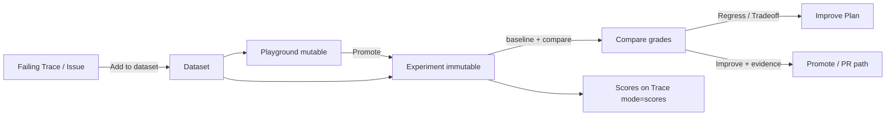
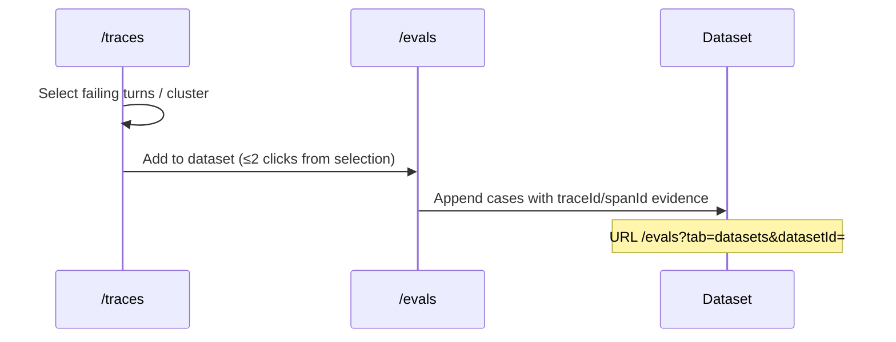

# Surface: Evals

> **Status:** Authoritative surface contract  
> **Decision date:** 2026-07-21  
> **Phase:** P4 Evaluate  
> **Companions:** [../02-information-architecture.md](../02-information-architecture.md) · [../01-product-bible.md](../01-product-bible.md) · [../design/DESIGN-SYSTEM-V2.md](../design/DESIGN-SYSTEM-V2.md) · [../03-competitive-synthesis.md](../03-competitive-synthesis.md)

---

## 1. Purpose

**One decision this page owns:** Did this change improve (or regress) agent quality on a known Dataset — and what do I do next (promote fix, open Improve Plan, or add more cases)?

Evals is the **Evaluate hub**. It is not a second Observe product and not merged into Improve. Primary objects: **Dataset**, **Playground** (mutable draft), **Experiment** (immutable run), **Score**.

---

## 2. Primary user + JTBD

| | |
|--|--|
| **Primary** | Mira (solo AI eng) — tonight’s regression check after a prompt/model/tool change |
| **Secondary** | Jordan (EM) — “did quality hold this week?” |
| **JTBD** | J9 — Run / inspect Evals |
| **Done when** | Dataset → Experiment → scores visible on cases and linkable back to Traces; compare vs baseline answers Improve / Regress / Tradeoff / Tie |

**Tonight triggers**

| Trigger | Entry |
|---------|--------|
| Failing Trace / Issue cluster | “Add to dataset” from Traces/Issues |
| Prompt tweak in Playground | Promote Playground → Experiment |
| Ship candidate Artifact | Gate via Experiment compare before Promote/PR |
| Eval regression alert | Open Experiment with `grade=regress` filter |

---

## 3. URL + query grammar

### 3.1 Canonical routes

| Route | Purpose |
|-------|---------|
| `/evals` | Hub — tabbed work surface |
| `/evals/datasets/[id]` | Dataset detail (full page when drawer insufficient) |
| `/playgrounds` | **Redirect** → `/evals?tab=playgrounds` |
| `/experiments` | **Redirect** → `/evals?tab=experiments` |
| `/datasets` | **Redirect** → `/evals?tab=datasets` |
| `/datasets/:id` | **Redirect** → `/evals/datasets/:id` or hub `datasetId=` |
| `/labeling`, `/studio`, `/synthetic` | **Redirect** → matching `tab=` |

### 3.2 Hub query params

| Param | Values | Notes |
|-------|--------|-------|
| `tab` | `datasets` \| `playgrounds` \| `experiments` \| `labeling` \| `studio` \| `synthetic` \| `eval` | Default `datasets`. Advanced tabs (`labeling`, `studio`, `synthetic`, `eval`) may collapse under Overflow on first paint if chrome budget exceeds ≤5 toolbar actions |
| `datasetId` | id | Master–detail selection on datasets |
| `playgroundId` | id | Selection on playgrounds |
| `experimentId` | id | Selection on experiments |
| `baselineId` | experimentId | **Baseline** for compare (Braintrust noun) |
| `compareId` | experimentId | Candidate / comparison experiment |
| `layout` | `summary` \| `list` \| `grid` | Experiments compare layout |
| `diff` | `0` \| `1` | Diff mode on/off |
| `grade` | `improve` \| `regress` \| `tradeoff` \| `tie` | Filter compare rows by grade |
| `agentId` | id | Scope filter |
| `q` | string | Search |
| `filter` | string | Structured filter |
| `queueId` | id | Labeling queue (when `tab=labeling`) |
| `viewId` | opaque | Saved table view — never overload `view` |

**Write normalization:** camelCase; drop aliases; omit empties; Esc clears selection ids without wiping `tab` / filters.

### 3.3 Example URLs

```
/evals
/evals?tab=datasets
/evals?tab=datasets&datasetId=ds_refunds
/evals?tab=playgrounds&playgroundId=pg_12
/evals?tab=experiments&experimentId=exp_v2
/evals?tab=experiments&baselineId=exp_v1&compareId=exp_v2&layout=summary&diff=1
/evals?tab=experiments&baselineId=exp_v1&compareId=exp_v2&grade=regress
/evals?tab=datasets&agentId=agent_support
/evals/datasets/ds_refunds
```

### 3.4 Breadcrumb

| State | Crumb |
|-------|-------|
| Hub | `Evaluate / Evals` |
| Dataset selected | `Evaluate / Evals / {datasetName}` |
| Dataset page | `Evaluate / Evals / Datasets / {datasetName}` |
| Experiment compare | `Evaluate / Evals / Experiments` (+ title in PageHeader) |

---

## 4. Layout diagrams

### 4.1 Desktop ≥1280 — hub (datasets | playgrounds | experiments)

```
┌─ AppShell ──────────────────────────────────────────────────────────────┐
│ Sidebar (240) │ Identity header: Evaluate / Evals · utilities · Ask AI  │  ← band 1
│               ├─────────────────────────────────────────────────────────┤
│               │ PageHeader title=Evals  [New ▾]                         │
│               │ underline tabs: Datasets | Playgrounds | Experiments    │  ← band 2 (tabs+toolbar)
│               │         [Labeling…] overflow for advanced tabs           │
│               │ Toolbar IN PANE: Views · Search · Filter · Display · ⋯  │
│               ├──────────────────────┬──────────────────────────────────┤
│               │ Master list (~55%)   │ Detail inspector (~45%)          │
│               │ DataTable / cards    │ Dataset meta · cases · actions   │
│               │                      │ OR Playground editor             │
│               │                      │ OR Experiment summary + cases    │
│               └──────────────────────┴──────────────────────────────────┘
└─────────────────────────────────────────────────────────────────────────┘
```

### 4.2 Desktop — Experiment compare (Braintrust grammar)

```
┌─ Experiments tab ───────────────────────────────────────────────────────┐
│ Toolbar: Baseline [exp_v1 ▾]  Compare [exp_v2 ▾]  Layout[Summary|List|Grid]
│          Diff[off|on]  Grade chips: All · Improve · Regress · Tradeoff · Tie
│          Search · Display · Overflow                                      │
├─────────────────────────────────────────────────────────────────────────┤
│ SUMMARY (layout=summary)                                                │
│ ┌ Comparison grade: IMPROVE | REGRESS | TRADEOFF | TIE (per compare col)┐│
│ │ Score rows: avg · Δ vs baseline · improve count · regress count       ││
│ │ Metrics: latency · cost · errors · tokens                             ││
│ └───────────────────────────────────────────────────────────────────────┘│
│ LIST/GRID: case rows — input preview | base out | compare out | scores │
│            Diff=1 → sub-rows per experiment; score deltas green/red    │
├─────────────────────────────────────────────────────────────────────────┤
│ Case detail (right or below): I/O split · scores · link to Trace if any │
└─────────────────────────────────────────────────────────────────────────┘
```

### 4.3 Tablet / mobile &lt;1280

```
[ Band 1 header ]
[ Band 2: tab pills scroll + primary CTA ]
[ Master full width ]
→ Row open: Sheet/Drawer detail (Esc closes, clears datasetId/…)
Touch targets ≥44px. No second sticky filter bar.
```

### 4.4 Mermaid — product flow



### 4.5 Mermaid — failing traces → dataset (must-ship exit)



---

## 5. Chrome budget

| Rule | Contract |
|------|----------|
| Bands above content | **≤2** — (1) identity/breadcrumb (2) tabs + pane toolbar |
| Primary toolbar actions | **≤5** visible: Views, Search, Filter, Display, primary CTA (`New` / `Run experiment` / `Compare`) |
| Rest | Overflow · ⌘K |
| LIVE | Not primary on Evals; opt-in under Display if streaming scores |
| Banners | Max one (e.g. “Playground unsaved”) |
| No hub-of-hubs | **Forbidden:** embedding full Traces/Improve pages with a second PageHeader inside Evals |

**One primary CTA per context**

| Context | Solid `--accent` CTA |
|---------|----------------------|
| Datasets list (none selected) | `New dataset` |
| Dataset selected | `Add cases` **or** `Run experiment` (pick one primary; other ghost) |
| Playground | `Run` (ephemeral) — promote is secondary until ready |
| Playground ready | `Promote to experiment` |
| Experiments list | `New experiment` |
| Compare open | `Open Improve Plan` when grade=regress/tradeoff; else `Promote fix` if linked Artifact |

---

## 6. States

Use kit `QueryState`: `loading → error → empty | filter-empty → children`.

| State | UI | Primary action |
|-------|----|----------------|
| **Empty / first-run** | Title: “No datasets yet.” Body: build from production failures or upload. | `Add from traces` · secondary docs link |
| **Loading** | Skeleton table + inspector | — |
| **Error** | Retry + support path | `Retry` |
| **Filtered-empty** | Distinct copy: “No experiments match filters.” | `Clear filters` |
| **Populated** | Master–detail | Context CTA |
| **Live** | Optional score append pulse ≤200ms; polite live region | Display → Live scores |

**Playground-specific:** dirty state banner; leave confirm Dialog.

**Compare-specific:** missing baseline → prompt to set Baseline before Diff/grades.

---

## 7. Components used (kit only)

| Component | Use |
|-----------|-----|
| `PageHeader` | Title `Evals`; optional one-liner subtitle; actions |
| `Tabs` `underline` | Hub tabs |
| `ResourcePageShell` / `DetailPanelShell` | Master–detail contract |
| `QueryFilterBar` + `ViewsMenu` | Pane toolbar |
| `DataTable` | Datasets, cases, experiments, compare list |
| `QueryState` | All list hubs |
| `Panel` | Grouping (not decorative Card soup) |
| `StatCard` | **Compare summary metrics only** — not Trace collage |
| `Badge` / `StatusBadge` | Grade chips: Improve / Regress / Tradeoff / Tie |
| `Button` | One `default` CTA |
| `Dialog` / `Sheet` | Create dataset, promote playground, mobile detail |
| `Input` / `Select` / `Textarea` | Filters, playground editor chrome |
| `MetricInline` | latency · tokens · cost on case/experiment rows |
| `CodeChip` | IDs, model names |
| `CommandPalette` | Nav + “New experiment”, “Open datasets” |
| `BulkActionBar` | Multi-select add-to-dataset / delete cases (desktop) |

**Domain widgets (rebuild under `components/evals/`):** `CompareGradeHeader`, `ExperimentDiffToggle`, `DatasetCaseRow`, `PlaygroundEditor`, `AddToDatasetDialog` (shared entry from Traces/Issues).

---

## 8. Keyboard map

| Key | Action |
|-----|--------|
| `⌘K` / `Ctrl+K` | Command palette |
| `⌘J` | Ask AI (same surface as bubble) |
| `/` | Focus search in pane |
| `1`–`3` | Jump tabs Datasets / Playgrounds / Experiments (when focus in hub) |
| `↑` `↓` | Move list selection |
| `Enter` | Open / focus detail |
| `Esc` | Close detail / Sheet; clear `datasetId`/`experimentId`/…; keep filters |
| `⌘Enter` | Run playground / run experiment (when editor focused) |
| `b` | Set selected experiment as Baseline (experiments tab) |
| `c` | Open compare with current as `compareId` (needs baseline) |
| `d` | Toggle `diff=1` |
| `g` then `r` | Filter `grade=regress` |

All icon-only controls need accessible names. Focus ring = `--terminal`.

---

## 9. Closed-loop exits

| From | Exit | Max actions | Preserve |
|------|------|-------------|---------|
| Trace / Issue | Add to dataset | **≤2** | `traceId`, `spanId?`, `agentId?` on case metadata |
| Dataset | Run experiment | **≤2** | `datasetId` |
| Playground | Promote → Experiment | **≤2** | playground config frozen into experiment |
| Experiment compare (regress) | Create Improve Plan | **≤2** | `experimentId`, `baselineId`, failing case ids |
| Experiment (improve + Artifact) | Improve Promote / Open PR | **≤3** | evidence gate ids |
| Experiment case with `traceId` | Open Trace | **1** | `traceId`, `mode=scores` optional |
| Any | Ask AI with dataset/experiment context | **1** | `ai=1` + object ids |
| Evals | Cost advisor (model swap hypothesis) | link only | Related strip — not embed |

**Invariant:** Clusters/Issues path into Datasets must not dead-end as “insight cards.”

---

## 10. Anti-patterns banned on this surface

- **Hub-of-hubs:** embedding full Traces/Improve/Agents pages with nested second headers
- Merging Evaluate into Improve nav or copy
- Top-level `/playgrounds`, `/experiments`, `/datasets` as non-redirect peers
- Helicone-style KPI card collage as the default Experiments view (summary cards OK **inside compare**)
- Purple brand glow; Laminar orange CTA
- Card-per-case decorative wrappers; prefer rows
- Tree/Timeline as default (N/A here — do not steal Trace Mode chrome into Evals)
- False success toast on promote-to-experiment before run completes
- Advertising Labeling/Studio/Synthetic as equal first-paint tabs if they blow chrome budget — Overflow
- Red-team / adversarial attack libraries
- Unmounting master list on select at ≥1280
- Overloading `view` for saved views (use `viewId`)
- 9–10px chrome labels; &gt;2 bands; sticky sandwich

---

## 11. Acceptance checklist

- [ ] `/evals` loads with `tab=datasets` default; underline tabs work; advanced tabs reachable
- [ ] Redirects: `/playgrounds`, `/experiments`, `/datasets` → hub tabs
- [ ] Master–detail ≥1280; Sheet &lt;1280; Esc clears selection params
- [ ] Chrome ≤2 bands; ≤5 primary toolbar actions; one solid CTA per context
- [ ] QueryState distinguishes empty / filter-empty / error / loading / populated
- [ ] **Add to dataset** from Traces/Issues ≤2 clicks; cases store evidence ids
- [ ] Playground mutable → Promote creates immutable Experiment
- [ ] Compare: Baseline noun, Diff toggle, layouts Summary|List|Grid
- [ ] Grades: Improve / Regress / Tradeoff / Tie; `grade=` filter works
- [ ] Score deltas + latency/cost/errors visible when API provides
- [ ] Closed-loop: regress → Improve Plan; case → Trace deep link
- [ ] No nested hub headers; kit components only; en+de i18n
- [ ] Keyboard map works; focus visible; reduced-motion honored
- [ ] Density comfortable/compact respected on tables

---

## 12. Tab contracts (detail)

### 12.1 Datasets (`tab=datasets`)

| Column / field | Notes |
|----------------|-------|
| Name | Primary |
| Cases | Count |
| Agent | Optional scope |
| Updated | Relative + UTC tooltip |
| Source | `manual` \| `traces` \| `issues` \| `import` |

Detail: version, description, case table (input / expected? / tags / source `traceId`), actions Add cases / Run experiment / Export.

Optional full page `/evals/datasets/[id]` when case editing needs width — same components, not a second IA.

### 12.2 Playgrounds (`tab=playgrounds`)

Mutable prompt/model/tool config. Runs are ephemeral until **Promote to experiment**. Braintrust: mutable → immutable. Dirty banner. Link “Open as experiment” after promote.

### 12.3 Experiments (`tab=experiments`)

Immutable runs. List: name, dataset, status, avg scores, cost, latency, created.

**Compare (required):**

| Element | Spec |
|---------|------|
| Baseline | Required for grades; `baselineId` |
| Compare | One or more candidates; v1 ship **one** `compareId` |
| Grade | Improve / Regress / Tradeoff / Tie vs baseline across scores + latency + cost + errors |
| Diff | `diff=1` sub-rows / inline output diff |
| Sort default | Regressions first when in compare mode |
| Layout | `summary` aggregate cards (click → filter) · `list` · `grid` |

### 12.4 Advanced tabs

| Tab | Role |
|-----|------|
| `labeling` | Human queues (LangSmith-class); `queueId` |
| `studio` | Heavier authoring if retained |
| `synthetic` | Synthetic case gen |
| `eval` | Legacy online-eval lens — do not rebuild as Observability child |

---

## 13. Permissions

| Action | Viewer | Member | Admin |
|--------|--------|--------|-------|
| View datasets/experiments | ✓ | ✓ | ✓ |
| Create/edit datasets, run experiments | | ✓ | ✓ |
| Promote playground | | ✓ | ✓ |
| Delete dataset | | | ✓ |

Hide mutate CTAs for Viewer.

---

## 14. Related strip (links only)

`Issues · Traces · Improve plans · Cost advisor` — never nested routers.

---

*End of surfaces/evals.md*
