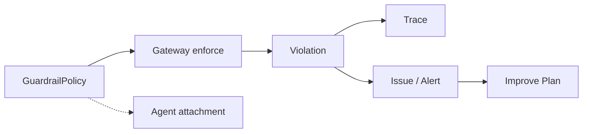

# Surface: Guardrails

> **Status:** Authoritative surface contract  
> **Decision date:** 2026-07-21  
> **Phase:** P5  
> **Companions:** [../01-product-bible.md](../01-product-bible.md) · [../02-information-architecture.md](../02-information-architecture.md) · [../design/DESIGN-SYSTEM-V2.md](../design/DESIGN-SYSTEM-V2.md) · [../03-competitive-synthesis.md](../03-competitive-synthesis.md) · [../04-interview-log.md](../04-interview-log.md)

---

## 1. Purpose

**One decision this page owns:** Which **GuardrailPolicy** applies to which Agent/gateway path — and what violations occurred — without operating an adversarial “red team” product.

**Scope = policies (+ violations observability). Red-team UI is killed (D3).**

---

## 2. Primary user + JTBD

| | |
|--|--|
| **Primary** | Mira — attach a policy so bad tool/PII paths fail closed at gateway |
| **Secondary** | Jordan — org policy coverage without compliance theater |
| **JTBD** | J11 Enforce GuardrailPolicy |
| **Done when** | Policy CRUD + attachment; violations visible and link to Trace/Issue/Alert |

---

## 3. URL + query grammar

### 3.1 Canonical routes

| Route | Purpose |
|-------|---------|
| `/guardrails` | Policies hub |
| `/redteam`, `/redteam/:path*` | **Redirect** → `/guardrails?tab=policies` |
| `/guardrails?tab=redteam` | **Redirect** → `/guardrails?tab=policies` (strip param) |

### 3.2 Allowed tabs only

| Param | Values | Notes |
|-------|--------|-------|
| `tab` | `policies` \| `violations` | Default `policies`. **`redteam` is illegal** — never render, never list in Tabs, never Cmd+K |
| `policyId` | id | Master–detail selection |
| `violationId` | id | Violations selection |
| `agentId` | id | Scope / attach filter |
| `q` / `filter` / `viewId` | | |
| `pastHours` / `from` / `to` | | Violations time window |
| `severity` | `block` \| `warn` \| `log` | Policy filter |

### 3.3 Explicit ban list (routes / UI)

Never ship, advertise, or soft-land as product UI:

| Banned | Action |
|--------|--------|
| `/redteam` and children | Permanent redirect to policies |
| `tab=redteam` | Normalize away; no tab chrome |
| Attack libraries / campaign runners / adversarial prompt galleries | Delete in teardown; do not rebuild |
| “Red team”, “adversarial test center”, “attack suite” nav labels | Forbidden copy |
| Cmd+K destinations for red-team | Forbidden |
| Mobile More sheet red-team entry | Forbidden |
| Guardrails → nested red-team drawer as “Advanced” | Forbidden |

Detectors that score production traffic belong under **Alerts / Issues / Improve** — not a red-team surface.

### 3.4 Example URLs

```
/guardrails
/guardrails?tab=policies
/guardrails?tab=policies&policyId=pol_pii
/guardrails?tab=violations&agentId=agent_support&pastHours=24
/guardrails?tab=violations&violationId=vio_9
/redteam  →  /guardrails?tab=policies
```

### 3.5 Breadcrumb

`Improve / Guardrails`

---

## 4. Layout diagrams

### 4.1 Desktop ≥1280 — policies

```
┌─ AppShell ──────────────────────────────────────────────────────────────┐
│ Sidebar │ Improve / Guardrails · Ask AI                                 │
│         │ PageHeader: Guardrails                    [New policy]        │
│         │ tabs: Policies | Violations     ← ONLY THESE TWO              │
│         │ Toolbar: Views · Search · Filter · Display · ⋯                │
├────────────────────────────┬────────────────────────────────────────────┤
│ Policy list (~50%)         │ Policy detail (~50%)                       │
│ name · severity · scope    │ Rules editor (declarative)                 │
│ agents attached · updated  │ Attach to Agent / gateway route            │
│                            │ Status: enabled/disabled                   │
│                            │ CTA: Save · Attach · View violations       │
└────────────────────────────┴────────────────────────────────────────────┘
```

### 4.2 Violations tab

```
┌─ Violations ────────────────────────────────────────────────────────────┐
│ Table: time · policy · agent · severity · action taken · trace preview  │
│ Detail: violation payload · link Trace · create Issue · ack             │
│ Related: Alerts rules (detectors) — link to /alerts?tab=rules           │
└─────────────────────────────────────────────────────────────────────────┘
```

### 4.3 Mobile

```
Tabs: Policies | Violations
List → Sheet detail
Attach agent via Select sheet
No third “Test attacks” affordance anywhere
```

### 4.4 Mermaid — allowed loop



### 4.5 Mermaid — banned

```mermaid
flowchart LR
  X[Red-team UI] -.->|KILLED D3| Y[Do not implement]
  X -.-> Z[/guardrails policies redirect only]
```

---

## 5. Chrome budget

| Rule | Contract |
|------|----------|
| Bands | ≤2 |
| Tabs | **Exactly two:** Policies, Violations |
| Toolbar | ≤5: Views, Search, Filter, Display, New policy |
| One solid CTA | `New policy` or `Save policy` when editing |
| Banner | Optional “Policies enforce at gateway” one-liner — not marketing |

---

## 6. States

| State | Behavior |
|-------|----------|
| **Empty / first-run** | “No policies yet.” CTA: `New policy`. Secondary: docs (external). Do **not** suggest red-team onboarding |
| **Loading** | Skeleton |
| **Error** | Retry |
| **Filtered-empty** | Clear filters |
| **Populated** | Master–detail |
| **Live** | Violations append opt-in under Display |
| **Policy invalid** | Inline validation; Save disabled |

---

## 7. Components used (kit only)

| Kit | Use |
|-----|-----|
| `PageHeader`, `Tabs` underline | Hub — two tabs only |
| `DataTable`, `QueryState`, `QueryFilterBar`, `ViewsMenu` | Lists |
| `DetailPanelShell` | Policy / violation inspector |
| `Form` controls: `Input`, `Select`, `Textarea` | Policy editor |
| `Badge` / `StatusBadge` | severity, enabled |
| `Button`, `Dialog`, `Sheet` | Create/delete confirm |
| `CodeChip` | policyId, rule ids |
| `CommandPalette` | Guardrails, Policies, Violations — **never** Red-team |

**Domain:** `PolicyEditor`, `PolicyAttachForm`, `ViolationRow`, `SeveritySelect`.

**Teardown:** remove any `RedTeam*`, attack-library, campaign components; redirects are safety nets only (IA §7.5).

---

## 8. Keyboard map

| Key | Action |
|-----|--------|
| `⌘K` | Palette (policies/violations only) |
| `/` | Search |
| `1` / `2` | Policies / Violations |
| `↑` `↓` `Enter` | Select |
| `Esc` | Clear `policyId`/`violationId` |
| `n` | New policy (Member+) |
| `s` | Save policy when editor dirty |
| `t` | Open Trace from violation |

---

## 9. Closed-loop exits

| From | To | Max |
|------|----|-----|
| Policy detail | `/agents/[id]` attach context | **1** |
| Violation | `/traces?traceId=` | **1** |
| Violation | Create/link Issue | **≤2** |
| Violation | `/alerts` related | **1** |
| Repeated violations | `/improve?tab=queue` Create plan | **≤2** |
| Policy | `/settings?tab=gateway` / PII settings | **1** |
| Any | Ask AI “explain this policy” | **1** |

No exit into red-team runners.

---

## 10. Anti-patterns banned on this surface

- **Any red-team UI, route, tab, Cmd+K item, or Advanced trap**
- Compliance theater dashboards of simulated attacks
- Merging Guardrails into Alerts as the only home (Guardrails remains core leaf)
- Hub-of-hubs embedding full Trace/Improve pages
- Using `--terminal` / purple as CTA fills
- Multiple solid CTAs; sticky sandwich; 9–10px labels
- Onboarding that requires adversarial tests before Observe
- Galileo “runtime protection as Home widgets” spam

---

## 11. Acceptance checklist

- [ ] `/guardrails` core leaf; tabs **only** `policies` \| `violations`
- [ ] No `redteam` tab component in tree; URL `tab=redteam` redirects/normalizes to `policies`
- [ ] `/redteam` and children permanent redirect to policies
- [ ] Cmd+K and Mobile More contain zero red-team destinations
- [ ] Policy CRUD + attach to Agent/gateway; violations list with Trace links
- [ ] Closed-loop: violation → Issue/Improve ≤2 actions
- [ ] Empty state does not mention red-team / attacks
- [ ] Chrome ≤2 bands; ≤5 toolbar actions; QueryState complete
- [ ] Permissions: Member edit policies; Admin delete org-wide; Viewer read
- [ ] en+de i18n; kit only; teardown removed attack-library code

---

## 12. Policy object (UI)

| Field | Notes |
|-------|-------|
| `policyId` | Mono copy |
| Name / description | Sans |
| Severity | block \| warn \| log |
| Rules | Declarative list (PII, tool allowlist, rate, content — implementation-defined) |
| Attachments | agentIds[], gateway routes |
| Enabled | boolean |
| UpdatedAt / updatedBy | Audit-friendly |

Violations: `violationId`, `policyId`, `agentId`, `traceId?`, `action`, `payload`, `createdAt`.

---

## 13. Permissions

| Action | Viewer | Member | Admin |
|--------|--------|--------|-------|
| View policies/violations | ✓ | ✓ | ✓ |
| Create/edit policies | | ✓ | ✓ |
| Delete org-wide policy | | | ✓ |
| Attach to agent | | ✓ | ✓ |

---

## 14. Copy rules

- Prefer “policy”, “violation”, “enforce at gateway”.
- Ban: “red team”, “attack”, “adversarial campaign”, “jailbreak suite” as product nouns in this surface.
- Dry tone per `.impeccable.md` / Design System V2.

---

*End of surfaces/guardrails.md*
