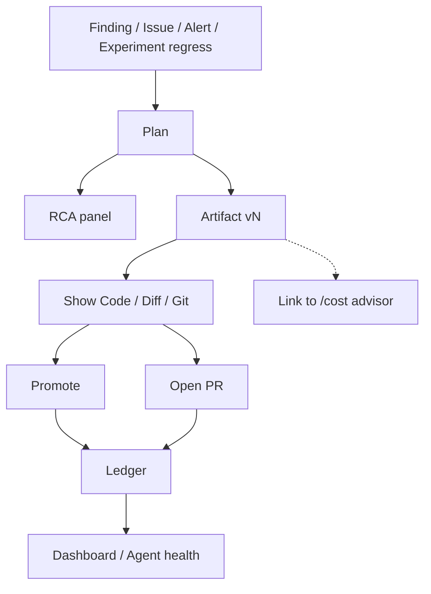

# Surface: Improve

> **Status:** Authoritative surface contract  
> **Decision date:** 2026-07-21  
> **Phase:** P5 Improve  
> **Companions:** [../01-product-bible.md](../01-product-bible.md) · [../02-information-architecture.md](../02-information-architecture.md) · [../design/DESIGN-SYSTEM-V2.md](../design/DESIGN-SYSTEM-V2.md) · [../03-competitive-synthesis.md](../03-competitive-synthesis.md)  
> **Critical:** This surface owns the **closed loop** — failure → Plan → Artifact → Promote and/or **PR**. TraceRoot grammar adapted to Eden objects.

---

## 1. Purpose

**One decision this page owns:** Given evidence (Issue / Alert / Finding / Experiment), what fix path do we take — and has it shipped (Artifact promote, optimization link, or PR)?

Improve is **not** Observe and **not** Evaluate. It consumes evidence and produces **Plan → Artifact → Promotion | PR**, remembered in **Ledger**.

Eden multifaceted outcomes (D7 / interview): **artifacts**, **optimization/cost links**, **PRs** — all first-class; none decorative.

---

## 2. Primary user + JTBD

| | |
|--|--|
| **Primary** | Mira — “I found the bad turn; I need a fix path before sleep.” |
| **Secondary** | Jordan — “Did fixes ship? What’s in flight?” |
| **JTBD** | J6 Start Improve · J7 Artifact + PR · J8 Promote → Ledger |
| **Success sentence** | Found bad turn → Plan → Artifact / PR before sleep |

**TraceRoot-inspired loop (Eden nouns)**

```
Finding / Issue / Alert
  → Plan (RCA + proposed fix path)
    → Artifact (versioned fix payload)
      → Show Code / Diff / Git
        → Promote  AND/OR  Open PR
          → Ledger entry
```

---

## 3. URL + query grammar

### 3.1 Canonical routes

| Route | Purpose |
|-------|---------|
| `/improve` | Hub — queue / plans / artifacts / promotions / ledger / history |
| `/improve/plans/[id]` | Plan detail (full page): evidence, RCA, artifacts, PR actions |
| `/artifacts`, `/ledger`, `/promotions`, `/pr-suggestions`, `/closed-loop`, `/autonomous` | **Redirect** → hub tabs per IA §7.3 |
| `/agents/eden/inbox` | **Redirect** → `/improve?tab=plans` |
| `/optimization` | **Redirect** → `/cost` (not absorbed into Improve chrome) |

### 3.2 Hub query params

| Param | Values | Notes |
|-------|--------|-------|
| `tab` | `queue` \| `plans` \| `artifacts` \| `promotions` \| `ledger` \| `history` | Default **`queue`** |
| `planId` | id | Master–detail selection (hub) |
| `artifactId` | id | Artifacts tab selection |
| `promotionId` | id | Promotions selection |
| `agentId` | id | Scope |
| `issueId` / `alertId` / `experimentId` | id | Evidence filters / create context |
| `status` | `needs_you` \| `in_progress` \| `verify` \| `done` \| `blocked` | Queue views |
| `q` / `filter` / `viewId` | | Search / structured / saved view |
| `pastHours` / `from` / `to` | | Time window for history/ledger lenses |

### 3.3 Plan detail

`/improve/plans/[id]?panel=evidence|rca|code|artifacts|pr|activity`

| `panel` | Content |
|---------|---------|
| `evidence` | Linked Issue/Alert/Finding/Experiment/Traces |
| `rca` | RCA write-up / AI draft (editable) |
| `code` | Show Code / Diff / Git correlation (TraceRoot) |
| `artifacts` | Artifact versions from this plan |
| `pr` | PR status, open PR, provider link |
| `activity` | Timeline |

### 3.4 Example URLs

```
/improve
/improve?tab=queue&status=needs_you
/improve?tab=plans&planId=pl_91
/improve/plans/pl_91
/improve/plans/pl_91?panel=code
/improve?tab=artifacts&artifactId=art_3&agentId=agent_support
/improve?tab=promotions
/improve?tab=ledger&agentId=agent_support
/improve?tab=history
/improve?tab=queue&issueId=iss_12
```

### 3.5 Breadcrumb

| State | Crumb |
|-------|-------|
| Hub | `Improve` |
| Plan in hub | `Improve / Plans / {title\|id}` |
| Plan page | `Improve / Plans / {title\|id}` |

---

## 4. Layout diagrams

### 4.1 Desktop ≥1280 — Queue (default)

```
┌─ AppShell ──────────────────────────────────────────────────────────────┐
│ Sidebar │ Improve · utilities · Ask AI                                  │  band 1
│         ├───────────────────────────────────────────────────────────────┤
│         │ PageHeader: Improve                    [New plan]             │
│         │ tabs: Queue | Plans | Artifacts | Promotions | Ledger | History│ band 2
│         │ Queue views: Needs you | In progress | Verify                 │
│         │ Toolbar: Views · Search · Filter · Display · ⋯                │
│         ├────────────────────────┬──────────────────────────────────────┤
│         │ Queue list (~50%)      │ Plan / item detail (~50%)            │
│         │ row: severity · title  │ Evidence strip (links)               │
│         │ agent · age · status   │ RCA summary                          │
│         │                        │ Artifacts peek · PR status           │
│         │                        │ ONE primary CTA                      │
│         │                        │ Related: Issues · Artifacts · Ledger │
│         └────────────────────────┴──────────────────────────────────────┘
└─────────────────────────────────────────────────────────────────────────┘
```

### 4.2 Plan detail page

```
┌─ /improve/plans/[id] ───────────────────────────────────────────────────┐
│ Breadcrumb: Improve / Plans / {title}                                   │
│ Title · StatusBadge · Agent · [Open PR] primary when ready              │
│ underline panels: Evidence | RCA | Code | Artifacts | PR | Activity     │
├─────────────────────────────────────────────────────────────────────────┤
│ Evidence: Issue cards (link) · Trace chips · Experiment link            │
│ RCA: markdown / structured findings (Finding list)                      │
│ Code: file path · blame · Diff (Formatted/Unified) · copy               │
│ Artifacts: version table → Promote / Open PR                            │
│ PR: provider status · checks · deep link · “Create PR”                  │
│ Outcomes strip: Artifact | Optimization (/cost) | PR — equal weight UI  │
└─────────────────────────────────────────────────────────────────────────┘
```

### 4.3 Mobile

```
Tabs horizontal scroll
Queue full width → Sheet detail
Plan detail: stacked panels as accordion or sub-tabs
FAB Ask AI clears bottom nav when open
Primary CTA sticky in Sheet footer (one only)
```

### 4.4 Mermaid — closed loop



### 4.5 ASCII — outcome triad (first-class)

```
┌─────────────────────────────────────────────────────────┐
│  Outcomes (equal first-class — not buried menus)        │
│  ┌─────────────┐  ┌──────────────┐  ┌────────────────┐  │
│  │ Artifact    │  │ Optimization │  │ Pull request   │  │
│  │ Promote →   │  │ → /cost?…    │  │ Create / view  │  │
│  │ Ledger      │  │ (link out)   │  │ provider       │  │
│  └─────────────┘  └──────────────┘  └────────────────┘  │
│  One solid CTA = the next required step for THIS plan   │
└─────────────────────────────────────────────────────────┘
```

---

## 5. Chrome budget

| Rule | Contract |
|------|----------|
| Bands | ≤2 |
| Toolbar actions | ≤5: Views, Search, Filter, Display, New plan (or context CTA) |
| Queue view chips | Needs you / In progress / Verify — count as Display/views, not a third band |
| Related strip | Links only — **no** embedded Issues/Traces routers |
| One solid CTA | Per selection: e.g. `Generate artifact` **or** `Open PR` **or** `Promote` — never all three solid |

---

## 6. States

| State | Copy / behavior |
|-------|-----------------|
| **Empty / first-run** | “No improve work yet.” CTA: `Create plan from issue` (links `/issues`) — not feature tourism |
| **Loading** | Skeleton queue + detail |
| **Error** | Retry |
| **Filtered-empty** | Clear filters |
| **Populated** | Master–detail |
| **Live** | Optional status updates on PR checks — opt-in under Display; polite announce |
| **Blocked / insufficient evidence** | Explicit dead-end allowed: “Not enough evidence to plan” — do **not** fake Plan |
| **EvidenceGate fail** | Promote/PR disabled with reason (scores, approvals, policy) |

---

## 7. Components used (kit only)

| Kit | Use |
|-----|-----|
| `PageHeader`, `Tabs` underline | Hub + plan panels |
| `ResourcePageShell`, `DetailPanelShell` | Queue / lists |
| `DataTable`, `QueryState`, `QueryFilterBar`, `ViewsMenu` | Lists |
| `Badge` / `StatusBadge` | Plan/PR/Artifact status |
| `Button` | One `default` CTA |
| `Dialog` | Promote gate, create plan, confirm discard |
| `Sheet` | Mobile detail |
| `Panel` | Grouping |
| `MetricInline` | Impact metrics when present |
| `CodeChip` | planId, artifact versions, commit SHAs |
| `CommandPalette` | Plans, Artifacts, New plan, Open PR |

**Domain (`components/improve/`):** `QueueRow`, `EvidenceStrip`, `RcaPanel`, `ShowCodePanel`, `ArtifactVersionTable`, `PrOutcomeCard`, `OutcomeTriad`, `EvidenceGateBanner`, `RelatedStrip`.

---

## 8. Keyboard map

| Key | Action |
|-----|--------|
| `⌘K` | Palette |
| `⌘J` | Ask AI with plan/issue context |
| `/` | Focus search |
| `1`–`6` | Tabs queue…history |
| `↑` `↓` / `Enter` | Select / open |
| `Esc` | Close detail; clear `planId`/`artifactId` |
| `n` | New plan (Member+) |
| `a` | Generate / focus Artifacts panel |
| `p` | Open PR flow (when enabled) |
| `Shift+P` | Promote (when EvidenceGate passes) |
| `e` | Focus Evidence panel on plan detail |
| `c` | Focus Code / Diff panel |

---

## 9. Closed-loop exits

| Flow | Max | Contract |
|------|-----|----------|
| Issue → Create Plan | **≤2** (C4) | Prefill `issueId` + evidence ids |
| Alert → Plan | **≤2** | Retain `alertId` in related strip |
| Plan → Generate Artifact | **≤2** (C6) | Stay in Improve; `planId` in URL |
| Artifact → Open PR | **≤3** (C7) | Provider deep link; no false success toast |
| Artifact → Promote | **≤2** (C8) | Promotion + Ledger visible |
| Plan → Cost optimization | **1** link | `/cost?tab=advisor&agentId=` — do not embed Cost |
| Plan → Experiment gate | **1** | `/evals?tab=experiments&…` |
| Any → Trace evidence | **1** | Canonical `traceId` |
| PR merged / Promote | — | Ledger append-only entry |
| AI citation → Plan/Artifact | **1** (C11) | Canonical URLs |

**PR is always allowed in grammar** even when not every Plan produces one.

---

## 10. Anti-patterns banned on this surface

- Dead-end insight cards with no Artifact/PR/Cost exit
- Absorbing FinOps into Improve (Cost stays `/cost`)
- False success toasts on Promote/PR
- Red-team / attack simulation as Improve work
- Hub-of-hubs: nested second headers embedding Traces/Evals full pages
- Top-level Artifacts / Ledger / Promotions / PR-suggestions as peer nav leaves
- Multiple solid accent CTAs on one selection
- TraceRoot “self-healing” breathless marketing copy
- Silent auto-merge
- Unmount list on select ≥1280
- Sticky sandwich chrome
- Decorative Card soup; Card only for interactive outcome units

---

## 11. Acceptance checklist

- [ ] Default `/improve?tab=queue` with Needs you / In progress / Verify views
- [ ] Tabs: queue, plans, artifacts, promotions, ledger, history — no red-team
- [ ] Plan create from Issue ≤2 clicks with evidence prefill
- [ ] `/improve/plans/[id]` exposes Evidence, RCA, Code, Artifacts, PR, Activity
- [ ] Show Code / Diff / Git panel ships TraceRoot exit grammar
- [ ] Outcome triad visible: Artifact · Optimization link · PR
- [ ] EvidenceGate blocks Promote/PR with explicit reason
- [ ] Promote creates Promotion and Ledger entry
- [ ] Open PR ≤3 actions; provider URL; no false success toast
- [ ] Related strip = links only
- [ ] Redirects from `/artifacts`, `/ledger`, `/promotions`, `/pr-suggestions`, `/closed-loop`
- [ ] Chrome ≤2 bands; ≤5 toolbar actions; one solid CTA
- [ ] QueryState states complete; Viewer hides mutate CTAs
- [ ] en+de i18n; kit only; a11y focus + Esc

---

## 12. Tab contracts

### 12.1 Queue (`tab=queue`)

Work inbox. Rows = Plans (or plan-worthy items) needing attention.

| View | Meaning |
|------|---------|
| Needs you | Awaiting human decision / approval / evidence |
| In progress | Artifact generating, PR open, checks running |
| Verify | Shipped candidate — confirm outcome / close |

Primary CTA depends on row status.

### 12.2 Plans (`tab=plans`)

All plans table + detail. Create Plan Dialog requires ≥1 evidence ref or explicit “manual” with warning.

**Plan fields:** title, status, agentId, evidence[], rca, artifactIds[], prIds[], createdBy, timestamps.

### 12.3 Artifacts (`tab=artifacts`)

Versioned fix payloads: prompt patch, config, code suggestion, tool policy, etc.

| Action | Gate |
|--------|------|
| Promote | EvidenceGate + Member+ |
| Open PR | Git connected + EvidenceGate |
| Rollback pointer | Admin or Member with policy |

Detail: diff vs previous version, linked plan, scores/experiments.

### 12.4 Promotions (`tab=promotions`)

Decision records Artifact → Agent/production path. Each promotion appears in Ledger.

### 12.5 Ledger (`tab=ledger`)

Canonical institutional memory — full contract in [ledger.md](./ledger.md). Improve hosts the tab; do not duplicate chrome.

### 12.6 History (`tab=history`)

Runs / scorecard-ish timeline of improve attempts (ex-`/improve/runs`, soft-land scorecard). Not a core sidebar leaf.

**Advanced (optional, Overflow):** online-scoring, change-impact — never core leaves.

---

## 13. EvidenceGate (product rules)

Promote / Open PR requires:

1. Linked evidence (Issue or Experiment or Trace set) **or** explicit override reason (audited)  
2. Artifact version selected  
3. Org git connection for PR path  
4. No unresolved blocking EvidenceGate policy from Settings  

Failures surface inline — never fake green toast.

---

## 14. Permissions

| Action | Viewer | Member | Admin |
|--------|--------|--------|-------|
| View queue/plans/artifacts | ✓ | ✓ | ✓ |
| Create/update plans, artifacts | | ✓ | ✓ |
| Promote | | ✓ | ✓ |
| Open PR / connect git | | ✓ | ✓ |
| Force override EvidenceGate | | | ✓ (audited) |

---

*End of surfaces/improve.md*
