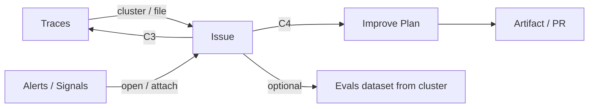

# Surface: Issues

> **Routes:** `/issues` · `/issues/[id]`  
> **IA leaf:** Observe → Issues (core #4)  
> **Primary object:** Issue (clustered or filed failure; Findings roll up)  
> **Decision date:** 2026-07-21  
> **North star:** Laminar Signals/clusters → workflow object; TraceRoot Findings severity — **not** red-team  
> **Companions:** bible Issue/Finding · IA `tab=open|all|incidents` · competitive §1.4 · §2 TraceRoot

Issues are the **cluster / incident unit** with status workflow. Laminar “Signals → clusters” energy maps here (and Alerts for fire/detector inbox). Raw triage stays on Traces.

---

## 1. Purpose

**One decision this page owns:**  
*Is this failure acknowledged, who owns it, and what is the next Improve exit?*

Issues own clustering, status, evidence links, and handoff to Plan. They do not own transcript pixels (Traces) or notification delivery (Alerts).

---

## 2. Primary user + JTBD

| | |
|--|--|
| **Primary** | Mira (J4 triage clustered failures) |
| **Secondary** | Jordan (incident lens noise vs signal) |
| **Contracts** | C1 diagnosis→Issue; C3 Issue→Trace **1**; C4 Issue→Plan **2** |
| **Done when** | Issue open with evidence; status updated; Plan created or explicitly blocked (“not enough evidence”) |

---

## 3. URL + query grammar

### 3.1 List hub

| Param | Values | Notes |
|-------|--------|-------|
| Path | `/issues` | Master–detail preferred |
| `tab` | `open` \| `all` \| `incidents` | Default `open`. `incidents` = clustered lens, **not** separate product |
| `issueId` | id | Master–detail selection on list |
| `q` | string | Search title/id |
| `filter` | string | status, severity, agent |
| `agentId` | id | Scope |
| `pastHours` / `from`/`to` | window | |
| `outcome` | rare | if used for evidence filters |

### 3.2 Detail page

| Path | `/issues/[id]` |
| Notes | Full page allowed; also deep-linkable. List may sync `issueId` instead of navigating — both OK if back stack sane |

### 3.3 Redirects

| Old | New |
|-----|-----|
| `/incidents` | `/issues?tab=incidents` |
| `/incidents/:cluster_id` | `/issues?tab=incidents&issueId=:cluster_id` (or mapped id) |

### 3.4 Examples

```
/issues
/issues?tab=open
/issues?tab=incidents&issueId=iss_12
/issues/iss_12
/issues?agentId=agent_support&pastHours=24
```

### 3.5 Cross-link preservation

Issue → Trace: set `traceId` (+ `spanId`); preserve `pastHours`, `q`, `agentId` (C3).  
Trace → Issue create: pass evidence ids (C2).

---

## 4. Layout

### 4.1 Desktop ≥1280 — master–detail

```
┌─ Observe / Issues ─────────────────────────────────────────────────┐
│ Band2: [Open | All | Incidents] · Search · Severity · Agent · ⋯    │
├────────────────────────────┬───────────────────────────────────────┤
│ MASTER list                │ DETAIL                                │
│ title · severity · status  │ Title · StatusBadge · severity        │
│ agent · count · updated    │ Diagnosis / Findings strip            │
│                            │ Evidence: traces/sessions (links)     │
│                            │ Related: Alerts · Plans · Scores      │
│                            │ Primary CTA: Create Improve Plan      │
│ List stays mounted         │ Secondary: Open trace · Ack · Assign  │
└────────────────────────────┴───────────────────────────────────────┘
```

**Incidents tab:** same layout; copy emphasizes cluster size / blast radius; still Issue objects.

### 4.2 Full detail `/issues/[id]`

Same detail body full width; breadcrumb `Observe / Issues / {title|id}`. Related strip only (no nested routers).

### 4.3 Tablet / mobile

List full width; detail in **Sheet** or push to `/issues/[id]`. Mobile bottom nav Issues slot. Touch ≥44px. One accent CTA: Create Plan (Member+) or Open evidence (Viewer).

### 4.4 Findings embedding

Findings are **not** a nav leaf. Show as list inside detail (atomic assertions: tool X failed, heuristic Y). Each Finding links to span/trace when present.

### 4.5 Wireframes

**ASCII**

```
Observe / Issues                    [Open|All|Incidents]  Search  ⋯
LIST                         DETAIL
● tool:search timeout ×12    tool:search timeout
  support-bot · Sev High     Status: Open · Sev High · agent support-bot
  updated 4m                 Findings
○ schema drift refund          · tool:search timed out (span sp_9)
  writer-v2 · Med              · retry exhausted
○ latency budget p95           Evidence
                                 tr_ab12  2.1s · 3.2k · $0.11
                                 ses_9f3a turn 4
                               [Create Improve Plan]  [Open trace]  ⋯
```

**Mermaid — Laminar cluster loop**



---

## 5. Chrome budget

| Band | Contents |
|------|----------|
| 1 | Breadcrumb · Ask AI · Notifications |
| 2 | Tabs Open/All/Incidents · Search · ≤2 filters · Overflow |

≤5 primary toolbar actions. Detail actions: Create Plan (accent) · Open trace · Overflow (Assign, Status, Add to dataset, Copy link). Max one Banner.

---

## 6. States

### 6.1 Empty / first-run

No issues ever. Copy: Issues appear from detectors/clusters or when you file from a Trace. CTA: **Open Traces** (not Connect unless also zero agents — then prefer Connect). Secondary: docs on detectors (external).

### 6.2 Loading

List skeleton; detail skeleton if `issueId`/`[id]` present.

### 6.3 Error

Retry. 404 detail: back to list. Permission: Viewer sees read-only (no Create Plan solid CTA).

### 6.4 Filtered-empty

Issues exist; tab/filters match none (e.g. Open tab empty but All has closed). CTA: **View all** / Clear filters. Distinct from first-run.

### 6.5 Populated

List + detail. Show evidence counts. Severity + status text+icon (not color alone).

### 6.6 Live

Opt-in: new issues / count bumps. Quiet indicator. Default off.

### 6.7 Not-enough-evidence

Create Plan path may dead-end honestly: message “Not enough evidence to plan” + CTA add evidence / open traces — **do not fake a Plan** (bible).

---

## 7. Components (kit only)

ResourcePageShell · DetailPanelShell · DataTable · Tabs underline · QueryState · StatusBadge · Tag · Panel · Button · CodeChip · MetricInline (on evidence rows) · Sheet · Dialog (status/assign) · CommandPalette.

Ban: red-team attack library; decorative insight cards without evidence links; hub-of-hubs Incidents product.

---

## 8. Keyboard map

| Key | Action |
|-----|--------|
| `⌘K` | Palette |
| `/` | Search |
| `j`/`k` | List move |
| `Enter` | Open detail |
| `Esc` | Close sheet / clear `issueId` |
| `t` | Open primary evidence Trace (C3) |
| `p` | Create Improve Plan (C4) if permitted |
| `s` | Cycle status (Member+) |
| `a` | Assign |

---

## 9. Closed-loop exits

| From | To | Cap | Notes |
|------|----|-----|-------|
| Diagnosis elsewhere | Issue | 1 | C1 |
| Primary evidence | `/traces?traceId=` | **1** C3 | preserve filters |
| Create Plan | `/improve?tab=plans` or plan draft | **2** C4 | `issueId` + evidence |
| Related Alert | `/alerts?alertId=` | 1–2 | |
| Add to dataset | `/evals?tab=datasets` | 2 | cluster → eval (Laminar steal) |
| Agent | `/agents/[id]` | 1 | |
| Ask AI | bubble with issue context | 1 | |

---

## 10. Anti-patterns (banned)

- Red-team / adversarial campaign UI  
- Top-level `/incidents` product without redirect  
- Issues as read-only insight cards with no status/Plan exit  
- Unmounting list on select ≥1280  
- Fake Plan when evidence missing  
- Purple glow / Helicone collage  
- Filing Issue requiring Eval setup first  
- Dual Signals top-level leaf (Signals live under Alerts)  

---

## 11. Acceptance checklist

- [ ] `/issues` core leaf; tabs `open|all|incidents`  
- [ ] `/issues/[id]` works; list `issueId` master–detail OK  
- [ ] `/incidents` redirects  
- [ ] Evidence links preserve filter grammar; C3 one click  
- [ ] Create Plan ≤2 clicks; honest dead-end allowed  
- [ ] Findings embedded, not nav  
- [ ] States: empty, loading, error, filtered-empty, populated, live, not-enough-evidence  
- [ ] Chrome budget; one accent CTA  
- [ ] Viewer read-only mutate CTAs hidden  
- [ ] Cluster → dataset exit available (Member+)  
- [ ] Mobile Issues in bottom nav; Sheet detail  
- [ ] No red-team  

---

## 12. Field contracts

**Issue:** `issueId`, `title`, `status` (`open|acked|mitigating|resolved|closed`), `severity` (`low|med|high|critical`), `agentId?`, `occurrenceCount`, `firstSeenAt`, `lastSeenAt`, `findingIds[]`, `evidence` (`traceId`/`spanId`/`sessionId`[]), `linkedAlertIds[]`, `linkedPlanIds[]`, `assigneeId?`.

**Finding (embedded):** `findingId`, `kind`, `message`, `severity`, `traceId?`, `spanId?`.

---

*End of surfaces/issues.md*
