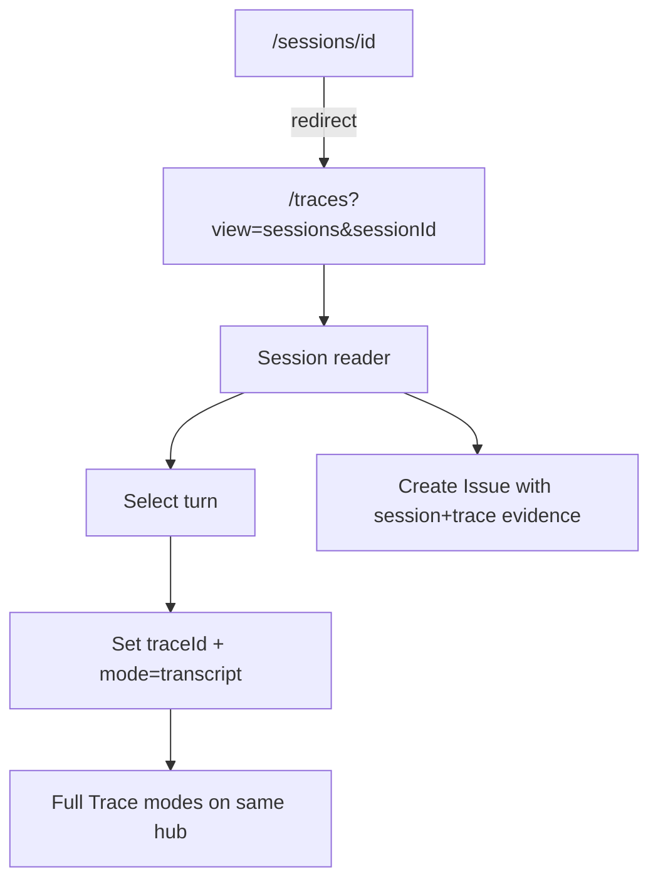

# Surface: Sessions

> **Canonical UX home:** `/traces?view=sessions` (+ `sessionId` for reader)  
> **Deep links:** `/sessions` → redirect; `/sessions/[id]` → `/traces?view=sessions&sessionId=[id]`  
> **IA status:** Must-ship capability; **not** a 13th sidebar leaf (IA §1.2)  
> **Primary object:** Session (contains Traces)  
> **Decision date:** 2026-07-21  
> **Companions:** [traces.md](./traces.md) · bible Session · IA §3 · Laminar multi-turn / debugger adjacency

Sessions are a **hub lens and reader** under Traces. This file is the full UX contract for session list + session reader so engineering does not under-specify the embed.

---

## 1. Purpose

**One decision this page owns:**  
*Which multi-turn thread is failing, and which child Trace holds the bad turn?*

Sessions own conversation/thread continuity. Single-run depth remains Trace transcript (`mode=transcript` on a child).

---

## 2. Primary user + JTBD

| | |
|--|--|
| **Primary** | Mira (J3 multi-turn context) |
| **JTBD** | Understand session timeline; jump to child Trace; feed Issue evidence |
| **Done when** | Session selected; failing turn Trace opened with shareable URL; filters preserved |

---

## 3. URL + query grammar

### 3.1 Canonical

| Form | Meaning |
|------|---------|
| `/traces?view=sessions` | Session list lens (master) |
| `/traces?view=sessions&sessionId=ses_1` | Session selected (detail/reader) |
| `/traces?view=sessions&sessionId=ses_1&traceId=tr_abc&mode=transcript` | Session context + child Trace focus |

Optional: `spanId` when drilling into child.

### 3.2 Redirects (permanent)

| Old | New |
|-----|-----|
| `/sessions` | `/traces?view=sessions` |
| `/sessions/:sessionId` | `/traces?view=sessions&sessionId=:sessionId` |

**Ban:** Implementing `/sessions` as a parallel non-redirect product page.

### 3.3 Shared Observe filters

Same as Traces: `q`, `filter`, `pastHours`, `from`/`to`, `outcome`, `agentId`, `realm`, `live`, `viewId`, `facet` (rarely meaningful on session aggregate — apply if backend supports).

Preserve set when jumping child → Trace-only view: keep filters; set `view=traces` only if user explicitly switches lens — prefer stay in sessions lens with `traceId` set so back stack remains coherent.

### 3.4 Examples

```
/traces?view=sessions
/traces?view=sessions&sessionId=ses_1
/traces?view=sessions&sessionId=ses_1&traceId=tr_abc&mode=transcript
/sessions/ses_1          → redirect to canonical
```

### 3.5 Cmd+K

Destination **Sessions** → `/traces?view=sessions` (IA §6).

Breadcrumb when lens active: `Observe / Sessions` (+ short session id when selected) — IA §9.

---

## 4. Layout

Sessions reuse Traces chrome (≤2 bands, pane-local toolbar). Switching `view=sessions` swaps **master** content and **detail** canvas; do not remount entire Observe shell.

### 4.1 Desktop ≥1280

```
┌─ MASTER: Sessions table ─────────┬─ DETAIL: Session reader ────────┐
│ time · agent · turns · outcome   │ Header: sessionId · agent · dur │
│  tokens · $ · last error         │ · tokens · $                    │
│                                  │ DiagnosisStrip (session-level)  │
│ Row metrics REQUIRED             │ Turn timeline (child traces)    │
│ latency·tokens·cost aggregates   │  [turn 1] tr_…  ok   0.4s $0.02 │
│                                  │  [turn 2] tr_…  err  2.1s $0.11 │
│                                  │ Selected turn → embedded mini   │
│                                  │ transcript OR "Open transcript" │
│ List stays mounted               │ Mode for child: default         │
│                                  │ transcript (link to full modes) │
└──────────────────────────────────┴─────────────────────────────────┘
```

**Session reader jobs (one composition):**  
1) See turn list with outcomes/metrics.  
2) Select turn → preview failure.  
3) Open full Trace reader (same page: set `traceId` + `mode`, or expand in-pane).

Prefer **in-pane** child transcript preview + button `Open in Trace modes` that keeps `sessionId` and sets `traceId`/`mode`.

### 4.2 Tablet / mobile

Same as Traces: list full width; session detail in **Sheet**; child Trace may push nested sheet or navigate URL with sheet stack — Esc pops selection params in order: `spanId` → `traceId` → `sessionId`.

### 4.3 Relationship to Debugger sessions

**Session** (Observe) ≠ **DebuggerSession** (`/debugger`). Copy and Cmd+K must not conflate. Debugger is seeded from a Trace/Session via actions, not by renaming this lens.

### 4.4 Wireframes

**ASCII**

```
Observe / Sessions / ses_9f3a
SESSIONS                         SESSION
14:02 support  6 turns  err $0.4 ●  ses_9f3a · support-bot · 6 turns
14:00 research 3 turns  ok  $0.1    Diagnosis: turn 4 tool timeout
13:40 support  2 turns  ok  $0.05   Turns
                                      1 tr_a1  ok   0.3s · 1.1k · $0.01
                                      2 tr_a2  ok   0.5s · 1.4k · $0.02
                                      3 tr_a3  ok   0.4s · 0.9k · $0.01
                                      4 tr_a4  err  2.1s · 3.2k · $0.11  ←
                                      5 tr_a5  ok   0.6s · 1.0k · $0.02
                                    Preview transcript (turn 4)…
                                    [Open transcript] [Create issue] [Debugger]
```

**Mermaid**



---

## 5. Chrome budget

Identical to Traces host:

| Band | Contents |
|------|----------|
| 1 | Breadcrumb Sessions · Ask AI |
| 2 | View (includes Sessions) · Filter · Display · Search · Overflow · time |

When session selected, detail actions ≤5: Open transcript · Create issue · Debugger · Share · Overflow. One solid accent CTA (usually Create issue **or** Open transcript — context picks one solid).

First-paint still ≤8 controls on the Observe hub.

---

## 6. States

### 6.1 Empty / first-run

No sessions (and possibly no traces). Same Connect CTA as Traces empty — do not invent a separate “create session” product action (sessions are ingested).

### 6.2 Loading

Session table skeleton; if `sessionId` present, detail skeleton turn list.

### 6.3 Error

List error + Retry. Session 404: clear `sessionId`, toast/inline “Session not found”. Child trace preview error: inline on turn row.

### 6.4 Filtered-empty

Sessions exist org-wide; filters match none. **Clear filters**. Distinct from first-run.

### 6.5 Populated

Rows with aggregate **latency · tokens · cost** (and turn count, outcome rollup). Detail turn rows also show per-trace latency · tokens · cost.

### 6.6 Live

`live=1` appends new sessions / updates turn counts. Opt-in via Display. Same rules as Traces.

### 6.7 Session with zero hydrated traces

Show session shell + “Turns not yet available” + Retry. Do not fake turns.

---

## 7. Components (kit only)

Reuse Traces kit: ResourcePageShell · DetailPanelShell · DataTable · QueryState · MetricInline · StatusBadge · CodeChip · Panel · Sheet · Tabs (only if turn preview modes needed — prefer single timeline).

Ban: separate Sessions app shell; card-per-turn collage; Debugger chrome embedded as default.

---

## 8. Keyboard map

Inherits Traces map, plus:

| Key | Action |
|-----|--------|
| `j`/`k` | Session list **or** turn list (focus region) |
| `Enter` | Select session / open turn Trace |
| `o` | Open full transcript for focused turn |
| `Esc` | Clear `spanId` → `traceId` → `sessionId` progressively |
| `1`–`5` | Trace modes when `traceId` set |

---

## 9. Closed-loop exits

| From | To | Cap | Set / preserve |
|------|----|-----|----------------|
| Session row | `sessionId` on `/traces?view=sessions` | 1 | filters |
| Turn row | `traceId` + `mode=transcript` | 1 | keep `sessionId` |
| Create Issue | Issue with `sessionId` + `traceId` | 2 | C2 |
| Debugger | `/debugger` seeded with session/trace | 2 | |
| Agent chip | `/agents/[id]` | 1 | |
| Ask AI | bubble with session context | 1 | |

---

## 10. Anti-patterns (banned)

- Core nav leaf “Sessions” (13th item)  
- `/sessions` as live duplicate route without redirect  
- Conflating Observe Session with DebuggerSession in UI copy  
- Defaulting session reader to Timeline Gantt  
- Dropping `sessionId` when opening child transcript  
- Unmounting session list on select ≥1280  
- Helicone cards; red-team  

---

## 11. Acceptance checklist

- [ ] Canonical path is `/traces?view=sessions`  
- [ ] `/sessions` and `/sessions/[id]` redirect with id preserved  
- [ ] Breadcrumb Observe / Sessions  
- [ ] Cmd+K → sessions lens  
- [ ] Master–detail desktop; Sheet mobile  
- [ ] Turn list shows latency · tokens · cost per child Trace  
- [ ] Aggregate metrics on session rows  
- [ ] Esc progressive clear of selection params  
- [ ] States: empty, loading, error, filtered-empty, populated, live, zero-turns  
- [ ] Create Issue / Debugger / AI exits wired  
- [ ] No 13th sidebar leaf; no parallel Sessions product  

---

## 12. Field contracts

**Session list row:** `sessionId`, `agentId?`, `startedAt`, `endedAt?`, `turnCount`, `outcome` (rollup), `latencyMs` (sum or wall), `totalTokens`, `costUsd`, `lastErrorSummary?`.

**Turn row:** `traceId`, `index`, `startedAt`, `outcome`, `latencyMs`, `totalTokens`, `costUsd`, `preview?`.

---

*End of surfaces/sessions.md*
