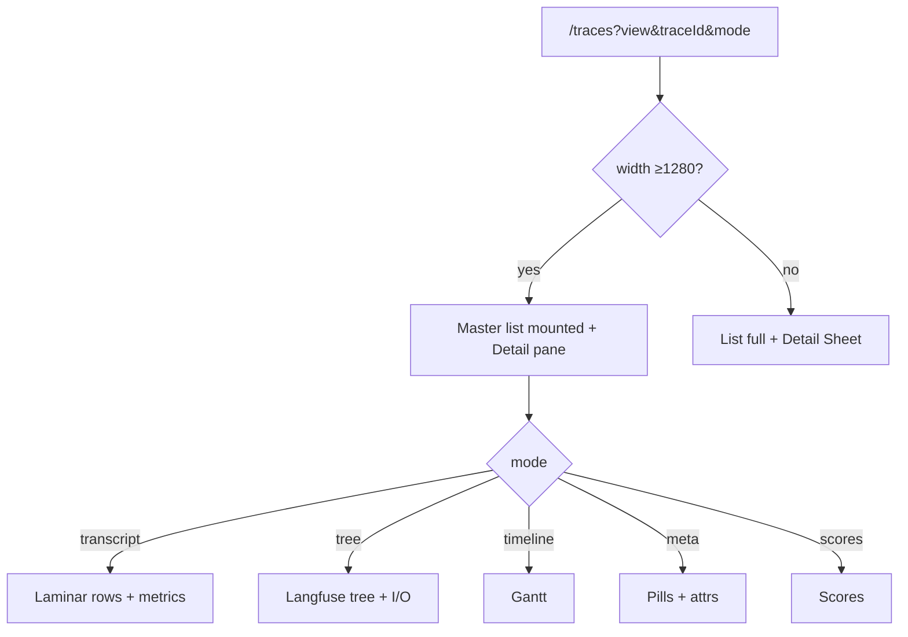

# Surface: Traces

> **Route:** `/traces` (+ selection via query)  
> **IA leaf:** Observe → Traces (core #3) — **hero Observe surface**  
> **Primary objects:** Trace · Span · Session (via `view=`)  
> **Decision date:** 2026-07-21  
> **North star:** Laminar transcript-first + Langfuse master–detail inspector mechanics  
> **Companions:** IA §3 URL grammar · DESIGN-SYSTEM-V2 §7.1–7.2 · competitive §1 Laminar · §3 Langfuse

This is the product’s **hero surface**. Default reader = **transcript**. Tree / Timeline / Meta / Scores are Modes — not equal nav peers. Sessions are a **hub lens** (`view=sessions`), not a 13th sidebar leaf.

---

## 1. Purpose

**One decision this page owns:**  
*What happened in this run (or session), and which span/message is the failure?*

Traces owns observation and diagnosis-in-context. It does not own Issue workflow status (Issues), alert routing (Alerts), or Artifact/PR (Improve) — it **exits** to those with evidence ids.

---

## 2. Primary user + JTBD

| | |
|--|--|
| **Primary** | Mira debugging a failing turn tonight |
| **JTBD** | J2 transcript debug; J3 session context; feeds J4–J6 |
| **Contracts** | C2 Trace→Issue ≤2; C9 Trace→Debugger ≤2; C10 AI ≤1 |
| **Done when** | Root-cause span/message identified; shareable URL restores `traceId` + `mode` + filters |

---

## 3. URL + query grammar

### 3.1 Two parameters — never conflate

| Param | Scope | Values | Default |
|-------|-------|--------|---------|
| **`view`** | Hub list lens | `traces` \| `spans` \| `sessions` | `traces` |
| **`mode`** | Trace reader canvas | `transcript` \| `tree` \| `timeline` \| `meta` \| `scores` | `transcript` when `traceId` set |
| **`viewId`** | Saved table view | opaque id | — — **never** reuse `view` |

### 3.2 Selection & identity

| Param | Canonical | Aliases (read → normalize write) |
|-------|-----------|----------------------------------|
| `traceId` | yes | `trace_id`, `trace` |
| `spanId` | yes | `span_id`, `span` |
| `sessionId` | yes | `session_id` |
| `agentId` | yes | `agent_id` |
| `issueId` | yes | cross-link |
| `alertId` | yes | cross-link |

### 3.3 Filters

`q` · `filter` · `pastHours` · `from`/`to` · `outcome` (`error`\|`ok`\|`unknown`) · `realm` · `facet` (`mcp`\|`decisions`\|`memory`\|`retrieval`) · `live` (`0`\|`1`)

### 3.4 Legacy embed map

| Legacy `view=` | New |
|----------------|-----|
| `inspect` | detail + `mode=meta` |
| `replay` / `debug` / `time-travel` | `/debugger` seeded |
| `query` | optional panel or ignore |
| `cohorts` | filter / `viewId` |
| `traces`\|`spans`\|`sessions` | keep as hub lens |

### 3.5 Examples

```
/traces
/traces?view=sessions
/traces?view=traces&traceId=tr_abc&mode=transcript
/traces?traceId=tr_abc&spanId=sp_9&mode=tree
/traces?view=sessions&sessionId=ses_1
/traces?agentId=agent_support&pastHours=24&outcome=error
/traces?traceId=tr_abc&mode=scores
/traces?facet=retrieval&q=checkout
```

### 3.6 Deep-link rules

- Refresh/share restore selection + mode + critical filters.  
- Esc closes detail: **remove** `traceId`/`spanId`/`sessionId` without wiping filters.  
- Cross-links preserve: `pastHours|from|to|q|filter|agentId|outcome|realm|viewId`.  
- Write camelCase; drop aliases on write; skip nav if query unchanged.

---

## 4. Layout

### 4.1 Desktop ≥1280 — master–detail (mandatory)

```
┌─ Observe / Traces ─────────────────────────────────────────────────┐
│ Band2 IN MASTER PANE: View · Filter · Display · Search · Overflow  │
│   (≤5 primary; LIVE under Display — not first-paint primary)       │
├──────────────────────────────┬─────────────────────────────────────┤
│ MASTER (~40–55%)             │ DETAIL (~45–60%)                    │
│ Hub lens table:              │ DiagnosisStrip (Signals-style)      │
│  traces | spans | sessions   │ Summary meta: dur · tokens · $      │
│                              │ Mode: Transcript|Tree|Timeline|     │
│ Row: time · agent · outcome  │       Meta|Scores                   │
│  preview · latency·tokens·$  │ ─────────────────────────────────── │
│                              │ Canvas per mode (see §4.4)          │
│ List STAYS MOUNTED           │ I/O split when expanded             │
└──────────────────────────────┴─────────────────────────────────────┘
```

**Do not** unmount list on row select at ≥1280. **Do not** full-page navigate per row.

### 4.2 Tablet 768–1279

Master full width. Selecting a row opens **Sheet/Drawer** detail (same URL params). Esc / back closes sheet and clears selection params.

### 4.3 Mobile `<768`

```
Bottom nav: Traces active.
List full width; priority columns: time · outcome · latency · $ · agent.
Tap row → Sheet with transcript default.
Mode as underline tabs inside sheet (scroll).
Inspector/meta as nested drawer if needed — never three sticky bands.
AI open hides bottom nav per z-index contract.
```

### 4.4 Reader modes (detail canvas)

#### Mode `transcript` (DEFAULT) — Laminar

```
[ DiagnosisStrip: findings / linked issue / alert ]
[ Meta line: total duration · tokens · cost · agent · time ]
[ Mode tabs ]
────────────────────────────────────────────────────────────
[icon] step name                         120ms · 1.2k · $0.01
       └─ In/Out collapsed (… more)
[icon] tool:search                        40ms · — · —
[icon] LLM completion                    800ms · 2.4k · $0.02  ← --accent-purple label only
```

- Hairline separators; **no card-per-step**.  
- Metrics on **every** row when API provides them (`MetricInline`: latency · tokens · cost).  
- I/O collapsed by default; expand accordion.  
- Span kind colors = pills only (LLM purple, tool amber, subagent cyan, error, running).

#### Mode `tree` — Langfuse mechanics

Left hierarchical span tree (~30–40% of detail) with per-node latency·tokens·cost; right inspector with metadata pill strip + Input / Output wash (`--bg-inset` / subtle success tint). Formatted ↔ JSON toggle. Selection syncs `spanId`.

#### Mode `timeline`

Virtualized Gantt / waterfall synced to `spanId`. Power mode — never default.

#### Mode `meta`

Attributes, resource, raw ids, links, custom props. Pill strip Langfuse-style.

#### Mode `scores`

Scores attached to trace/spans; link to Evals experiment when present.

### 4.5 Hub lenses (`view`)

| `view` | Master content |
|--------|----------------|
| `traces` | Trace rows |
| `spans` | Flattened span rows (still open parent trace in detail) |
| `sessions` | Session rows — full UX also documented in [sessions.md](./sessions.md) |

### 4.6 First-paint control budget

**≤8 first-paint controls** on this surface (hard). Example allowed set:

1. View (traces/spans/sessions)  
2. Filter (or one status/outcome)  
3. Display  
4. Search  
5. Overflow  
6. Time window  
7. Mode tabs (detail only — count when detail open)  
8. One primary action (Create issue / Share)

Everything else → Overflow or ⌘K. LIVE is **not** a first-paint primary.

### 4.7 Wireframes

**ASCII — desktop populated**

```
Observe / Traces / tr_ab12
MASTER                              DETAIL
View[Traces|Spans|Sessions]         Diagnosis: tool:search failed ×12 cluster
Filter Display Search ⋯ 24h         2.4s · 18.2k tok · $0.11 · support-bot
─────────────────────────────────   [Transcript|Tree|Timeline|Meta|Scores]
14:02  support  err  2.1s $0.11  ●  ─────────────────────────────────────
14:01  support  ok   0.4s $0.02     ◆ user: "Refund order 9921"
13:58  research ok   1.1s $0.05     ◆ tool:search          40ms
13:55  support  err  8.0s $0.20       in: q=order 9921
                                      out: timeout … more
                                    ◆ llm:gpt-4.1        800ms · 2.4k · $0.02
[Create issue] [Debugger] [Ask]
```

**Mermaid — layout decision**



---

## 5. Chrome budget

| Band | Contents |
|------|----------|
| 1 | Breadcrumb `Observe / Traces [/ {traceIdShort}]` · Ask AI · Notifications |
| 2 | **Inside master pane:** View · Filter · Display · Search · Overflow (+ time). Detail: Mode tabs + ≤1 accent action |

Max one Banner (e.g. ingest delay). No sticky sandwich (header + filters + table head + bulk + FAB + mobile nav).

Bulk select: desktop BulkActionBar only; hide on mobile when FAB+nav present.

---

## 6. States

### 6.1 Empty / first-run

No traces in org (ever or all-time empty). Copy: waiting for Gateway/SDK traffic. CTA: **Connect agent** → `/agents/connect`. Secondary: docs Quickstart. Distinct from filtered-empty.

### 6.2 Loading

Master skeleton rows; if `traceId` present, detail skeleton (strip + mode chrome + rows). Prefer streaming: show list when ready even if detail pending.

### 6.3 Error

| Kind | UI |
|------|-----|
| List fetch fail | QueryState error + Retry |
| Detail 404 | “Trace not found” + Clear selection |
| Partial span error | Inline on row; do not blank whole transcript |
| LIVE disconnect | Quiet badge; do not toast-spam |

### 6.4 Filtered-empty

Traces exist but filters match none. CTA: **Clear filters** (preserve `view`). Copy must mention filters.

### 6.5 Populated

List + optional detail. Every visible trace/span **row** shows latency · tokens · cost when known (placeholder `—` when unknown — never invent).

### 6.6 Live

`live=1` under Display. Append/poll new rows; short pulse on new row (`--duration-fast`). Polite aria-live. Default off. Never always-on first-paint primary.

### 6.7 Selection without data race

Opening `traceId` while list still loading: detail may fetch by id independently. On Esc, clear selection params only.

---

## 7. Components (kit only)

| Region | Kit |
|--------|-----|
| Shell | ResourcePageShell · DetailPanelShell · PageHeader |
| Toolbar | QueryFilterBar · ViewsMenu · FilterBar · Button · Select |
| List | DataTable (virtualized) · StatusBadge · MetricInline · CodeChip · Tag |
| Diagnosis | Panel · StatusBadge · Button |
| Transcript | Custom transcript rows using Panel/hairline — **not** Card-per-step |
| Tree/Meta | Tree list · Badge pills · Tabs · Input/Output panels (`--bg-inset` output wash) |
| States | QueryState · ErrorBoundary |
| Mobile | Sheet · Drawer |
| Bulk | BulkActionBar (desktop) |
| AI | Bubble overlay — data remains visible underneath |

Share: copy deep link (Langfuse-inspired); optional public share if backend supports — do not block v1 on public share.

---

## 8. Keyboard map

| Key | Action |
|-----|--------|
| `⌘K` | Palette |
| `/` | Focus search (`q`) |
| `j`/`k` | Move list selection |
| `Enter` | Open/focus detail for row |
| `Esc` | Close detail / clear `traceId`/`spanId`/`sessionId` |
| `1`…`5` | Mode transcript/tree/timeline/meta/scores (when detail open) |
| `e` | Expand/collapse focused transcript step |
| `i` | Create / link Issue (C2) |
| `d` | Open Debugger seeded (C9) |
| `f` | Focus filter |
| `⌘⏎` | Apply heavy filter (if Apply pattern used) |

Focus ring `--terminal`. Do not steal keys when typing in search/AI.

---

## 9. Closed-loop exits

| From | To | Cap | Preserve / set |
|------|----|-----|----------------|
| Row / diagnosis | stay on `/traces` with ids | 0–1 | selection |
| Create Issue | Issue create with evidence | **2** (C2) | `traceId`, `spanId?`, `agentId?` |
| Open Issue | `/issues/[id]` | 1 | filters set |
| Debugger | `/debugger?traceId=` | **2** (C9) | `agentId` |
| Add to dataset | `/evals?tab=datasets` (+ ids) | 2 | |
| Create Improve Plan | `/improve?tab=plans` | 2 | issue/trace evidence |
| Ask AI | bubble with context | **1** (C10) | object ids in payload |
| Citation back | canonical trace URL | **1** (C11) | |
| Session lens | see [sessions.md](./sessions.md) | — | `view=sessions` |

Related strip (links only): Issues · Alerts · Improve — no nested router.

---

## 10. Anti-patterns (banned)

- Helicone card-grid as Traces grammar  
- Equal-weight span **tree as default** reader  
- Timeline as default  
- Card-per-step transcript  
- Unmounting list on select ≥1280  
- Full-page hop per span open  
- Overloading `view` for saved views (use `viewId`)  
- Shipping `/sessions` as non-redirect duplicate of lens  
- 18–22 first-paint controls; LIVE as always-on primary  
- Chat as always-visible third column on mobile  
- Laminar orange brand; purple glow chrome  
- Red-team surface links  
- Dual `/observability` + `/traces` entry points  
- Metric cards instead of row MetricInline  

---

## 11. Acceptance checklist

- [ ] Default `view=traces`, `mode=transcript`  
- [ ] Master–detail ≥1280; Sheet &lt;1280; list stays mounted on desktop  
- [ ] Modes: transcript · tree · timeline · meta · scores  
- [ ] Latency · tokens · cost on every list row and transcript/tree row when known  
- [ ] I/O collapsed by default; Output wash tonal inset  
- [ ] DiagnosisStrip above reader (Signals-style)  
- [ ] ≤8 first-paint controls; ≤5 toolbar primaries; ≤2 chrome bands  
- [ ] URL grammar §3 complete + alias normalize + Esc clears selection  
- [ ] States: empty, loading, error, filtered-empty, populated, live  
- [ ] `view=sessions` works; `/sessions` redirects here  
- [ ] Create Issue ≤2 clicks; Debugger ≤2; AI ≤1  
- [ ] Facets via `facet=` not separate pages  
- [ ] Dark-terminal tokens; span hues only as labels  
- [ ] i18n en/de; a11y AA; reduced motion  
- [ ] No red-team; no Helicone collage  

---

## 12. Row field contracts

**Trace list row:** `traceId`, `agentId?`, `sessionId?`, `startedAt`, `outcome`, `latencyMs`, `totalTokens`, `costUsd`, `inputPreview?`, `errorSummary?`, `scoreSummary?`.

**Transcript step:** `spanId`, `kind`, `name`, `latencyMs`, `promptTokens?`, `completionTokens?`, `costUsd?`, `input`, `output`, `error?`, `childrenCollapsed`.

**DiagnosisStrip:** `findings[]`, `linkedIssueId?`, `linkedAlertId?`, `clusterSize?`, `primaryCta`.

---

*End of surfaces/traces.md*
