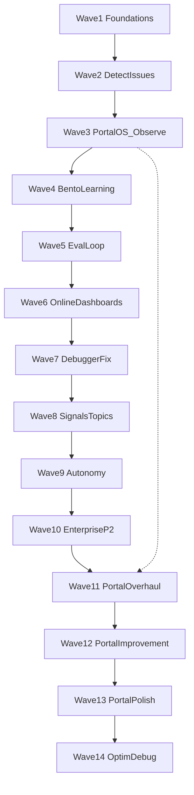

# Eden Master Roadmap

> **Purpose:** Sequence every F-spec that is **not fully shipped** (MISSING, PARTIAL, or SHIPPED v0), plus dedicated **portal overhaul / improvement / polish** waves and a **final optimization & debugging** wave.  
> **Specs are canonical** — this file only orders work and links out.  
> **No timelines** — waves are dependency order, not calendars.

| Companion | Path |
|---|---|
| Feature specs | [`features/`](features/) |
| Portal UI specs | [`ui/`](ui/) |
| Competitor research | [`COMPETITOR-UI-RESEARCH.md`](COMPETITOR-UI-RESEARCH.md) |
| Inventory index | [`FEATURE-GAP-MASTER.md`](FEATURE-GAP-MASTER.md) |
| Code vs spec | [`CODEBASE-GROUND-TRUTH.md`](CODEBASE-GROUND-TRUTH.md) |
| Perf/cost SLAs | [`PERFORMANCE-COST-STANDARDS.md`](PERFORMANCE-COST-STANDARDS.md) |
| Autonomy model | [`AUTONOMOUS-MAINTENANCE.md`](AUTONOMOUS-MAINTENANCE.md) |

---

## Status legend

| Tag | Meaning |
|---|---|
| **MISSING** | Not built to acceptance criteria |
| **PARTIAL** | Scaffold or thin surface; acceptance criteria open |
| **SHIPPED v0** | Core path works; stretch / harden to full ship still required |

**Fully shipped:** none. All F-specs on this roadmap are MISSING, PARTIAL, or SHIPPED v0. Portal program specs U18–U20 and optim specs F82–F85 are included in Waves 11–14.

---

## Wave order (execute top → bottom)



Waves **11–13** are **portal-only programs** (overhaul → improvement → polish).  
Wave **14** is the **final cross-cutting optimization & debugging** program.

Note: Wave 11 may start once Wave 3 shell primitives exist; it must complete after core product surfaces from Waves 4–10 have landed enough to re-shell.

---

## Wave 1 — Foundations

Unblock contracts, MCP, ingest primitives. Harden v0 to full ship.

| ID | Title | Status | P | Spec |
|---|---|---|---|---|
| F48 | Portal API contract fix | SHIPPED v0 | P0 | [f48](features/f48-portal-api-contract-fix.md) |
| F04 | Eden MCP server | SHIPPED v0 | P0 | [f04](features/f04-eden-mcp-server.md) |
| F03 | Checkpoint ingestion from spans | SHIPPED v0 | P0 | [f03](features/f03-checkpoint-ingestion-from-spans.md) |
| F12 | Typesense full-text span search | SHIPPED v0 | P1 | [f12](features/f12-typesense-span-search.md) |

**UI:** none required beyond contract stability for later waves.

**Exit:** Portal routes match backend; MCP tools reliable; checkpoints + search ready for debugger/observe.

---

## Wave 2 — Detect & issues

Zero-config detection and Sentry-style issue loop — harden v0 to full ship.

| ID | Title | Status | P | Spec |
|---|---|---|---|---|
| F28 | Agent stumbles | SHIPPED v0 | P0 | [f28](features/f28-agent-stumbles.md) |
| F29 | Agent issues (Sentry-style) | SHIPPED v0 | P0 | [f29](features/f29-agent-issues-sentry.md) |
| F20 | Zero-config auto issue detection | SHIPPED v0 | P0 | [f20](features/f20-zero-config-auto-issue-detection.md) |
| F30 | Triage agent | SHIPPED v0 | P0 | [f30](features/f30-triage-agent.md) |
| F35 | Default signal library | SHIPPED v0 | P1 | [f35](features/f35-default-signal-library.md) |
| F47 | Slack Block Kit outbound alerts | SHIPPED v0 | P0 | [f47](features/f47-slack-block-kit-alerts.md) |

**Exit:** Stumble → issue → triage → Slack outbound meets each spec’s full acceptance criteria (not only v0).

---

## Wave 3 — Portal OS & Observe

Shared table/filter/views OS, then Laminar-class traces hub.

| ID | Title | Status | P | Spec | UI |
|---|---|---|---|---|---|
| F58 | Saved table views | MISSING | P0 | [f58](features/f58-saved-table-views.md) | [U00](ui/00-portal-operating-system.md), [U08](ui/u08-saved-views-and-filters.md), [U12](ui/u12-portal-ia.md) |
| — | Traces hub (uses F12) | — | — | — | [U01](ui/u01-traces-hub.md) |

Also finish Observe-adjacent session contract (feeds hub Sessions tab):

| ID | Title | Status | P | Spec | UI |
|---|---|---|---|---|---|
| F23 | Session-first SDK | MISSING | P1 | [f23](features/f23-session-first-sdk.md) | [U01](ui/u01-traces-hub.md) |

**Exit:** Core nav ≤12; shareable filters/views; traces split-pane with transcript default; sessions first-class.

---

## Wave 4 — Bento learning loop

Artifacts, Book, promotion gate, drift, NL alert triage.

| ID | Title | Status | P | Spec | UI |
|---|---|---|---|---|---|
| F39 | Runtime nudge injection | PARTIAL | P0 | [f39](features/f39-runtime-nudge-injection.md) | [U02](ui/u02-artifacts.md) |
| F41 | Evidence-gated promotion | PARTIAL | P0 | [f41](features/f41-evidence-gated-promotion.md) | [U02](ui/u02-artifacts.md) |
| F40 | The Book (agent memory) | PARTIAL | P1 | [f40](features/f40-the-book-agent-memory.md) | [U05](ui/u05-book-and-drift.md) |
| F42 | Behavioral drift pinpoint | PARTIAL | P1 | [f42](features/f42-behavioral-drift-pinpoint.md) | [U05](ui/u05-book-and-drift.md) |
| F81 | NL alerts + real/benign triage | MISSING | P0 | [f81](features/f81-nl-alerts-real-benign-triage.md) | [U04](ui/u04-alerts-inbox.md) |

**Depends on:** Wave 2 issues (artifact authoring), Wave 3 observe (drill-down), F47 for channels.

**Exit:** Issue → shadow artifact → EvidenceGate promote/demote; Book LLM + diffs; live drift histograms; English alerts with real/benign judge.

---

## Wave 5 — Eval loop

Dataset → annotate → playground → experiment (Braintrust-class).

| ID | Title | Status | P | Spec | UI |
|---|---|---|---|---|---|
| F53 | Versioned dataset hub | PARTIAL | P0 | [f53](features/f53-versioned-dataset-hub.md) | [U10](ui/u10-datasets-spreadsheet.md) |
| F50 | Annotation queues | PARTIAL | P0 | [f50](features/f50-annotation-queues.md) | [U06](ui/u06-annotation-queue.md) |
| F49 | Production prompt playground | SHIPPED v0 | P0 | [f49](features/f49-prompt-playground.md) | [U03](ui/u03-playground.md) |
| F51 | Offline experiment runner + compare | PARTIAL | P0 | [f51](features/f51-offline-experiment-runner.md) | [U07](ui/u07-experiments-compare.md) |
| F44 | Auto-curated production eval slices | PARTIAL | P1 | [f44](features/f44-auto-production-eval-slices.md) | [U10](ui/u10-datasets-spreadsheet.md) |
| F33 | Issue-linked production experiments | PARTIAL | P1 | [f33](features/f33-issue-linked-experiments.md) | [U07](ui/u07-experiments-compare.md) |

**Depends on:** Wave 3 traces (open-in-playground / add-to-dataset).

**Exit:** Production failure → dataset → playground fix → immutable experiment compare; issue-linked experiments work.

---

## Wave 6 — Online quality, dashboards, prompts

Continuous scoring, home/cost surfaces, prompt deploy.

| ID | Title | Status | P | Spec | UI |
|---|---|---|---|---|---|
| F52 | Online scoring rules engine | PARTIAL | P0 | [f52](features/f52-online-scoring-rules.md) | [U14](ui/u14-online-rules-builder.md) |
| F79 | Span-level scoring API | PARTIAL | P1 | [f79](features/f79-span-level-scoring.md) | [U01](ui/u01-traces-hub.md) |
| F54 | Code evaluators (sandboxed) | MISSING | P1 | [f54](features/f54-code-evaluators.md) | Scorers settings |
| F55 | Categorical classifiers | MISSING | P1 | [f55](features/f55-categorical-classifiers.md) | U01 columns |
| F61 | Automations engine | MISSING | P1 | [f61](features/f61-automations-engine.md) | [U14](ui/u14-online-rules-builder.md) |
| F57 | Custom monitoring dashboards | PARTIAL | P1 | [f57](features/f57-custom-monitoring-dashboards.md) | [U09](ui/u09-home-dashboard.md) |
| F60 | Cost & usage analytics | PARTIAL | P1 | [f60](features/f60-cost-usage-analytics.md) | U09 + optimization |
| F66 | Collaborative prompt workspace | PARTIAL | P1 | [f66](features/f66-collaborative-prompt-workspace.md) | [U17](ui/u17-prompt-environments.md) |
| F68 | AI Gateway prompt deploy | PARTIAL | P1 | [f68](features/f68-gateway-prompt-deploy.md) | [U17](ui/u17-prompt-environments.md) |
| F56 | CI eval GitHub Action | MISSING | P1 | [f56](features/f56-ci-eval-github-action.md) | — |
| F76 | SQL/EQL → dataset / queue export | MISSING | P1 | [f76](features/f76-sql-export-to-dataset.md) | Query page |
| F75 | Late metadata on finished traces | MISSING | P1 | [f75](features/f75-late-trace-metadata.md) | U01 |
| F73 | Ingest PII redaction | PARTIAL | P1 | [f73](features/f73-ingest-pii-redaction.md) | Settings PII |

**Depends on:** Wave 5 datasets/experiments; Wave 3 filters.

**Exit:** Online rules score prod; editable Home; prompts env-deployed via gateway; CI gate posts PR scores.

---

## Wave 7 — Debugger & fix-in-code

| ID | Title | Status | P | Spec | UI |
|---|---|---|---|---|---|
| F01 | Cached-prefix live debugger | PARTIAL | P0 | [f01](features/f01-cached-prefix-live-debugger.md) | [U13](ui/u13-debugger-sessions.md) |
| F74 | Debugger session continuity | PARTIAL | P1 | [f74](features/f74-debugger-session-continuity.md) | [U13](ui/u13-debugger-sessions.md) |
| F09 | Browser session recording (RRWeb) | PARTIAL | P1 | [f09](features/f09-browser-session-recording-rrweb.md) | U01 timeline |
| F22 | Issue fix GitHub chat | PARTIAL | P0 | [f22](features/f22-issue-fix-github-chat.md) | Issues detail |

**Depends on:** Wave 1 F03/F04; Wave 2 issues.

**Exit:** Prefix replay + multi-run debugger sessions; RRWeb synced; issue → GitHub chat → PR path complete.

---

## Wave 8 — Signals & Topics

| ID | Title | Status | P | Spec | UI |
|---|---|---|---|---|---|
| F06 | Per-trace signal investigator | MISSING | P0 | [f06](features/f06-per-trace-signal-investigator.md) | U01 signals panel |
| F65 | Insights / Topics clustering | PARTIAL | P1 | [f65](features/f65-topics-insights-clustering.md) | [U11](ui/u11-topics-insights.md) |
| F21 | Tool call label learning | MISSING | P2 | [f21](features/f21-tool-call-label-learning.md) | U01 / U06 |
| F34 | Trained signal classifiers | MISSING | P2 | [f34](features/f34-trained-signal-classifiers.md) | Signals |
| F71 | Interactive Slack bot | PARTIAL | P1 | [f71](features/f71-interactive-slack-bot.md) | Slack (extends F47/F81) |

**Depends on:** Wave 3 observe; Wave 4 alerts; Wave 2 issues.

**Exit:** Investigate → cluster → act; labels feed learning; Slack inbound triage.

---

## Wave 9 — Autonomy (full ship of closed loop)

| ID | Title | Status | P | Spec |
|---|---|---|---|---|
| F46 | Closed-loop orchestrator | SHIPPED v0 | P0 | [f46](features/f46-closed-loop-orchestrator.md) |
| F62 | SLM-as-judge / Luna-cost path | MISSING | P1 | [f62](features/f62-slm-as-judge.md) |

**N-specs (not F, but required gate):** N22 → N21 / N20; N19 KB flywheel; N04 impact preview — see FEATURE-GAP-MASTER.

**Depends on:** Wave 4 EvidenceGate; Wave 5–6 eval proof; Wave 7 debugger.

**Exit:** F46 acceptance criteria fully met; cheap judges default for online; autonomy only behind N22.

---

## Wave 10 — Enterprise & differentiation (P2)

| ID | Title | Status | P | Spec | UI |
|---|---|---|---|---|---|
| F59 | Custom render templates | MISSING | P2 | [f59](features/f59-custom-render-templates.md) | [U15](ui/u15-render-templates.md) |
| F63 | Judge autotune / CLHF | MISSING | P2 | [f63](features/f63-judge-autotune.md) | — |
| F64 | Agentic metrics pack | PARTIAL | P2 | [f64](features/f64-agentic-metrics-pack.md) | — |
| F67 | LLM jury / composite metrics | MISSING | P2 | [f67](features/f67-llm-jury-composite.md) | — |
| F69 | Remote eval sandboxes | MISSING | P2 | [f69](features/f69-remote-eval-sandboxes.md) | U03 / U07 |
| F70 | In-product AI copilot | PARTIAL | P2 | [f70](features/f70-in-product-ai-copilot.md) | [U16](ui/u16-in-ui-copilot.md) |
| F72 | Virtual / customer data planes | MISSING | P2 | [f72](features/f72-virtual-data-planes.md) | — |
| F77 | Fine-tune export pipeline | MISSING | P2 | [f77](features/f77-finetune-export.md) | — |
| F78 | Multimodal playground inputs | MISSING | P2 | [f78](features/f78-multimodal-playground.md) | [U03](ui/u03-playground.md) |
| F80 | OSS local workshop | MISSING | P2 | [f80](features/f80-oss-local-workshop.md) | — |

**Exit:** Each listed F-spec acceptance criteria checked; enterprise blockers cleared for target customers.

---

## Wave 11 — Portal overhaul (structural)

**Totally focused on portal structure** — one shell, one IA, one detail contract. Not new product features.

| ID | Title | Status | P | Spec |
|---|---|---|---|---|
| U18 | Portal overhaul — structural rebuild | MISSING | P0 | [u18](ui/u18-portal-overhaul.md) |
| U00 | Portal operating system (complete adoption) | PARTIAL | P0 | [U00](ui/00-portal-operating-system.md) |
| U12 | Portal IA rewrite (freeze) | PARTIAL | P0 | [u12](ui/u12-portal-ia.md) |
| F58 | Saved table views (must be live for shell) | MISSING | P0 | [f58](features/f58-saved-table-views.md) |

### Work packages (from U18)

| WP | Deliverable |
|---|---|
| WP1 | AppShell + tokens + density provider |
| WP2 | ResourcePageShell + DetailPanelShell APIs |
| WP3 | Migrate Traces as reference |
| WP4 | Migrate Issues, Incidents, Alerts |
| WP5 | Migrate Artifacts, Improve, Book/Drift entry |
| WP6 | Migrate Playgrounds, Experiments, Datasets, Home |
| WP7 | Advanced quarantine + redirects |
| WP8 | ⌘K + mobile shell |
| WP9 | CI route agreement + Storybook shell states |
| WP10 | QA matrix desktop / tablet / mobile |

**Depends on:** Wave 3 primitives; product pages from Waves 4–10 exist to migrate into the shell.

**Exit gates:**
- [ ] U18 acceptance criteria all checked
- [ ] Core routes share one chrome; no orphan layouts in `(portal)/`
- [ ] Old `/observability?trace_id=` deep links redirect to U01 contract
- [ ] Do **not** start U19 until exit gates pass

---

## Wave 12 — Portal improvement (density & journeys)

**Totally focused on making every core surface competitor-dense** — filters, bulk actions, keyboards, cross-links, empty states. Still no net-new backend products.

| ID | Title | Status | P | Spec |
|---|---|---|---|---|
| U19 | Portal improvement — surface density pass | MISSING | P0 | [u19](ui/u19-portal-improvement.md) |
| U01 | Traces hub (full bar) | PARTIAL | P0 | [u01](ui/u01-traces-hub.md) |
| U02 | Artifacts UI (full bar) | PARTIAL | P0 | [u02](ui/u02-artifacts.md) |
| U03 | Playground UI (full bar) | PARTIAL | P0 | [u03](ui/u03-playground.md) |
| U04 | Alerts inbox (full bar) | PARTIAL | P0 | [u04](ui/u04-alerts-inbox.md) |
| U05 | Book & Drift (full bar) | PARTIAL | P0 | [u05](ui/u05-book-and-drift.md) |
| U06 | Annotation queue (full bar) | PARTIAL | P1 | [u06](ui/u06-annotation-queue.md) |
| U07 | Experiments compare (full bar) | PARTIAL | P1 | [u07](ui/u07-experiments-compare.md) |
| U08 | Saved views & filters (full bar) | PARTIAL | P0 | [u08](ui/u08-saved-views-and-filters.md) |
| U09 | Home dashboard (full bar) | PARTIAL | P1 | [u09](ui/u09-home-dashboard.md) |
| U10 | Datasets spreadsheet (full bar) | PARTIAL | P1 | [u10](ui/u10-datasets-spreadsheet.md) |
| U13 | Debugger sessions UI | PARTIAL | P1 | [u13](ui/u13-debugger-sessions.md) |
| U14 | Online rules builder UI | PARTIAL | P1 | [u14](ui/u14-online-rules-builder.md) |
| U17 | Prompt environments UI | PARTIAL | P1 | [u17](ui/u17-prompt-environments.md) |

### Work packages (from U19)

| WP | Surfaces |
|---|---|
| WP1 | Traces + Sessions density (reference) |
| WP2 | Issues + Incidents |
| WP3 | Alerts |
| WP4 | Artifacts + Improve |
| WP5 | Book + Drift |
| WP6 | Datasets + Labeling |
| WP7 | Playground + Experiments |
| WP8 | Home + Settings critical |
| WP9 | Debugger + Automations + Prompts |
| WP10 | Cross-link matrix + design sign-off |

**Depends on:** Wave 11 shell.

**Exit gates:**
- [ ] U19 acceptance criteria all checked
- [ ] Cross-link matrix Trace↔Issue↔Artifact↔Experiment↔Dataset live
- [ ] Design sign-off on Traces, Artifacts, Playground, Alerts
- [ ] Pages that fail the bar are Advanced-only or removed from nav

---

## Wave 13 — Portal polish

**Totally focused on polish** — a11y, motion, microcopy, visual consistency, toasts. No new features, no nav changes.

| ID | Title | Status | P | Spec |
|---|---|---|---|---|
| U20 | Portal polish — consistency, a11y, motion, delight | MISSING | P1 | [u20](ui/u20-portal-polish.md) |
| U15 | Render templates UI (polish integration) | PARTIAL | P2 | [u15](ui/u15-render-templates.md) |
| U16 | In-UI copilot chrome polish | PARTIAL | P2 | [u16](ui/u16-in-ui-copilot.md) |
| U11 | Topics / insights UI polish | PARTIAL | P2 | [u11](ui/u11-topics-insights.md) |

### Work packages (from U20)

| WP | Focus |
|---|---|
| WP1 | Token + component unification |
| WP2 | A11y pass on Home/Traces/Issues/Artifacts/Playground |
| WP3 | Motion + reduced-motion |
| WP4 | Empty/error microcopy sweep |
| WP5 | Toast coverage audit |
| WP6 | Axe CI gate required on main |

**Depends on:** Wave 12 density.

**Exit gates:**
- [ ] U20 acceptance criteria all checked
- [ ] Axe clean (no critical) on five core routes
- [ ] No structural refactors sneaking into polish

---

## Wave 14 — Complete optimization & debugging (final)

**Final program:** make the whole system fast, cheap, and debuggable — portal + backend + workers + LLM spend + dogfood self-observability + golden-path E2E.

| ID | Title | Status | P | Spec |
|---|---|---|---|---|
| F82 | Portal performance budgets & enforcement | MISSING | P0 | [f82](features/f82-portal-performance-budgets.md) |
| F83 | Platform-wide optimization pass | MISSING | P0 | [f83](features/f83-platform-wide-optimization.md) |
| F84 | Eden dogfood debugging & self-observability | PARTIAL | P0 | [f84](features/f84-dogfood-debugging-self-observability.md) |
| F85 | Critical-path E2E & debug hardening | MISSING | P0 | [f85](features/f85-critical-path-e2e-debug-hardening.md) |
| F62 | SLM-as-judge (cost path — finish if open) | MISSING | P1 | [f62](features/f62-slm-as-judge.md) |
| N09 | Content-addressed storage (full ship) | — | P1 | [n09](features/n09-content-addressed-trace-storage.md) |
| N16 | Intelligence-aware tail sampling (full ship) | — | P0 | [n16](features/n16-intelligence-aware-tail-sampling.md) |

### Work packages

| WP | Focus | Spec |
|---|---|---|
| WP1 | Virtualize core tables; code-split Advanced; Web Vitals CI | F82 |
| WP2 | Ingest/storage/query/worker/LLM/gateway optim report | F83 |
| WP3 | Admin status, synthetics, request ids, MCP health | F84 |
| WP4 | Eight golden E2E paths + fixtures + playbooks | F85 |
| WP5 | Default online scorers to SLM/code where quality allows | F62 |
| WP6 | N09/N16 on-by-default verification | N09, N16 |

**Golden E2E paths (F85) — must stay green:**

1. Sign-in → Home  
2. Traces → transcript → span → dataset  
3. Issue → shadow artifact  
4. Artifact → promote or visible gate fail  
5. Playground from-span → run → save prompt  
6. Alert NL compile → save → ack  
7. Experiment compare  
8. Debugger session / prefix rerun  

**Depends on:** Waves 11–13 complete (otherwise optimizes the wrong UI).

**Exit gates:**
- [ ] F82–F85 acceptance criteria met
- [ ] Before/after optimization report published
- [ ] Golden paths green on main
- [ ] Admin self-health visible without infra SSH
- [ ] Roadmap items eligible to mark fully shipped only after these gates

---

## Complete checklist — all not-fully-shipped F-specs

| ID | Wave | Status | Title |
|---|---|---|---|
| F01 | 7 | PARTIAL | Cached-prefix live debugger |
| F03 | 1 | SHIPPED v0 | Checkpoint ingestion from spans |
| F04 | 1 | SHIPPED v0 | Eden MCP server |
| F06 | 8 | MISSING | Per-trace signal investigator |
| F09 | 7 | PARTIAL | Browser session recording (RRWeb) |
| F12 | 1 | SHIPPED v0 | Typesense span search |
| F20 | 2 | SHIPPED v0 | Zero-config auto issue detection |
| F21 | 8 | MISSING | Tool call label learning |
| F22 | 7 | PARTIAL | Issue fix GitHub chat |
| F23 | 3 | MISSING | Session-first SDK |
| F28 | 2 | SHIPPED v0 | Agent stumbles |
| F29 | 2 | SHIPPED v0 | Agent issues |
| F30 | 2 | SHIPPED v0 | Triage agent |
| F33 | 5 | PARTIAL | Issue-linked experiments |
| F34 | 8 | MISSING | Trained signal classifiers |
| F35 | 2 | SHIPPED v0 | Default signal library |
| F39 | 4 | PARTIAL | Runtime nudge injection |
| F40 | 4 | PARTIAL | The Book |
| F41 | 4 | PARTIAL | Evidence-gated promotion |
| F42 | 4 | PARTIAL | Behavioral drift pinpoint |
| F44 | 5 | PARTIAL | Auto production eval slices |
| F46 | 9 | SHIPPED v0 | Closed-loop orchestrator |
| F47 | 2 | SHIPPED v0 | Slack Block Kit outbound |
| F48 | 1 | SHIPPED v0 | Portal API contract fix |
| F49 | 5 | SHIPPED v0 | Prompt playground |
| F50 | 5 | PARTIAL | Annotation queues |
| F51 | 5 | PARTIAL | Offline experiment runner |
| F52 | 6 | PARTIAL | Online scoring rules |
| F53 | 5 | PARTIAL | Versioned dataset hub |
| F54 | 6 | MISSING | Code evaluators |
| F55 | 6 | MISSING | Categorical classifiers |
| F56 | 6 | MISSING | CI eval GitHub Action |
| F57 | 6 | PARTIAL | Custom monitoring dashboards |
| F58 | 3 / 11 | MISSING | Saved table views |
| F59 | 10 | MISSING | Custom render templates |
| F60 | 6 | PARTIAL | Cost & usage analytics |
| F61 | 6 | MISSING | Automations engine |
| F62 | 9 / 14 | MISSING | SLM-as-judge |
| F63 | 10 | MISSING | Judge autotune |
| F64 | 10 | PARTIAL | Agentic metrics pack |
| F65 | 8 | PARTIAL | Topics / insights clustering |
| F66 | 6 | PARTIAL | Collaborative prompt workspace |
| F67 | 10 | MISSING | LLM jury / composite |
| F68 | 6 | PARTIAL | Gateway prompt deploy |
| F69 | 10 | MISSING | Remote eval sandboxes |
| F70 | 10 | PARTIAL | In-product AI copilot |
| F71 | 8 | PARTIAL | Interactive Slack bot |
| F72 | 10 | MISSING | Virtual data planes |
| F73 | 6 | PARTIAL | Ingest PII redaction |
| F74 | 7 | PARTIAL | Debugger session continuity |
| F75 | 6 | MISSING | Late trace metadata |
| F76 | 6 | MISSING | SQL/EQL → dataset export |
| F77 | 10 | MISSING | Fine-tune export |
| F78 | 10 | MISSING | Multimodal playground |
| F79 | 6 | PARTIAL | Span-level scoring |
| F80 | 10 | MISSING | OSS local workshop |
| F81 | 4 | MISSING | NL alerts + real/benign triage |
| F82 | 14 | MISSING | Portal performance budgets |
| F83 | 14 | MISSING | Platform-wide optimization pass |
| F84 | 14 | PARTIAL | Dogfood debugging & self-observability |
| F85 | 14 | MISSING | Critical-path E2E & debug hardening |

**F-spec count on roadmap: 61** (F01–F85 band present; gaps in numbering are deleted historical IDs).

### Portal program specs (U — Waves 11–13)

| ID | Wave | Title |
|---|---|---|
| U18 | 11 | Portal overhaul |
| U19 | 12 | Portal improvement |
| U20 | 13 | Portal polish |
| U00–U17 | 3 / 12 / 13 | Feature UI specs (density + polish passes) |

---

## IDs by wave (copy/paste)

```
Wave 1:  F48 F04 F03 F12
Wave 2:  F28 F29 F20 F30 F35 F47
Wave 3:  F58 F23
Wave 4:  F39 F41 F40 F42 F81
Wave 5:  F53 F50 F49 F51 F44 F33
Wave 6:  F52 F79 F54 F55 F61 F57 F60 F66 F68 F56 F76 F75 F73
Wave 7:  F01 F74 F09 F22
Wave 8:  F06 F65 F21 F34 F71
Wave 9:  F46 F62
Wave 10: F59 F63 F64 F67 F69 F70 F72 F77 F78 F80
Wave 11: U18 U00 U12 F58          # PORTAL OVERHAUL
Wave 12: U19 U01-U10 U13 U14 U17  # PORTAL IMPROVEMENT
Wave 13: U20 U15 U16 U11          # PORTAL POLISH
Wave 14: F82 F83 F84 F85 F62 N09 N16  # OPTIM + DEBUG (FINAL)
```

---

## Definition of done (leave this roadmap)

An F-spec is **fully shipped** only when:

1. Every acceptance criterion in its spec file is met  
2. Linked UI (if any) passes E2E smoke  
3. `CODEBASE-GROUND-TRUTH.md` marks it SHIPPED without open stretch that blocks the criterion list  
4. Feature flag GA (or documented permanent beta) and § Performance metrics emitting  

Portal waves 11–13 are done when U18/U19/U20 acceptance criteria are met.  
Wave 14 is done when F82–F85 acceptance criteria are met.

Until then items stay on this roadmap.

---

## How to use

1. Finish the current wave in listed order (respect Depends on).  
2. Implement from linked feature + UI specs — not from this summary.  
3. Check the ID off when DoD is met.  
4. Do not start Wave N+2 work that depends on Wave N exits.  
5. Treat Waves 11–13 as **portal-only**; treat Wave 14 as **final hardening** after polish.

---

*Eden Master Roadmap — all not-fully-shipped F-specs + dedicated portal overhaul/improvement/polish waves + final optimization & debugging wave. No time estimates.*
