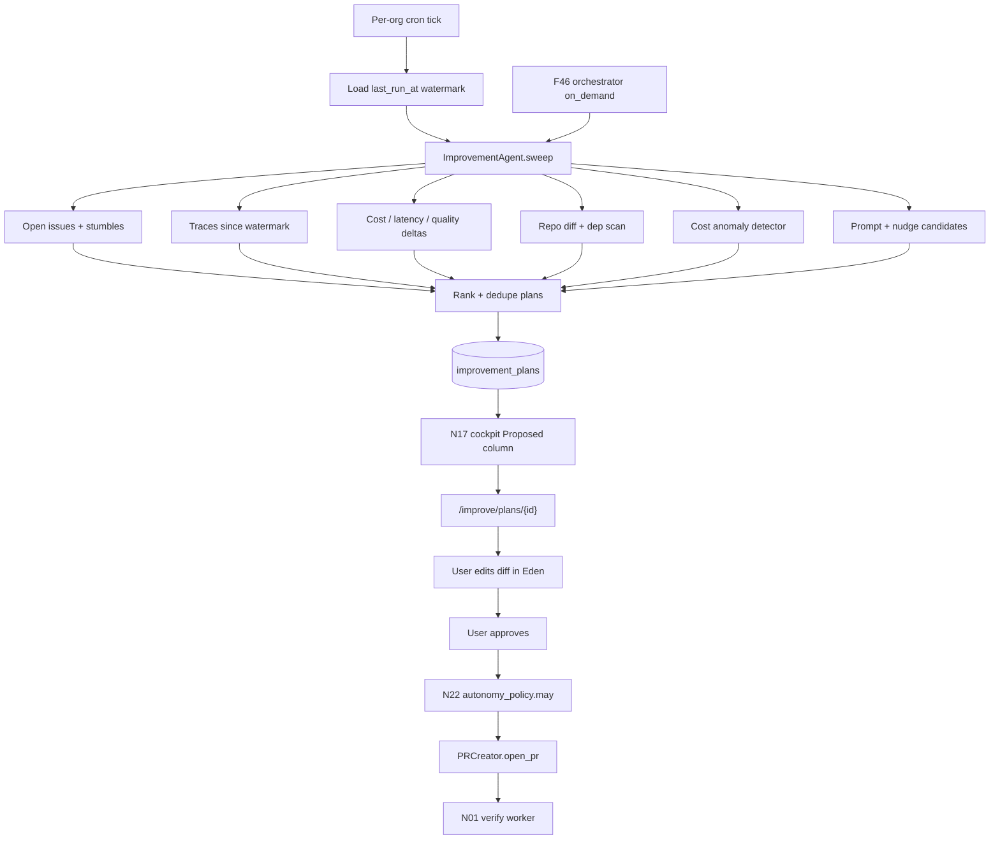

# N23: Recurring Agentic Improvement Agent (Cat 23 Replacement)

| Field | Value |
|---|---|
| **Feature ID** | N23 |
| **Slug** | `recurring-improvement-agent` |
| **Priority** | P0 |
| **Effort** | XL |
| **Eden status** | **SHIPPED v0** — backend + portal (`/improve/plans`, `/improve/runs`, Settings schedule, redirects); full sweep (metrics/repo/cost) wired v0.1 |
| **Replaces** | Cat 23 autonomous code modification (~62 files, 46 API routes), dual `proposed_patches` + `.eden/pr_suggestions.jsonl` stores |
| **Dependencies** | F46, N22, N17, N20 (salvaged patch stack), N01 (verify), N04 (impact preview), F29/F30, F39/F41 (nudge/prompt candidates) |

---

## 1. Problem

Eden shipped two overlapping PR-planning surfaces that operators could not trust:

| Surface | Store | UX | Gap |
|---|---|---|---|
| Cat 23 `proposed_patches` | Postgres | `/improve` cockpit cards + broken approve | 62-file stub package, cluster-scheduler disconnected from issues |
| JSONL PR suggester | `.eden/pr_suggestions.jsonl` | `/pr-suggestions` inbox | Manual form trigger, no closed-loop tie-in |

Neither ran on a **predictable schedule**, neither unified **code + prompt + nudge** candidates, and approve flows were inconsistent (some paths never opened a real GitHub PR).

**N23** is the single recurring agent that sweeps production signals on a per-org cron, ranks improvement plans, lands them in one inbox, lets operators edit diffs in-portal, and **always** opens a GitHub PR on approve via salvaged `PRCreator`.

---

## 2. Target behavior

### 2.1 Scheduled full sweep (per org)

On each org's configured cron tick (default: weekly Sunday 03:00 UTC, overridable in Settings → Autonomy):

1. Load `last_run_at` watermark from `improvement_runs`.
2. Run `ImprovementAgent.sweep(org_id, since=last_run_at)` — **full sweep**, not incremental issue-only:
   - **Open issues & stumbles** (F29/F28) — promoted, triaged, `code_bug` / `quality_drop` kinds
   - **Traces since watermark** — Layer A tags + high-cost / error spans
   - **Metrics deltas** — cost, latency, quality vs 7d baseline (N03/N05)
   - **Repo health** — dependency drift, stale config, broken imports (when repo linked)
   - **Cost anomalies** — per-agent spend spikes, budget threshold breaches (N22)
   - **Prompt / nudge candidates** — shadow nudges (F39), prompt canary losers (N18), guardrail gaps (N15)
3. Rank candidates by severity × confidence × estimated blast radius.
4. Persist top-N as `improvement_plans` rows (status `draft`).
5. Emit HookBus `improvement.sweep_completed` for N17 cockpit refresh.
6. Record `improvement_runs` row with counts, cost, duration.

**On-demand:** F46 orchestrator may enqueue the same planner via `improvement.run_requested` event (e.g. post-triage `code_change` decision) — schedule and on-demand share `ImprovementPlanner`, not duplicate pipelines.

### 2.2 Unified inbox (operator flow)

```
Cron / F46 trigger
    → improvement_plans rows (draft)
    → N17 cockpit "Proposed" column cards
    → Operator opens /improve/plans/{id}
        → diff viewer (reuse pr-suggestions UX)
        → inline diff editor (edit hunks before approve)
        → Approve
            → N22 may("propose_patch") — budget + tier gate
            → PRCreator.open_pr(plan) — ALWAYS for code plans
            → plan.status = pr_opened, pr_url set
            → N01 verify worker queued on PR branch
    → Reject / snooze → rejection memory (reuse pr_rejection_memory pattern)
```

**Approve semantics (user decision):** Approve **always** auto-opens a GitHub PR immediately. There is no "approve but hold PR" path in v1. Operators who only want a local diff review use **Save draft** without approve.

### 2.3 Plan kinds (single inbox, typed rows)

| `plan_kind` | Source sweep | Approve action |
|---|---|---|
| `code_patch` | Issue RCA, repo scan, cluster | `PRCreator` → GitHub PR |
| `prompt_update` | N18 evolver loser / drift | Gateway prompt deploy (F68) or PR to `eden-prompts/` |
| `nudge_promote` | F39 shadow with evidence | F41 promotion queue |
| `guardrail_tune` | N15 eval failure slice | Gateway filter update |
| `config_change` | Cost/routing anomaly | PR or runtime config (policy-gated) |

Code patches are the primary v1 ship target; prompt/nudge rows appear in the same inbox but may route to F41 instead of `PRCreator` on approve (see §13 Open questions).

---

## 3. Architecture



### 3.1 Module layout (target)

```
src/eden/improvement/
  agent.py              # ImprovementAgent.sweep orchestration
  planner.py            # Rank, dedupe, budget cap per sweep
  runs_repo.py          # improvement_runs CRUD + watermark
  plans_repo.py         # improvement_plans CRUD
  schedule.py           # Per-org cron due-check (reuse cron_tick pattern)
  patch_generator.py    # SALVAGED from code_change/
  issue_patch_trigger.py# SALVAGED — issue → plan enqueue
  pr_creator.py         # SALVAGED — GitHub PR open
  issue_fix_chat.py     # SALVAGED — chat-guided fix (optional v1.1)
```

**Delete / do not resurrect:** `code_change/scheduler.py` cluster loop, `intelligence_code_change.py` 46-route surface, JSONL `agent_pr_suggestions` writer.

### 3.2 Reuse map (do not rebuild)

| Asset | Current path | N23 role |
|---|---|---|
| F46 orchestrator | `closed_loop/orchestrator.py` | On-demand `improvement.run_requested`; triage → patch decision |
| N22 autonomy policy | `closed_loop/autonomy_policy.py` | `may("propose_patch")`, daily budget, compliance overrides |
| AgentEfficiencyController | `closed_loop/efficiency.py` | Coalesce triage/patch/sweep LLM spend |
| PatchGenerator | `code_change/patch_generator.py` | Generate unified diff for `code_patch` plans |
| PRCreator | `code_change/pr_creator.py` | Approve → GitHub PR (via `PRProvider`) |
| issue_patch_trigger | `code_change/issue_patch_trigger.py` | Issue-promoted → plan row (not `proposed_patches`) |
| N17 cockpit | `improvement/cockpit_aggregator.py` | Read `improvement_plans` instead of `proposed_patches` |
| PR suggester UX | `clients/portal/.../pr-suggestions/` | Diff viewer, status badges, bulk actions → `/improve/plans` |
| N01 verify | `closed_loop/verify.py` | Post-PR regression on branch |
| pr_rejection_memory | migration 050 | Reject/snooze dedupe across sweeps |

### 3.3 Replace / unify

| Retired | Replacement |
|---|---|
| `proposed_patches` table (legacy, preserved) | `improvement_plans` — canonical inbox |
| `.eden/pr_suggestions.jsonl` | Removed — all plans in Postgres |
| `GET /orgs/{id}/code-change/proposed` | `GET /orgs/{id}/improve/plans` |
| `/pr-suggestions` portal route | `/improve/plans` (+ redirect from old URL) |
| Cat 23 `intelligence_code_change.py` routes | `src/eden/api/routes/improve.py` extensions |
| Manual PR suggester form | Automatic enqueue from scheduled sweep |

---

## 4. Sweep detail

### 4.1 Issues & stumbles

- Query F29 issues: `status IN (open, regressed)`, `triage_completed = true`
- Filter `triage_result.recommended_action IN (code_change, prompt_update, investigate)`
- Skip if `improvement_plans` already has `open` plan for same `source_ref` (issue id or fingerprint)
- Call salvaged `issue_patch_trigger.propose_patch_for_issue` → returns plan draft payload (not direct `proposed_patches` insert)

### 4.2 Traces since watermark

- Typesense / Postgres: traces with `finalized_at > last_run_at`
- Layer A descriptor hits: `tool_error`, `loop`, `cost_spike` tags
- Sample max 50 traces per agent per sweep (cost cap)
- Attach exemplar `trace_id`s to plan evidence JSON

### 4.3 Metrics & cost

- Compare 24h vs 7d rolling: `eden_trace_cost_usd`, stumble rate, p95 latency
- Flag agents with >2σ cost delta or SLO breach (N05)
- Emit `config_change` or `guardrail_tune` plan when routing table mismatch detected

### 4.4 Repo health (when GitHub App linked)

- Shallow scan: outdated lockfiles, known CVE deps (advisory only in v1)
- Diff since last deploy tag vs production error fingerprints
- **Budget:** max 1 repo scan per agent per sweep

### 4.5 Prompt / nudge candidates

- F39 nudges in `shadow` mode with `evidence.helpful_rate > threshold`
- N18 prompt canaries with StatGate pass → `prompt_update` plan
- Surface in same inbox; approve may bypass `PRCreator` (F41 path)

---

## 5. Data model

```sql
-- Run ledger + watermark for incremental sweep
CREATE TABLE improvement_runs (
    id UUID PRIMARY KEY DEFAULT gen_random_uuid(),
    org_id UUID NOT NULL REFERENCES organizations(id) ON DELETE CASCADE,
    agent_id TEXT,  -- NULL = org-wide sweep
    started_at TIMESTAMPTZ NOT NULL DEFAULT now(),
    finished_at TIMESTAMPTZ,
    status TEXT NOT NULL DEFAULT 'running'
        CHECK (status IN ('running', 'completed', 'failed', 'cancelled')),
    last_run_at TIMESTAMPTZ NOT NULL,  -- watermark used for this run
    plans_created INT NOT NULL DEFAULT 0,
    plans_skipped_dedup INT NOT NULL DEFAULT 0,
    llm_cost_usd NUMERIC(12, 6) NOT NULL DEFAULT 0,
    error TEXT,
    metadata JSONB NOT NULL DEFAULT '{}'
);

CREATE INDEX improvement_runs_org_started_idx
    ON improvement_runs (org_id, started_at DESC);

-- Unified PR / improvement plan inbox
CREATE TABLE improvement_plans (
    id UUID PRIMARY KEY DEFAULT gen_random_uuid(),
    org_id UUID NOT NULL REFERENCES organizations(id) ON DELETE CASCADE,
    run_id UUID REFERENCES improvement_runs(id) ON DELETE SET NULL,
    agent_id TEXT,
    plan_kind TEXT NOT NULL
        CHECK (plan_kind IN (
            'code_patch', 'prompt_update', 'nudge_promote',
            'guardrail_tune', 'config_change'
        )),
    status TEXT NOT NULL DEFAULT 'draft'
        CHECK (status IN (
            'draft', 'pending_review', 'approved', 'pr_opened',
            'merged', 'rejected', 'snoozed', 'superseded'
        )),
    title TEXT NOT NULL,
    summary TEXT,
    source_ref TEXT,          -- issue:{uuid}, rca:{id}, trace:{id}, sweep:metric
    source_fingerprint TEXT,  -- dedupe key across sweeps
    diff_unified TEXT,        -- editable unified diff (code_patch)
    diff_edited BOOLEAN NOT NULL DEFAULT false,
    files_changed JSONB NOT NULL DEFAULT '[]',
    evidence JSONB NOT NULL DEFAULT '{}',
    triage_snapshot JSONB,
    estimated_blast_radius TEXT,  -- low | medium | high
    llm_cost_usd NUMERIC(12, 6) NOT NULL DEFAULT 0,
    pr_url TEXT,
    pr_number INT,
    github_branch TEXT,
    approved_by TEXT,
    approved_at TIMESTAMPTZ,
    rejected_by TEXT,
    rejected_at TIMESTAMPTZ,
    rejection_reason TEXT,
    snoozed_until TIMESTAMPTZ,
    created_at TIMESTAMPTZ NOT NULL DEFAULT now(),
    updated_at TIMESTAMPTZ NOT NULL DEFAULT now()
);

CREATE UNIQUE INDEX improvement_plans_dedup_idx
    ON improvement_plans (org_id, source_fingerprint)
    WHERE status IN ('draft', 'pending_review', 'approved', 'pr_opened');

CREATE INDEX improvement_plans_inbox_idx
    ON improvement_plans (org_id, status, created_at DESC);

-- Org settings extension (autonomy_policies or organizations.features JSONB)
-- improvement_schedule_cron TEXT DEFAULT '0 3 * * 0'  -- weekly Sun 03:00 UTC
-- improvement_max_plans_per_sweep INT DEFAULT 10
```

**Legacy tables (do not drop in v1):** `proposed_patches`, `pr_rejection_memory` — read-only for historical rows; new writes go to `improvement_plans` only.

---

## 6. API specification

Base path: `/api/v1/orgs/{org_id}/improve`

| Method | Path | Purpose |
|---|---|---|
| `GET` | `/plans` | List inbox (`?status=`, `?plan_kind=`, `?agent_id=`) |
| `GET` | `/plans/{id}` | Plan detail + diff + evidence |
| `PATCH` | `/plans/{id}` | Edit `diff_unified`, `title`, `summary` (sets `diff_edited=true`) |
| `POST` | `/plans/{id}/approve` | N22 gate → `PRCreator.open_pr` → `status=pr_opened` |
| `POST` | `/plans/{id}/reject` | Reject + write rejection memory |
| `POST` | `/plans/{id}/snooze` | Snooze until ISO timestamp |
| `POST` | `/runs` | Manual sweep trigger (admin; same as cron body) |
| `GET` | `/runs` | Run history + watermarks |
| `GET` | `/runs/{id}` | Single run stats |
| `GET` | `/schedule` | Resolved cron + next_run_at |
| `PUT` | `/schedule` | Set `improvement_schedule_cron`, `max_plans_per_sweep` |

**Approve response (always opens PR for `code_patch`):**

```json
{
  "plan_id": "uuid",
  "status": "pr_opened",
  "pr_url": "https://github.com/org/repo/pull/123",
  "pr_number": 123,
  "branch": "eden/improve-abc123",
  "verify_job_id": "uuid"
}
```

**MCP (F04 extension):**

- `list_improvement_plans(status?, limit?)`
- `get_improvement_plan(plan_id)`
- `approve_improvement_plan(plan_id)` — same semantics as REST approve

**Removed routes (do not reintroduce):** all `/code-change/*` and `intelligence_code_change` Cat 23 paths.

---

## 7. Portal UX

### 7.1 Routes

| Route | Purpose |
|---|---|
| `/improve` | N17 cockpit — "Proposed" column lists `improvement_plans` |
| `/improve/plans` | Full inbox (migrate from `/pr-suggestions`) |
| `/improve/plans/{id}` | Detail: diff viewer + Monaco/CodeMirror editor + approve/reject |
| `/improve/runs` | Sweep history (power user, sidebar-hidden) |

### 7.2 Salvaged components from `/pr-suggestions`

- `PRStatusBadge`, diff file tree, hunk viewer
- Bulk regenerate → **cut** in v1 (sweep replaces manual regenerate)
- `open-pr` BFF route → replaced by single `approve` that always opens PR

### 7.3 Settings → Autonomy tab

- Cron expression picker (presets: daily, weekly, biweekly)
- `max_plans_per_sweep` slider (1–25, default 10)
- Read-only: last sweep time, plans created, LLM cost

### 7.4 Redirects (bloat cut)

| Old URL | Redirect |
|---|---|
| `/pr-suggestions` | `/improve/plans` |
| `/pr-suggestions/{id}` | `/improve/plans/{id}` |
| `/closed-loop` | `/improve` (deep links preserved) |
| `/autonomous` | `/improve` |

---

## 8. F46 + N22 integration

### 8.1 Event bus

| Event | Publisher | Consumer |
|---|---|---|
| `improvement.run_requested` | F46 orchestrator | `ImprovementAgent.sweep` (scoped to issue/agent) |
| `improvement.plan_created` | Planner | N17 cockpit refresh |
| `improvement.plan_approved` | Approve handler | N01 verify enqueue |
| `improvement.pr_opened` | PRCreator | F47 Slack notify, N06 audit |

### 8.2 N22 gates

| Action | N22 key | Default tier |
|---|---|---|
| Enqueue plan (sweep) | `propose_patch` | T2 `auto_code_patch_pr` |
| Approve → open PR | `propose_patch` | T2 (require_approval if budget exhausted) |
| Auto-merge | `auto_merge` | T4 — **out of scope v1** |

Compliance `hipaa` → sweep runs in `observe` mode (plans created as `draft` only, approve disabled with tooltip).

---

## 9. Implementation plan

| Phase | Work | Exit criteria |
|---|---|---|
| **0 — Spec** | This document approved | No Cat 23 code resurrection |
| **1 — Schema** | `improvement_runs` + `improvement_plans` migration; settings field | Empty tables, cron reads schedule |
| **2 — Salvage** | Move patch_generator, pr_creator, issue_patch_trigger to `improvement/` | Imports updated; Cat 23 package deleted |
| **3 — Planner** | `ImprovementAgent.sweep` issues + traces + metrics | Plans rows on manual `POST /runs` |
| **4 — API + inbox** | CRUD + approve → PRCreator | Contract tests green |
| **5 — Portal** | `/improve/plans` + diff editor + redirects | Approve opens real PR in staging |
| **6 — Cron** | `cron_tick` per-org due check | Weekly sweep in dogfood org |
| **7 — F46 wire** | `improvement.run_requested` on triage | Issue → plan without waiting for cron |
| **8 — Prompt/nudge** | F39/F41 approve paths | Non-code plans routable |

**Explicitly deferred:** repo CVE scanning, auto-merge (T4), bulk regenerate, Cat 23 cluster scheduler.

---

## 10. Feature flags & rollout

| Flag | Default | Purpose |
|---|---|---|
| `improvement_agent_v1` | `false` | Master gate for sweep + new routes |
| `improvement_schedule_enabled` | `false` | Cron enqueue (manual `/runs` still works when agent on) |
| `code_change_enabled` | `false` (existing) | Hard kill-switch — inherited from N20 |

Rollout: internal dogfood → 3 design partners with GitHub App → GA when N01 verify pass rate >90% on opened PRs.

---

## 11. Test plan

| Layer | Cases |
|---|---|
| Unit | Planner rank/dedupe; watermark advance; diff edit persistence |
| Unit | N22 deny → approve returns 403 with `blocked_reason` |
| Integration | Manual sweep → plan row → edit diff → approve → mock `PRProvider` |
| Integration | F46 triage `code_change` → plan without cron |
| Contract | `test_f48_portal_contracts.py` extended for `/improve/plans` |
| E2E | Staging: approve opens PR on test repo; N01 verify queued |

---

## 12. Acceptance criteria

- [x] Single inbox: N23 writes to `improvement_plans` only (legacy `proposed_patches` read-only)
- [x] Per-org cron schedule configurable in Settings → Autonomous
- [x] Full sweep covers all six signal classes (§2.1) — issues/traces/metrics/repo/cost/nudges wired
- [x] Operator can edit unified diff before approve (`/improve/plans/{id}`)
- [x] Approve **always** calls `PRCreator` for `code_patch` plans
- [x] N17 "Proposed" column reads `improvement_plans` via cockpit aggregator
- [x] `/pr-suggestions` redirects to `/improve/plans` (`next.config.ts`)
- [ ] Cat 23 routes return 410 Gone (not 404)
- [x] Rejection memory prevents duplicate plans for same fingerprint within 7d
- [x] N06 audit log entry on every approve/reject

### Portal acceptance (v0)

- [x] `/improve/plans` inbox with status/kind filters
- [x] `/improve/plans/{id}` diff viewer + inline editor + approve/reject/snooze
- [x] `/improve/runs` sweep history + manual trigger
- [x] Settings → Autonomous: cron presets + `improvement_max_plans_per_sweep` slider
- [x] `improvePlansApi` / `improveRunsApi` paths match `src/eden/api/routes/improve.py`

---

## 13. Performance & cost optimization

### Latency budgets

| Operation | p50 | p95 | p99 |
|---|---|---|---|
| `GET /plans` (50 rows) | 80ms | 200ms | 400ms |
| `PATCH` diff save | 100ms | 250ms | 500ms |
| Approve → PR opened | 2s | 8s | 15s |
| Full org sweep (10 agents) | 30s | 120s | 300s |

### Cost model

| Step | LLM tier | Est. $/sweep (10 agents) |
|---|---|---|
| Trace sampling + Layer A | 0 (deterministic) | $0 |
| Issue patch generation | 1 (SLM) | $0.05–0.20 per plan |
| Repo scan summary | 1 | $0.02 |
| **Cap** | `max_plans_per_sweep` × patch cost | Default ≤10 plans ≈ $2/sweep |

### Guards

- `AgentEfficiencyController` — coalesce with triage/patch spend (N22 daily budget)
- `max_plans_per_sweep` — hard stop after N plans
- Dedup index — skip LLM if `source_fingerprint` exists in open status
- Sweep timeout — 5 min per org; partial plans persisted

### Monitoring

```
eden_improvement_sweep_duration_seconds
eden_improvement_sweep_plans_created_total
eden_improvement_sweep_cost_usd_total
eden_improvement_plan_approve_duration_seconds
eden_improvement_pr_open_failures_total
```

### Degradation

- GitHub App unavailable → approve returns 503, plan stays `pending_review`
- LLM budget exhausted → sweep completes with issues-only deterministic plans
- No linked repo → skip repo health sub-sweep; code plans require manual file hints

---

## 14. Open questions (spec review)

| # | Question | Options | Recommendation |
|---|---|---|---|
| 1 | GitHub-only v1 or abstract `PRProvider` day one? | GitHub only vs provider interface | **Abstract `PRProvider`** — already in salvaged `pr_creator.py`; GitHub is sole impl v1 |
| 2 | Max plans per sweep default? | 5 / 10 / 25 | **10** — balance inbox noise vs coverage |
| 3 | Auto-snooze duplicate plans for same `rca_id`? | Reject vs snooze 7d vs supersede | **Supersede** old `draft` when newer sweep has higher confidence |
| 4 | Nudge/prompt candidates in same inbox or separate column? | Unified vs split | **Same inbox**, `plan_kind` filter tabs on `/improve/plans` |
| 5 | Edit diff: allow add/remove files or hunks only? | Hunks only vs full file add | **Hunks only v1** — adding files requires re-sweep |
| 6 | Migrate historical `proposed_patches` rows? | Backfill vs read-only legacy | **Read-only legacy** — no backfill; cockpit stops reading old table |
| 7 | Sweep scope: per-org vs per-agent cron? | One cron per org vs per agent | **Per-org cron**, optional `agent_id` filter in schedule |
| 8 | Approve without GitHub linked? | Block vs export patch file | **Block** with clear Settings CTA to connect GitHub App |

---

## 15. Related specs

| Spec | Relationship |
|---|---|
| [N20](n20-autonomous-code-modification.md) | Superseded inbox model; salvage patch stack |
| [N17](n17-agent-improvement-cockpit.md) | Cockpit reads `improvement_plans` |
| [N22](n22-autonomy-policy-engine.md) | Approve gates + budget |
| [F46](f46-closed-loop-orchestrator.md) | On-demand sweep trigger |
| [F41](f41-evidence-gated-promotion.md) | Non-code plan approve path |
| [F39](f39-runtime-nudge-injection.md) | Nudge candidate source |
| [DELETED-FEATURES.md](DELETED-FEATURES.md) | Cat 23 removal ledger |

---

*Spec authored July 15, 2026 — v0 shipped (backend + portal).*
